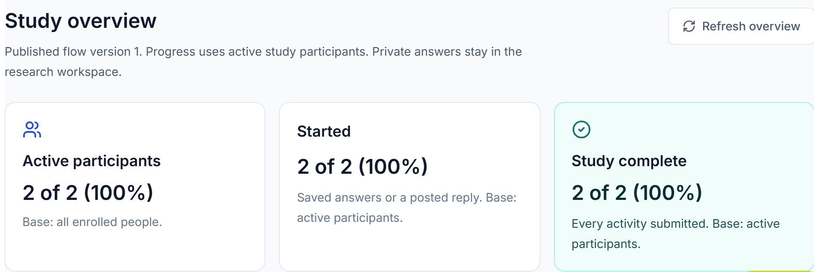

The study **Overview** shows participation and completion across the active roster. Choose **Refresh overview** to load the latest totals.

{/* Available with */}
{/* Let Q-bit do it */}

- **Active participants** compares people with active access with everyone enrolled.
- **Started** counts active participants who saved an answer or posted a reply.
- **Study complete** counts active participants who submitted every activity.

Check the base shown with each count and percentage. A participant who starts has not necessarily submitted a completed activity.

Under **Section completion**, search for a section or choose **Needs responses** or **Complete for all participants**. A section is complete when all its screens have been submitted. Open **People** to see individual activity progress and the last recorded activity time.

If the overview cannot load, choose **Try again**. A refreshed overview describes the published flow and active participants; it does not expose private answers in the overview.

## Related tasks

- [Manage study people](./manage-study-people)
- [Snapshot and export study data](./snapshot-and-export-study-data)
