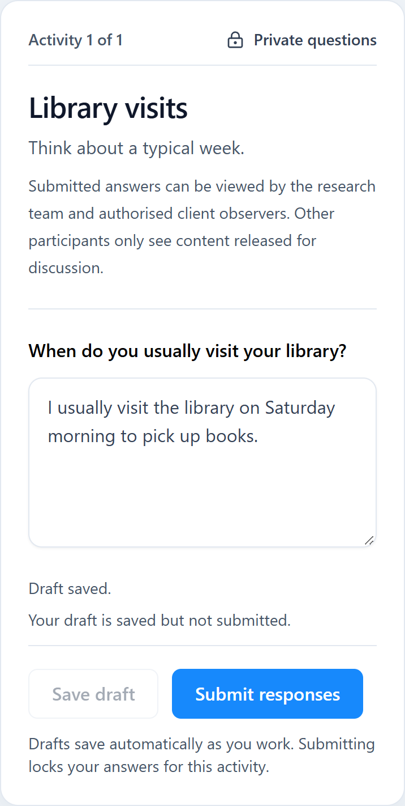
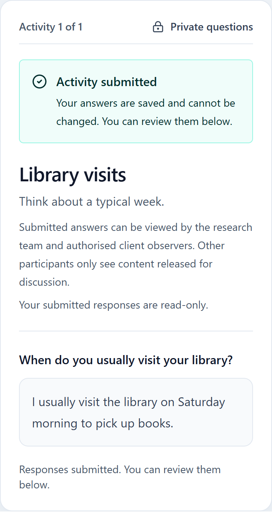

A Bulletin Board study lets you complete research activities and, where available, join discussions over time. Open the personal study link provided by the research team, and keep it private. If the study asks for contact information or permission before you begin, read the notice and follow the instructions. Use the provided support contact if you need help.

{/* Available with */}
{/* Let Q-bit do it */}

## Answer an activity

On the study home, choose an available activity from the activity list. The list heading may differ by study. Read the instructions and content, then answer the questions. Some activities may become available later or wait for the research team. If a grid on your phone shows one item at a time, answer the current item and use **Next item** to continue.

Your draft answers save automatically as you work. You can continue typing while a draft saves, including in a grouped completion section. You can also use **Save draft** when offered. Wait for **Draft saved** before leaving. A saved draft is not submitted, so you can return and review your answers before handing them in.

When ready, choose **Submit responses** or **Submit activity** for a standalone activity. If screens are grouped in a completion section, use **Back** and **Next** to review them. On the final screen, select **Complete [section name]** to submit the screens together.

## After submitting

Submitting locks the answers for that activity or section. You can return to review submitted answers, and you can continue an open discussion where available. After the study closes, submitted responses remain available for review while your link is valid, but new answers cannot be submitted.

The research team and authorised client observers can view submitted answers, including answers to private activities. Other participants see only content released for discussion. Replies are reviewed before they are shared.

If saving or submission cannot be confirmed, follow the displayed retry. If your link is unavailable, open your latest link or contact the research team.

## Related tasks

- [Participate in a Bulletin Board discussion](./participate-in-discussion)
- [Use study notifications and text contact](../../participant-help/bulletin-boards/notifications-and-text-contact)
