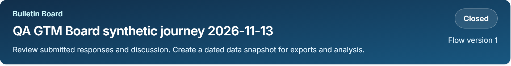
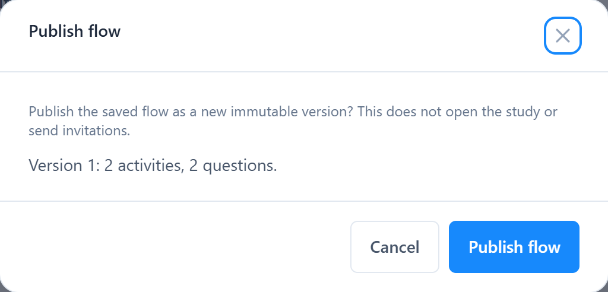
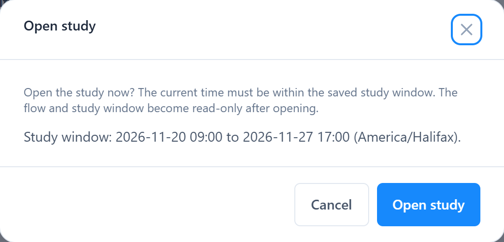

Publishing saves a flow version, and opening a Bulletin Board makes available activities accessible to enrolled participants.

{/* Available with */}
{/* Let Q-bit do it */}

1. In **Study flow**, save and preview the study. Under **Study dates and availability**, set opening and closing times in the study time zone and choose **Save study window**. Review [contact requirements](./set-contact-requirements) under **Messages → Contact requirements** and choose **Save contact requirements** if you make changes. Enrol participants and save other unsaved workspace changes.
2. Choose **Publish flow** and review the version, activities, and questions. Confirm publication. This creates a published version. It does not open the study or send invitations.

   

3. When the published flow and saved window are ready, [review and send invitations](./send-study-email). Participants can receive their links before the study opens.
4. Return during the saved window, choose **Open study**, and confirm. Opening is a staff action. Enrolled participants can then open available activities. The flow and window become read-only after opening.

   

For example, if the study window starts at 10 a.m. in its time zone, staff can send reviewed invitations at 9 a.m. after publishing the flow and saving a valid window. Participants wait until staff open the study at or after 10 a.m.

If the flow was edited and saved after publication, review and publish the saved draft again before opening.

The study closes automatically at its closing time. To close it earlier, choose **Close study** and confirm. Closing cannot be undone. Participants can no longer save or submit answers, but submitted responses remain available for review.

If a command result is not confirmed, use its displayed retry. If the saved flow changed elsewhere, load the current version and review it before continuing.

## Related tasks

- [Enrol people and manage study access](./manage-study-people)
- [Send Bulletin Board invitations and reminders](./send-study-email)
