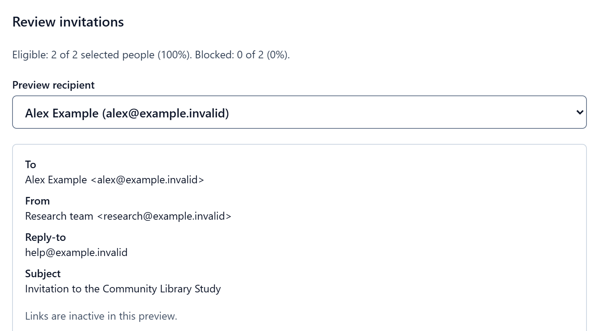

Bulletin Board invitation and reminder emails deliver a personal study message to selected people. Enrol the people first, publish the flow, and save a valid study window. Then open **Messages → Email invitations** in the study. A reviewed invitation can be sent before staff open the study.

{/* Available with */}
{/* Let Q-bit do it */}

1. Choose **Invitation** or **Reminder for incomplete participation**. For a manual reminder, the study must be open, an earlier invitation must be recorded as sent, and participation must be incomplete. Review the sender and reply-to, and write the subject and message. Use the available personalisation fields where helpful.
2. Search for recipients and select eligible people. Confirm the contact permission notice. **Select eligible people on this page** applies to the displayed page. Searching or changing pages clears the selection, so review and send each selected page before moving on.
3. Choose **Review messages**. Inspect eligibility and the exact personal preview for each recipient. Links in the preview are inactive. Resolve any blocked recipients or return to the composer to make changes.

   

4. Choose **Send reviewed messages**. Open **Delivery history** and choose **Refresh history** to check the result.

Queued means the message is waiting for delivery. Sent does not mean it was opened or read. If queueing is unconfirmed, choose **Retry reviewed send** for the same batch rather than creating a replacement. If recipients or sender settings changed, prepare a fresh review. If delivery history calls for operator review after a transport attempt, do not create a replacement message. Follow the operator review process.

An address with an existing email suppression is blocked. Confirming permission to contact someone does not override that suppression. Eligibility is checked again before delivery, so a message can be stopped if the address becomes suppressed after review. Check **Delivery history** for its outcome.

## Related tasks

- [Enrol people and manage study access](./manage-study-people)
- [Participate in a Bulletin Board study](./participate-in-a-study)
