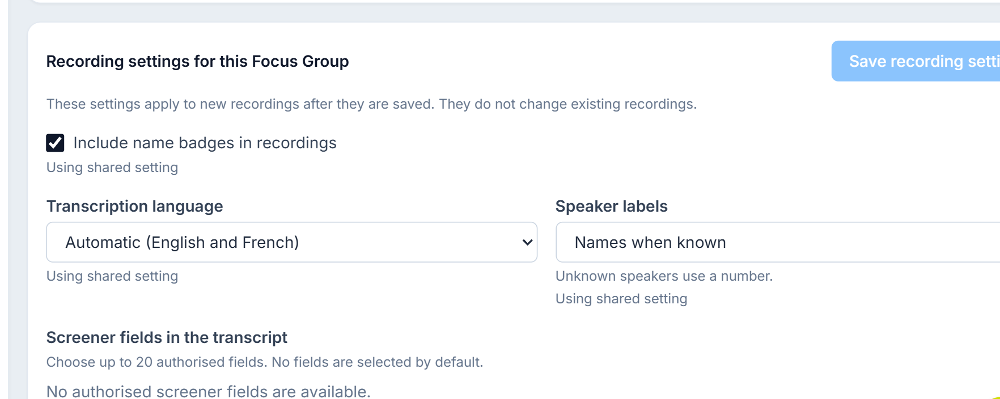

Participant arrival settings control when the waiting room opens and which devices participants need to join. Before inviting people, open the Focus Group and choose **Prepare → Participant arrival**.

{/* Available with */}
{/* Let Q-bit do it */}

1. Set **Participant waiting room opens (minutes before start)** and **Observer greenroom opens (minutes before start)**. Each accepts a whole number from 0 to 1,440.
2. Under **Device access**, choose **Desktop only** or **Mobile and desktop**. In **Advanced screen width**, set a minimum width if needed. Zero means no minimum; the device access choice still applies.
3. Select **Audio required** and **Video required** if participants need those devices to enter. **Enhanced microphone noise reduction** can reduce steady background noise. Turn it off if voices sound distorted.
4. Add a **Help contact** and a **Waiting room note**, then choose **Save arrival settings**. To return a changed field to its group default, choose **Use shared setting** beside it and save.
5. If incentives are enabled in shared defaults, enter an optional session incentive amount or leave it blank to use the group default. Choose **Save incentive** separately.

For example, if you require video and allow mobile devices, a participant whose camera is unavailable sees that video is required before joining. Observers can enter the backroom with their camera and microphone off.

The joining page shows the session's duration and device requirements. If someone cannot meet a requirement, help them change devices or review the saved policy before they try again. Share [joining and device help](../../participant-help/focus-groups/fix-joining-and-devices) with them.

Organisers can set the shared arrival defaults in **Shared Focus Group settings → Defaults**. Choose **Save arrival defaults** after changing them.

Next: [Assign people to a Focus Group](./assign-people).
