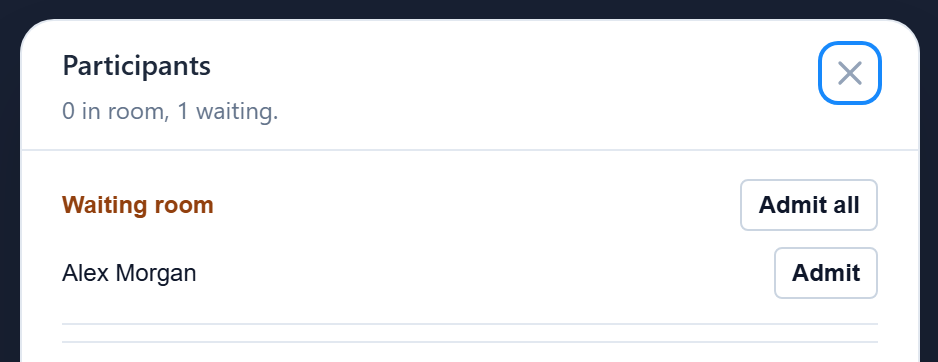

The moderator room is where staff start a Focus Group, admit participants, and present materials. Moderators need their own personal link and a scheduled Focus Group. Check the guide, materials, and devices before starting. Use [a test session](./practise-as-moderator) if you want to practise first.

{/* Available with */}
{/* Let Q-bit do it */}

1. Open your personal moderator link. The joining page normally loads automatically. Check your display name, microphone, camera, and preview. Follow the entry shown for your link. If the page shows **Prepare for session**, choose **Enter private preparation room**. Your microphone and camera are shared only in that private room while you are there.
2. From private preparation, choose **Start session and join main room** to start the discussion, or **Join main room** if another moderator has already started it. A moderator joining a live session for the first time may still enter private preparation. If your link opens to **Join main room**, choose **Enter main room**. Participants can hear or see you in the main room when your microphone or camera is on.
3. Open **Participants** in the room controls. If it is in **Room tools**, open that menu first. In **Waiting room**, choose **Admit** beside a person or choose **Admit all**. An approved participant remains waiting until a moderator enters the main room. Open **View participant details** when you need the available roster details.

   
4. Open **Moderator guide** from **Room tools**. In **Session controls**, select a prepared material or **Screen share**, then choose **Share**. For a screen, choose what to share in your browser. Choose **Stop share** when finished.
5. Use participant chat, observer questions and replies, session notes, and **Team chat** as needed. You can reply to an observer question and mark it answered. Use **Pop-out controls** or **Companion device** to open controls separately.
6. When the discussion is finished, choose **End session**. Choose **End & close**, or **End & rejoin green room** to continue privately with observers. Ending the session stops the recording and ends the main discussion for participants.

If you rejoin the green room, it opens after the recording has stopped and the private room is ready. Choose **Close green room** and confirm when the private discussion is finished. This disconnects everyone from the green room.

Selecting another material while sharing changes the presentation. **Force focus on share** directs participants' view to the share. Turn it off when it is no longer needed. If a screen picker is cancelled, start sharing again and choose a screen.

Before recording, follow your organisation's consent process and tell the group. See [Record a Focus Group](./record-a-focus-group). If room access or devices fail, see [Fix joining and device problems](../../participant-help/focus-groups/fix-joining-and-devices).
