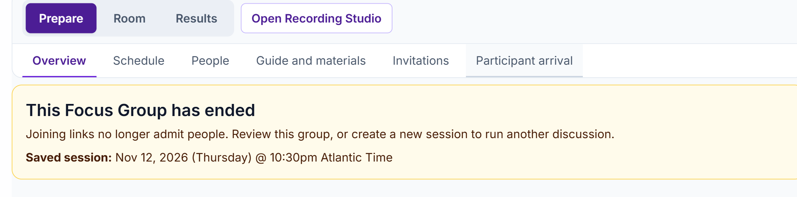

The Focus Group workspace separates session preparation, room access, and review. Open a Focus Group from its Session Group to see these parts of the workflow.

{/* Available with */}
{/* Let Q-bit do it */}

- **Prepare** contains **Overview**, **Schedule**, **People**, **Guide and materials**, **Invitations**, and **Participant arrival**. The overview links to the setup areas and shows private preparation notes.
- **Room** lists the assigned moderators' personal room links. Opening this page does not start the session or send an invitation.
- **Results** contains **Attendance** and **Recording Studio**. You can also choose **Open Recording Studio** from the workflow bar.

Choose a part, then select the section you need. Save changes in a section when a save button is shown. If you leave with unsaved changes, review the prompt before discarding them.

For a first session, [set the schedule](./schedule-a-focus-group), [assign people](./assign-people), and [review invitations](./send-invitations) in **Prepare**. The moderator uses a personal link to [start the session and admit participants](./moderate-a-focus-group). Afterward, return to **Results** to review attendance.

## Related tasks

- [Schedule a Focus Group](./schedule-a-focus-group)
- [Start and moderate a Focus Group](./moderate-a-focus-group)
- [Review attendance](./review-attendance)
