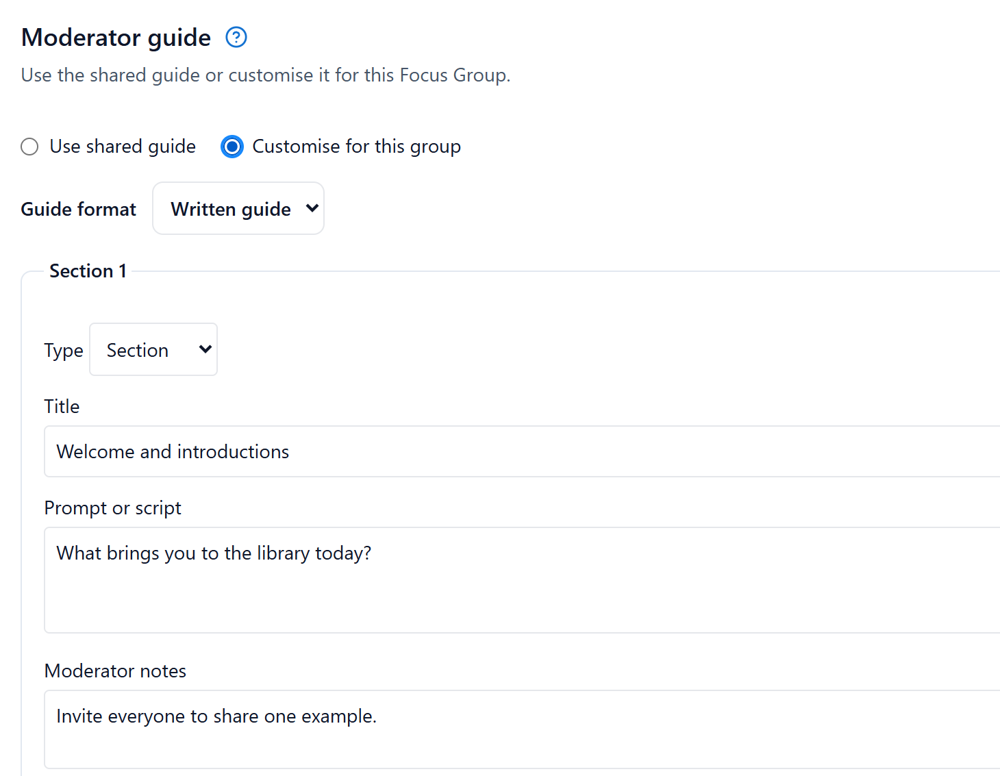
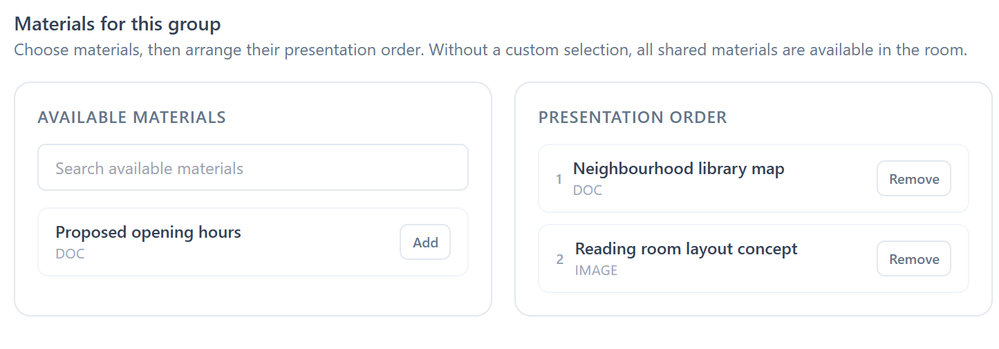

A Focus Group guide and material library prepare the prompts and resources a moderator can use in the room. Organisers can prepare shared resources, then choose what an individual Focus Group uses.

{/* Available with */}
{/* Let Q-bit do it */}

## Prepare shared resources

1. Open the Session Group and choose **Shared Focus Group settings**. In **Guide**, add a PDF or written guide. A written guide can contain sections, questions, and notes. Save the guide.
2. In **Materials**, upload the images, audio, video, or PDFs you plan to present. Give each item a label and add any tags that will help you find it. Export Word and PowerPoint documents to PDF first.

## Choose a guide for this Focus Group

1. Open the Focus Group and choose **Prepare → Guide and materials**.
2. Keep **Use shared guide**, or select **Customise for this group**. Set **Guide format** to **PDF** or **Written guide**.
3. For a written guide, choose the section **Type**, then give it a **Title**. Use **Prompt or script** for what the moderator will say or ask, and **Moderator notes** for reminders. For a PDF guide, choose the file under **Guide PDF**.
4. Select **Save guide**.

## Set the presentation order

1. Under **Materials for this group**, find the first item in **Available materials** and select **Add**. Repeat for the materials you want to present.
2. Drag items into the order you want under **Presentation order**. Select an item to check it in **Preview**.
3. Select **Save materials**.

For example, upload two service images to the shared library and select them for one group in the order the moderator will discuss them. The moderator can then choose each prepared image in the room.

Without a custom material selection, all shared materials are available in the room. A shared guide continues to receive shared updates; a custom guide is for that Focus Group. The moderator can open the guide and select a prepared material in the live room. PDFs can be shown in the stage or opened separately; other documents open separately.

If an upload or save fails, check the message and try again. Keep your draft open until the save succeeds.

Next: [Practise as a moderator](./practise-as-moderator).
