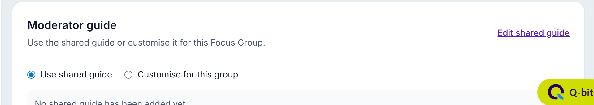

A Focus Group guide and material library prepare the prompts and resources a moderator can use in the room. Organisers can prepare shared resources, then choose what an individual Focus Group uses.

{/* Available with */}
{/* Let Q-bit do it */}

1. Open the Session Group and choose **Shared Focus Group settings**. In **Guide**, add a PDF or written guide. A written guide can contain sections, questions, and notes with titles, prompts, and internal notes. Save the guide.
2. In **Materials**, upload images, audio, video, or PDFs. Add a label, type, and any tags that help you find them. Export Word and PowerPoint documents to PDF for presentation.
3. Open the Focus Group and choose **Prepare → Guide and materials**. Use the shared guide or select **Customise for this group**. For a custom guide, choose PDF or written guide and select **Save guide**.
4. Under **Materials for this group**, add items from the available list, arrange the presentation order, preview the selected item, and choose **Save materials**.

For example, upload two service images to the shared library and select them for one group in the order the moderator will discuss them. The moderator can then choose each prepared image in the room.

Without a custom material selection, all shared materials are available in the room. A shared guide continues to receive shared updates; a custom guide is for that Focus Group. The moderator can open the guide and select a prepared material in the live room. PDFs can be shown in the stage or opened separately; other documents open separately.

If an upload or save fails, check the message and try again. Keep your draft open until the save succeeds.

Next: [Practise as a moderator](./practise-as-moderator).
