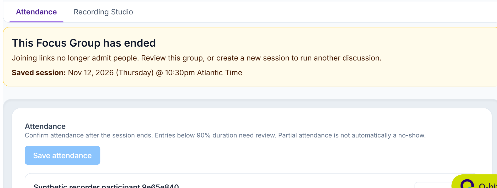

Attendance review lets an organiser record each assigned participant’s status after a Focus Group. After the session ends, open **Results → Attendance**.

{/* Available with */}
{/* Let Q-bit do it */}

1. Review the assigned participants and their available attendance percentages.
2. For each person, choose **Pending**, **Attended**, or **No show**.
3. Choose **Save attendance**.

For example, an attendance figure of 45 minutes for a 60-minute session is 75% and is flagged for review. Entries below 90% of the session duration are flagged for review. Partial attendance is not automatically a no-show. If there is no attendance data, review the person's status using the information available to your team. Attendance appears after the session has ended.
