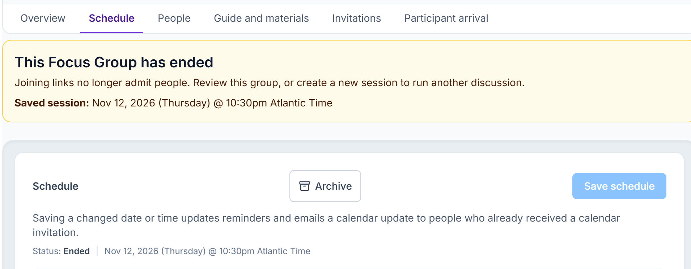

A Focus Group schedule sets when the session takes place and supplies its joining time. Organisers can set it from **Prepare**.

{/* Available with */}
{/* Let Q-bit do it */}

1. Open the Focus Group and select **Schedule**.
2. Enter an **Internal session name** for staff. Enter the **Participant session name** people should see in their invitation, calendar, and waiting room. If you leave it blank, they see **Session**.
3. Enter the date, time, duration in minutes, and time zone. Choose **Save schedule**. Review the confirmation if the change can send calendar updates or schedule reminders.
4. In **Overview**, add any **Preparation notes** and choose **Save notes**. These notes are private guidance for staff and assigned moderators and appear in the moderator room.

For example, choose Atlantic time for a session scheduled in Halifax. If the app says the selected time is invalid when clocks change, choose another time before saving. People viewing their joining page see the time in their browser's time zone.

Saving a changed date or time updates reminders and sends a calendar update to people who already received a calendar invitation. Opening the **Room** page does not start the discussion. The moderator starts it from their personal link.

Use **Advanced: correct a status** only to correct an inaccurate status. This does not start or end the room, stop a recording, or notify participants. If the moderator access window has expired, update the schedule and renew the link in **People** when prompted.

## Related tasks

- [Configure participant arrival](./configure-participant-arrival)
- [Assign people to a Focus Group](./assign-people)

