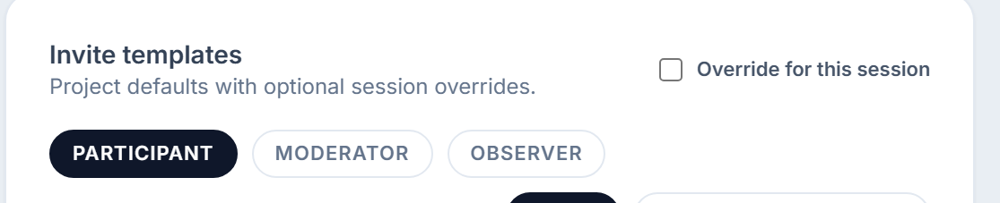

Focus Group invitations send each assigned person their own session details and joining link. Assign people and save the session schedule before preparing invitations. In the Focus Group, open **Prepare → Invitations**.

{/* Available with */}
{/* Let Q-bit do it */}

1. Choose **participant**, **moderator**, or **observer**, then **Email**. The template starts from the shared invitation defaults.
2. To change it for this session, select **Override for this session**, edit the subject and message, and choose **Save override**. Use the merge tags to insert details such as the recipient name, session time, and personal invite URL. **Clear override** returns to the shared template.
3. Select the recipient roles under **Invite groups**. Under **When to send**, choose **Send now** or **Schedule for later**. For a scheduled send, enter a future **Send date and time**. Choose **Review invitations**. Send times use the session's time zone.
4. Review the message, eligible recipients, missing email addresses, and inactive links. If multiple roles are selected, use the role buttons to review each message. Where a role has an eligible recipient, its preview uses the first eligible person for that role. Choose **Send now** or **Schedule send** to confirm.

Each recipient receives a separate message and personal link. A working link normally loads the joining page automatically. Each person should keep their link private and follow the entry shown for their role. With a saved start and end time, the email includes a personal calendar invitation. A later schedule change updates issued calendars. Shared **Invitation defaults** also lets you configure email reminders before or after the start, end, or initial send.

In the shared **Reminder rules**, a new rule starts as an enabled participant email one day before the session start. Change the role, reference time, direction, and offset in minutes as needed, then save the invitation defaults. Review the confirmation. Saving changed reminder rules can schedule future reminders for people with matching joining links, including people who have not received an invitation. For example, an offset of 60 minutes before the session start schedules a reminder one hour before it begins.

Scheduling captures the eligible recipients and templates at that time. If a link will expire before the send, choose an earlier send time or renew the link. If the people, message, or schedule change during review, close it and review invitations again.

Check **Scheduled sends** and **Delivery history** for the result. If a batch is only partly queued, keep the review open and retry as directed. Recipients already queued are skipped. If a link is unavailable, check the person's assignment in **People**. SMS messages can be drafted, but cannot be sent or scheduled here.

## Related tasks

- [Assign people to a Focus Group](./assign-people)
- [Configure participant arrival](./configure-participant-arrival)
- [Join a Focus Group as a participant](../../participant-help/focus-groups/join-a-focus-group)
- [Observe a Focus Group](../../participant-help/focus-groups/observe-a-focus-group)
