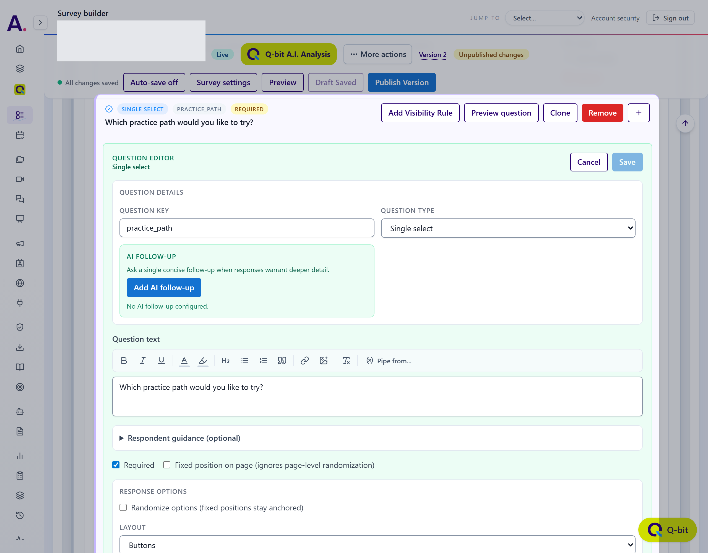
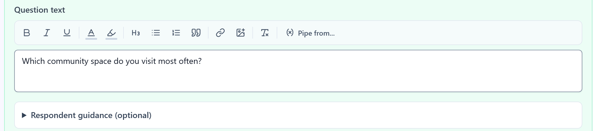
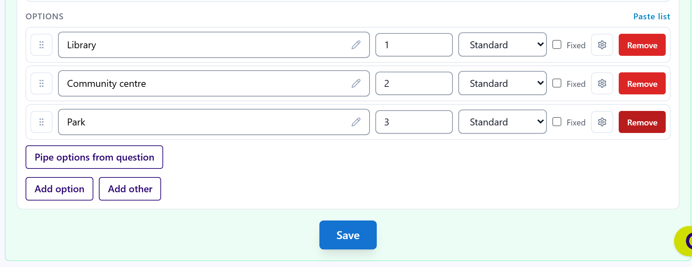
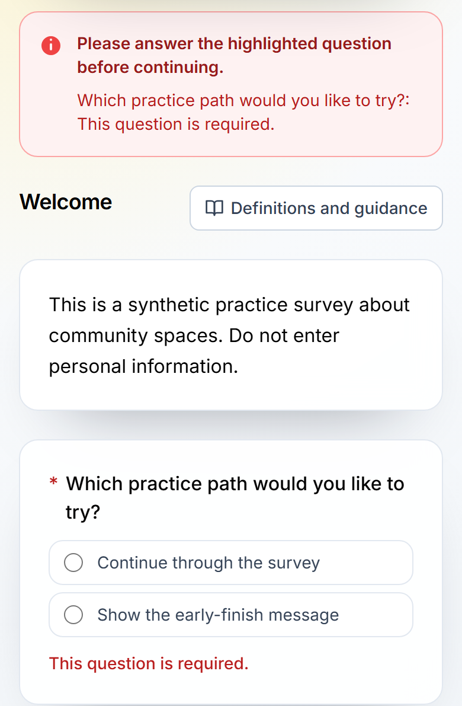

Add and configure questions to collect the answers your survey needs in a form respondents can complete.

{/* Available with */}
{/* Let Q-bit do it */}

## When to use it

Choose a question type that fits the answer you need. Reuse a suitable bank question when consistent wording and codes matter across studies. Use a content block when you only need to show information.

## Choose a question type

These examples all fit a survey about community services.

| What you want to learn | Choose |
| --- | --- |
| Which service someone uses most | [Single select](./choice-questions) |
| Which services someone uses | [Multi select](./choice-questions) |
| Which services they would improve first, in order | [Rank](./ranking-questions) |
| How satisfied they are with each service | [Grid rating](./grid-questions) |
| How they would divide a $100 budget among services | [Continuous sum](./continuous-sum) |
| What they would change about a service in their own words | [Open-end or Textbox](./written-answer-questions) |

## Add an item

1. Open **Survey Builder** and find the page. If the survey has no pages, select **Add First Page**.
2. Select **+ Add item to page**.
3. Choose a question type. To reuse an available question, choose **Add from Question Bank**. The question editor opens.
4. Enter the wording in **Question text** and add any guidance.
5. Set **Required** where offered, then configure the choices or type-specific settings.
6. Review the **Question key** used to identify the question. If you enter a key, use at most 64 characters, starting with a letter or underscore. Use letters, digits, underscores, or periods, and do not end with a period. Keys must be unique across the survey, including removed questions and questions on removed pages, regardless of case. Reserved words are not accepted. If a key is already in use, choose another. The editor reports invalid keys.
7. Select **Save** in the question editor. The question is applied to the working draft.
8. Select **Save Draft** in the builder. Wait for **Draft Saved** or the saved status. Preview the question where available, and use a [full respondent test](./preview-and-test) for Record Collections.

For a first example, choose **Single select**, enter a question, and use **Paste list** under **Response options** to enter one choice per line. Choose **Replace list** to replace existing choices, then select **Insert items**. Check the labels and distinct values before saving. See [start a survey](./start-a-survey) for a worked example.

The question card provides **Edit**, **Clone**, and **Remove**, plus **Preview** and **Save to bank** where available. Drag an item to rearrange it or, where allowed, move it between pages. Some specialised question types have placement restrictions. In **Recycle bin**, select **View**, then **Restore** beside a removed question when needed.

## Before changing a question type

Changing type resets type-specific settings. Some compatible types retain options or rows, but other changes discard them. Review the prompt, choices, codes, and settings after conversion. Type switching is unavailable for questions linked to a tracking set or piped list, and for some specialised types.

A required question asks for an answer before the respondent can proceed. For open-end and numeric-entry questions, **Add a “No Answer” option** offers an alternative response when configured. **Fixed position on page (ignores page-level randomization)** keeps a question anchored when its page's questions are randomised.

For example, make a contact-method question required if an answer is needed to continue, then test both leaving it blank and selecting an answer. Check the question on a phone as well as a desktop, especially when its wording or choices are long.

For choice-specific controls, see [choice questions](./choice-questions). Check each other question type's available settings in its editor, then preview the resulting respondent page.
