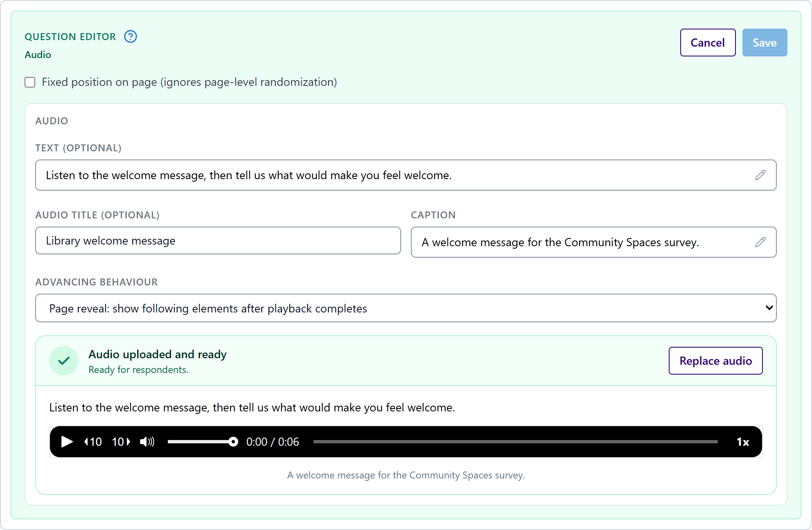
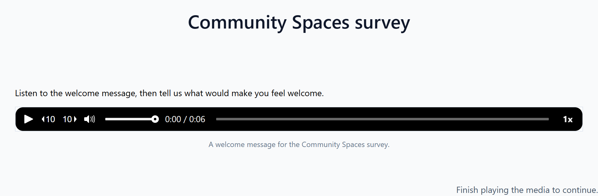
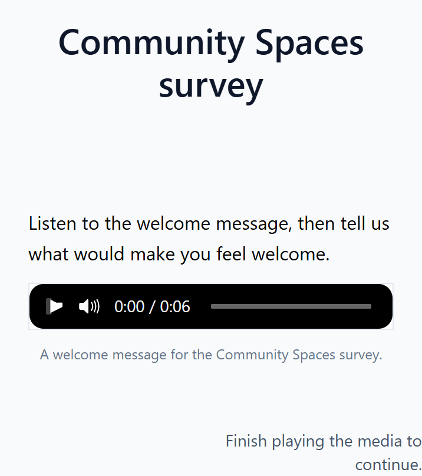
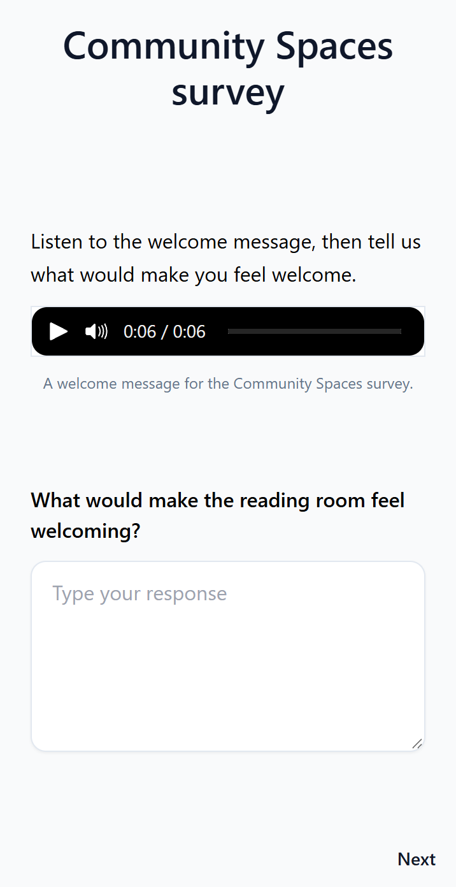
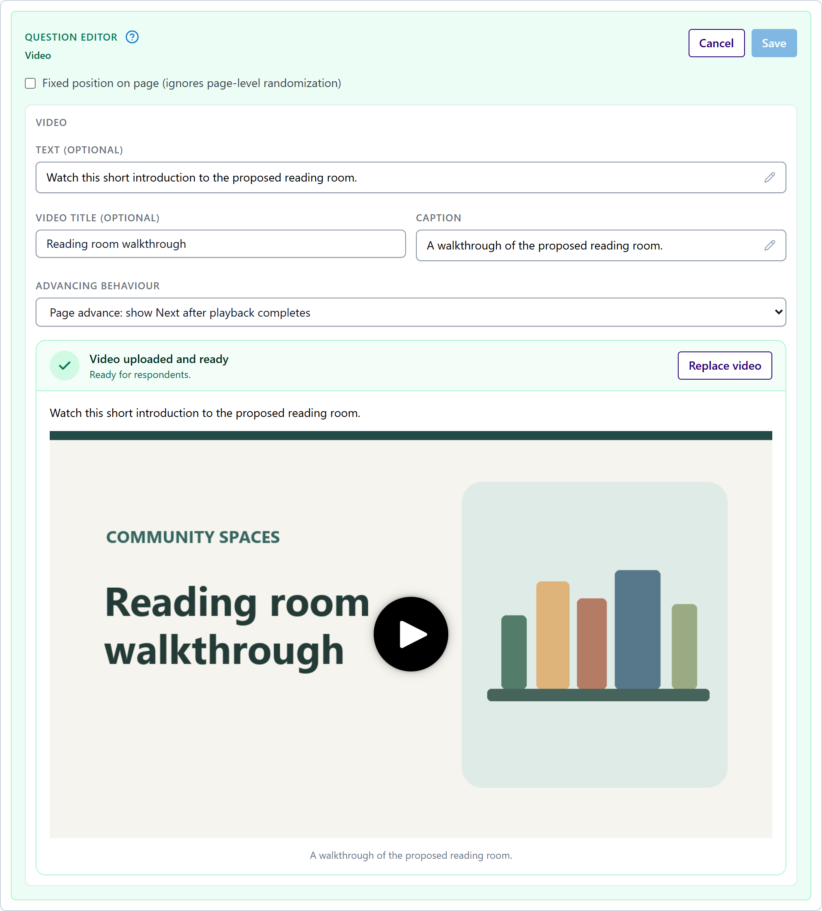
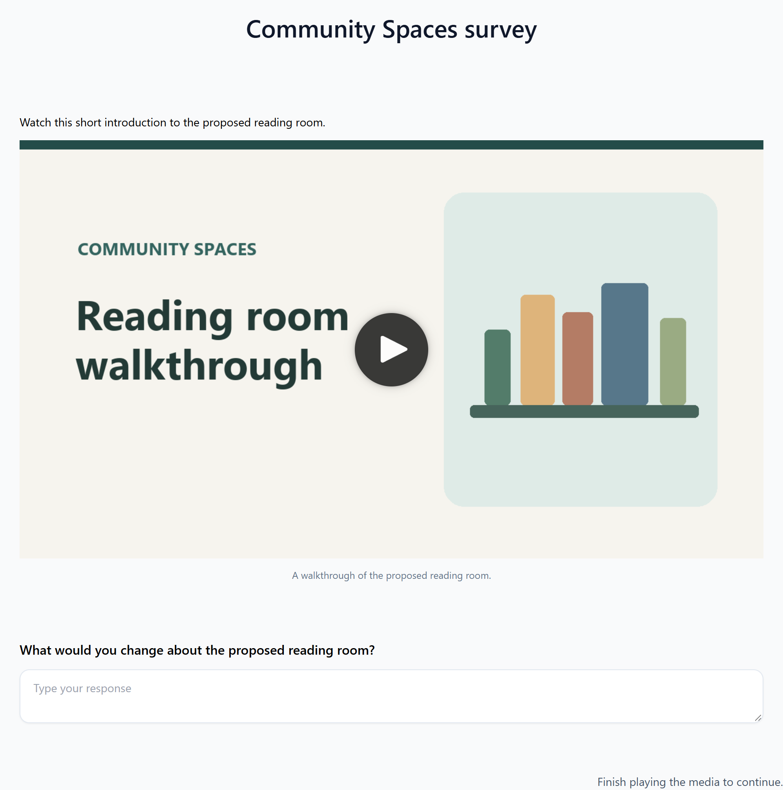
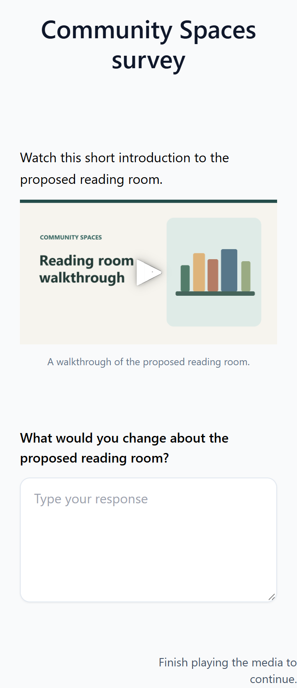

Add content blocks to give respondents context or media before they answer, without adding an answer control.

{/* Available with */}
{/* Let Q-bit do it */}

## When to use it

Use text for instructions, an image when a visual is needed to answer, and audio or video when respondents should hear or watch material. For example, place a short audio clip before a question about what the respondent heard. Open **+ Add item to page** and choose the block under **Media & Text**. Position the block where the information is needed.

## Audio and video

1. On the page where the clip belongs, select **+ Add item to page** and choose **Audio** or **Video** under **Media & Text**, if available in your workspace.
2. Choose a file. Wait for **Ready**. Add optional text above the player, a title, and a caption to tell respondents what they’re about to hear or watch.
3. Choose **Advancing behaviour**.
   - **None** leaves the rest of the page and **Next** available during playback.
   - **Page reveal** hides the elements below the clip and withholds **Next** until playback completes.
   - **Page advance** shows the rest of the page and withholds **Next** until playback completes.
4. Select **Save**, then **Save Draft**. Use [Preview](./preview-and-test) to check playback and the behaviour before and after the clip ends. Repeat on desktop and phone before publishing.

If upload or processing fails, check the message and choose the file again. If respondents should answer a question about the clip, add that question as a separate item after the media block.

## Audio example

In the Community Spaces survey, add an Audio block titled **Library welcome message**. Choose **Page reveal** so respondents hear the message before they see the follow-up question.

<Tabs>
  <Tab title="Editor">

    

  </Tab>
  <Tab title="Desktop">

    

  </Tab>
  <Tab title="Phone">

    **Before playback**

    

    **After playback**

    

  </Tab>
</Tabs>

## Video example

Add a Video block titled **Reading room walkthrough**. Choose **Page advance** so respondents can read the follow-up question while watching. **Next** becomes available after the video ends.

<Tabs>
  <Tab title="Editor">

    

  </Tab>
  <Tab title="Desktop">

    

  </Tab>
  <Tab title="Phone">

    

  </Tab>
</Tabs>

## Try adding instructions

1. On the page where the instructions belong, select **+ Add item to page**, then choose **Text Block** under **Media & Text**.
2. In **Body**, enter “Please answer the following questions about the spaces you use.”
3. Select **Show Preview** in the editor to check the text.
4. Select **Save**, then **Save Draft**. Place the block before the question it introduces.
5. Preview the page on desktop and phone. The instructions appear as text without an answer field.

If the instructions appear after the question, move the block above it in the builder, save the draft, and preview again. Check that the wording is readable at both sizes.

## Text and images

A text block provides rich text for instructions or context. For an image block, enter an **Image URL** or use **Upload image**. Add **Alt text** that describes the image's purpose, unless it is purely decorative. You can add a **Caption** and adjust **Scale**, which starts at 100%.

## HTML blocks

An HTML block accepts HTML and a height setting. Check that its content works within the embedded frame and remains usable on a narrow screen.
