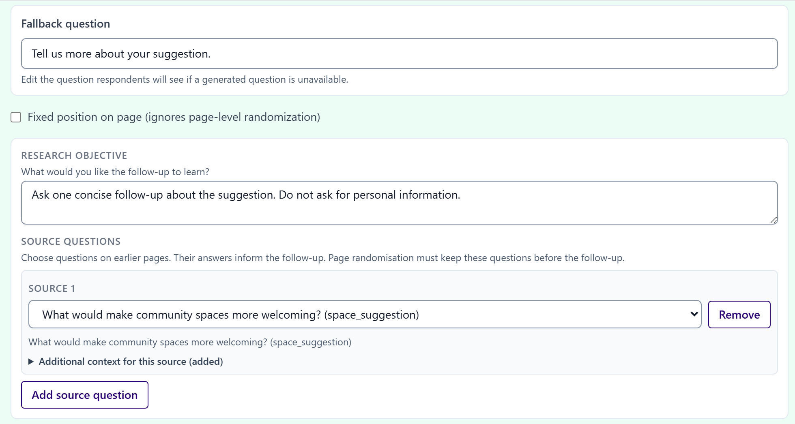

**AI Follow-up Question** can generate a prompt from earlier responses when the configured service is available. Respondents see the fallback question if generation is unavailable.

{/* Available with */}
{/* Let Q-bit do it */}

## When to use it

Choose it when the follow-up should depend on what a respondent has already said. For a fixed prompt shown to everyone, use an open-end question instead. Place the follow-up on a later page than its source questions, and keep page randomisation from reversing their order.

1. Add the source questions first and decide what you want to learn from their answers.
2. Add an AI Follow-up Question on a later page. Enter a respondent-ready **Fallback question** of up to 1,000 characters. Respondents see it if a generated question is unavailable.
3. Under **Source questions**, select **Add source question** and choose at least one supported question from a strictly earlier page. Optionally add **Additional context for this source** to help interpret an answer.
4. Optionally enter a **Research objective** for the follow-up. Keep it specific to the research task and avoid asking for unnecessary sensitive information.
5. Save the question and draft. In the question editor, expand **Try with sample answers**, enter sample answers, choose a **Preview language**, and select **Generate preview**. Review the generated question or fallback. Sample answers are not saved as responses. If **Generate preview** is unavailable, save the question and survey draft, resume editing, and check that you selected a supported earlier question.
6. Run a full respondent test with different source answers. Review the generated prompt and response field, and check that the fallback wording makes sense on its own.

For example, select an earlier question about a visit and use **Research objective** to ask for more detail about the experience. Test both a positive and a negative source answer, to see how the generated follow-up varies with the response when generation is enabled. A fallback such as “What else would you like to tell us about your visit?” can stand alone if generation is unavailable.

The respondent may see a preparation state before the follow-up appears. Check that the generated question is understandable, appropriate, and consistent with the source response. If generation is unavailable, check access and service availability before fielding the survey.
