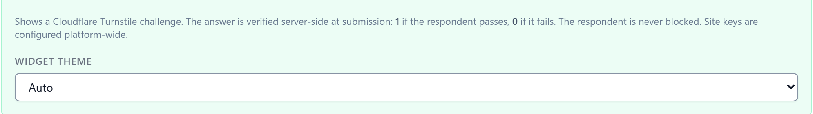

A **Bot detection** item uses Cloudflare Turnstile to provide a response-quality signal when the service is configured.

{/* Available with */}
{/* Let Q-bit do it */}

## When to use it

Add it where the study needs an automated check alongside other quality evidence. It is not a substitute for a research question, and a failed check alone is not a fraud determination.

1. Add a **Bot detection** item to the page.
2. Choose **Widget theme**: **Auto**, **Light**, or **Dark**. Auto is the default.
3. Save the item and draft. Test the challenge in a full survey preview with the configured service available, including a retry or unavailable state.

For example, add the item to a synthetic test survey and check that the challenge loads before submitting the page. The selected theme changes its appearance, not the result of the check.

The server verifies the challenge at submission. To inspect the recorded result, open the survey's **Responses** tab, open a response, and find the bot check item under **Answers**. A stored **1** means the check passed. A **0** can also mean the challenge was unavailable or no solution was recorded. The check allows respondents to continue. If the challenge cannot load, they may see a retry control or an unavailable message. Review the signal alongside other evidence in [survey responses](../reports-analysis/review-survey-responses).

