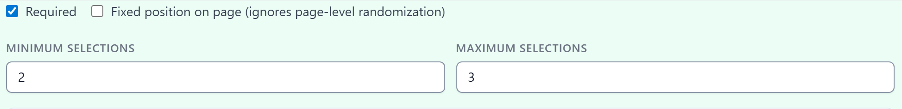
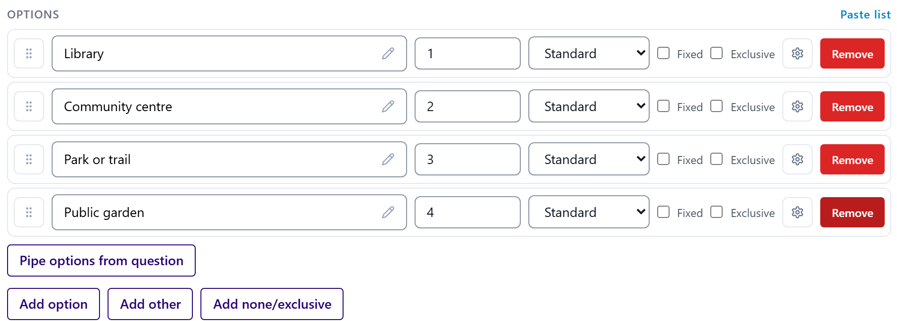
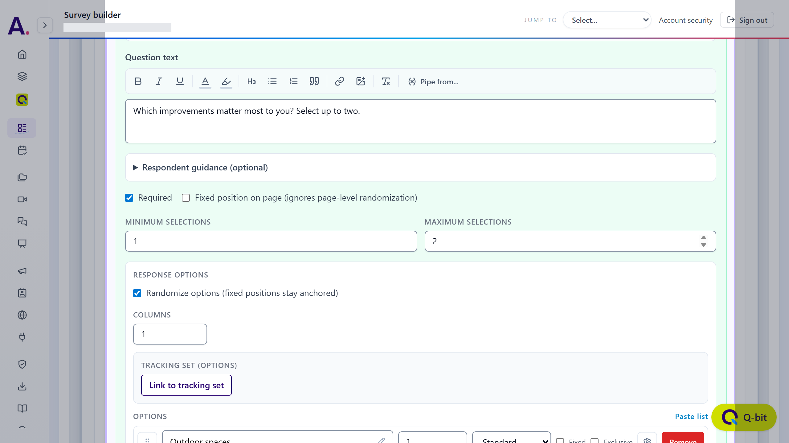
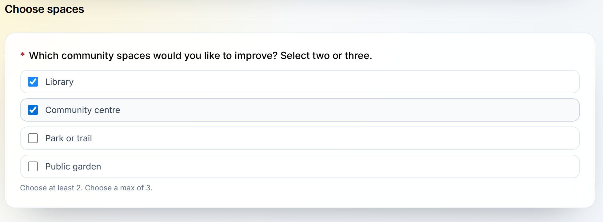
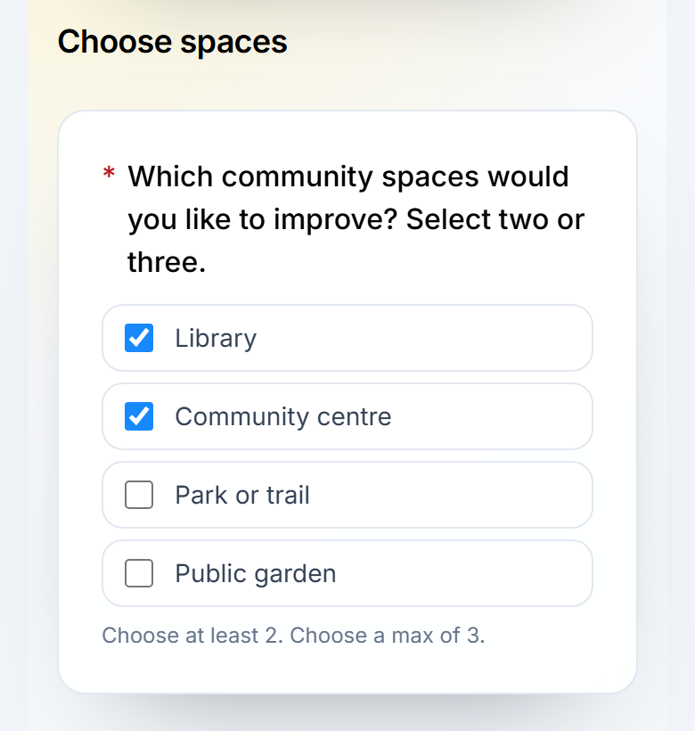
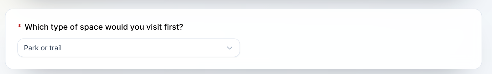
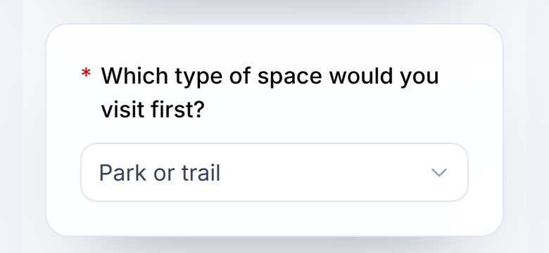

**Single select** and **Multi select** questions collect answers from a defined list of choices.

{/* Available with */}
{/* Let Q-bit do it */}

## When to use it

Choose **Single select** when only one answer should be recorded, such as a preferred contact method. Choose **Multi select** when several answers can apply, such as the services a respondent has used. Add the item to a page, enter its question text, and configure the choices.

## Try a multi-select question

This example asks respondents to choose two or three community spaces. Start on the page where the question should appear.

1. Select **+ Add item to page**, then choose **Multi select**.
2. Enter “Which community spaces would you like to improve? Select two or three.” as the question text.
3. Under **Options**, use **Add option** as needed. Enter **Library**, **Community centre**, **Park or trail**, and **Public garden** as the four choices. Check that each choice has a distinct coded value.
4. Turn on **Required**. Set **Minimum selections** to **2** and **Maximum selections** to **3**.

   

   

5. Select **Save** in the question editor, then **Save Draft** in the builder.
6. Preview the question. Select Library and Community centre, then continue. Try selecting only one choice and continuing to check the minimum. Select three choices and check that another substantive choice cannot be selected.

The respondent sees the four choices and a selection hint. If the hint or choices do not match, reopen the question, check the limits and labels, save it, and preview again.

## Choices and codes

Enter a readable label and a distinct coded value for each choice. Values must be nonblank, unique within the list, and no longer than 100 characters. Reorder choices as needed. You can add a display rule to an option, or mark it **Hidden** to keep it out of the respondent list.

To enter several choices, select **Paste list**, enter one label per line, and choose **Append to list** or **Replace list** before selecting **Insert items**. Replace removes the existing list. Review the automatically assigned values and edit them if needed.

Use the option type selector to choose **Other** for a written response. Only one Other choice is allowed, and a respondent who selects it must enter text. For multi-select, choose **None/Exclusive** in the option type selector, or select **Exclusive** on another choice, to make that choice stand alone. Test both transitions between an exclusive choice and other choices on the respondent page.

## Layout and selection limits

*Separate editor example.*

Single select offers **Buttons** or **Dropdown** under **Layout**. Button layouts and multi-select questions support **Columns** from one to four. New choice questions start with buttons, one column, and no randomisation.

For multi-select, set **Minimum selections** or **Maximum selections** when appropriate. A blank limit adds no minimum or maximum. The minimum applies when an answer is submitted; turn on **Required** if the respondent must answer rather than skip the question. An exclusive or None choice may stand alone even when a minimum is set; it cannot be combined with another choice. For example, set a maximum of three when a respondent may select up to three reasons. Use wording that tells them the limit. Test a response below the minimum, an exclusive choice, and the maximum, after which additional substantive choices are unavailable.

Turn on **Randomize options (fixed positions stay anchored)** to vary the order. Mark a choice **Fixed** if its position must stay anchored. Piped or tracking-set lists are read-only while linked. Piping from an eligible earlier question replaces the current list, so review the source and existing choices before applying it. Save the question, save the draft, and preview on a phone as well as desktop.

