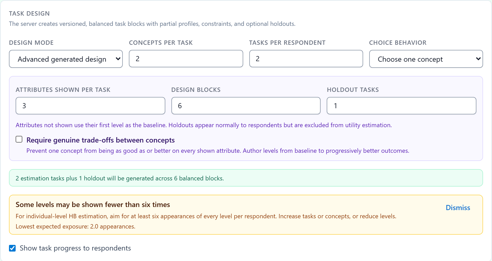
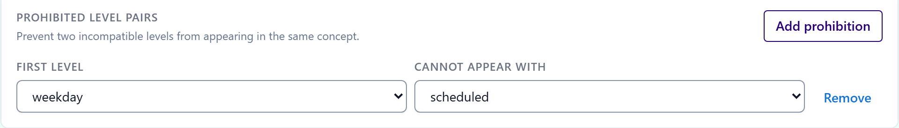
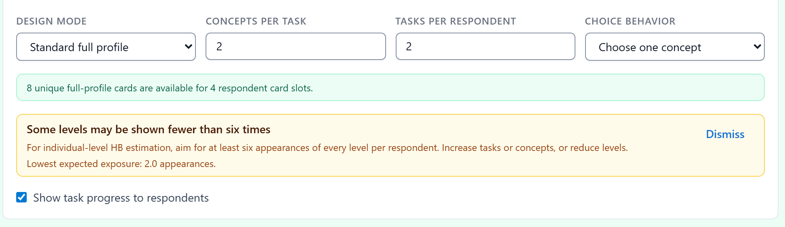
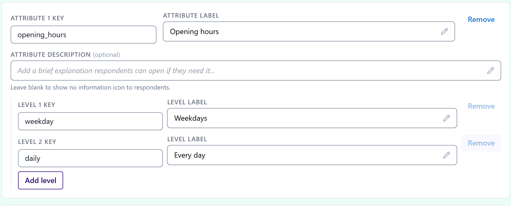
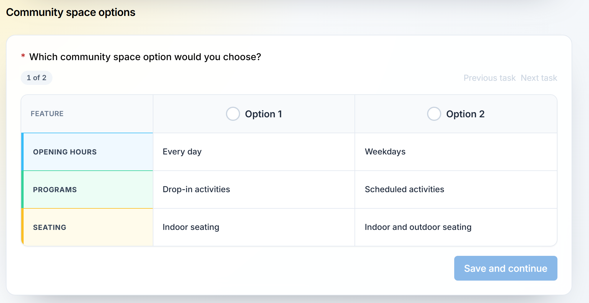
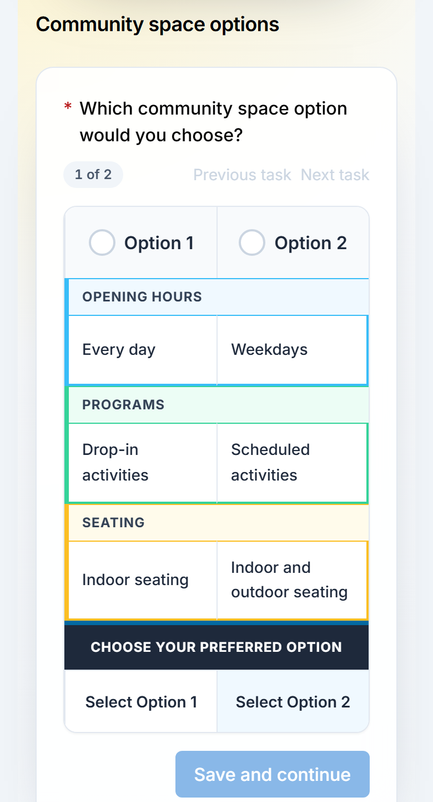

**Conjoint** asks respondents to choose between concepts made from combinations of attributes and levels.

{/* Available with */}
{/* Let Q-bit do it */}

## When to use it

Choose it to study trade-offs between features, such as price and delivery time. For best and worst choices among named items without combining their attributes, consider MaxDiff. Put the question on its own page and plan the design before fielding it.

## Define the task

*Separate editor example.*

1. Add a Conjoint question. Under **Design mode**, choose **Standard full profile** or **Advanced generated design**.
2. Set **Concepts per task** from 2 to 5 and **Tasks per respondent** from 2 to 100. A new question starts with two concepts and two tasks.
3. Choose **Choice behavior**: **Choose one concept**, **Choose one or None**, or **Choose one, then ask actual use**. Set the available labels and task progress as needed.
4. Add attributes with distinct keys, labels, optional descriptions, and 2–6 labelled levels each. Standard mode permits 2–6 attributes; advanced mode permits 2–10.

## Review an advanced design

Advanced mode adds **Attributes shown per task**, **Design blocks**, **Holdout tasks**, and **Require genuine trade-offs between concepts**. You can use 1–24 blocks and 0–3 holdout tasks. Holdouts are added to the **Tasks per respondent** estimation tasks, appear to respondents, and are excluded from utility estimation. For example, two estimation tasks and one holdout give each respondent three tasks.

Attributes not shown in a task use their first level as the baseline. Enable **Require genuine trade-offs between concepts** only when each attribute's levels are ordered from baseline to progressively better outcomes. The generator uses that order to compare concepts. Add **Prohibited level pairs** when two levels cannot appear together in a concept. Review feasibility and expected exposure warnings before saving. Switching back to standard mode clears prohibited pairs and the advanced settings, so review the design before changing modes.

## Try a standard design

1. On a page of its own, select **+ Add item to page**, then choose **Conjoint**.
2. Enter “Which community space option would you choose?” as the question text.
3. Choose **Standard full profile**. Set **Concepts per task** to **2**, **Tasks per respondent** to **2**, and **Choice behavior** to **Choose one concept**.
4. Under **Attributes and levels**, use **Add attribute** and **Add level** as needed to create the following. Give each attribute and level a distinct key.

| Attribute | Levels |
| --- | --- |
| Opening hours | Weekdays, Every day |
| Programs | Drop-in activities, Scheduled activities |
| Seating | Indoor seating, Indoor and outdoor seating |

   

   

5. Review the design message. Select **Save**, then **Save Draft**. Complete both assigned tasks in a full preview on desktop and phone.

Each task compares two options made from the attribute levels. The respondent chooses one option; the combinations can vary. If the design is infeasible, review the message and add levels or reduce the task settings. Once you have responses, see [interpret experiment results](../reports-analysis/interpret-experiment-results).

