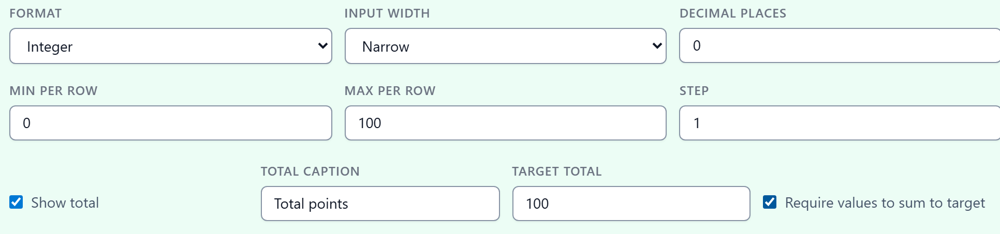
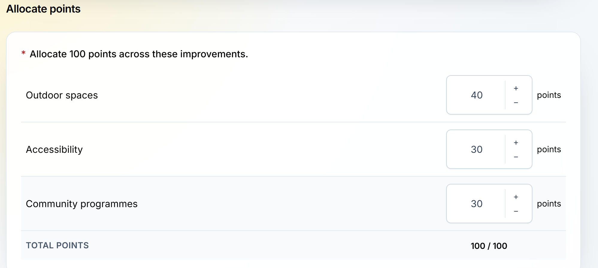
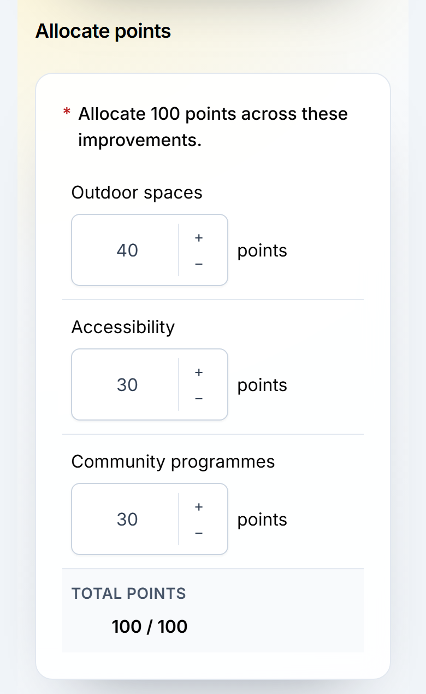

**Continous sum** collects a number for each row and can check their combined total.

{/* Available with */}
{/* Let Q-bit do it */}

## When to use it

Choose it for allocations, such as distributing 100 points across activities. For one number without a row total, choose Numeric entry; for separate ratings, consider a slider list or grid.

## Try allocating 100 points

1. On the desired page, select **+ Add item to page**, then choose **Continous sum**.
2. Enter “Allocate 100 points across these improvements.” as the question text.
3. Use **Add row** to create **Outdoor spaces**, **Accessibility**, and **Community programmes**. Give each row a distinct stub.
4. Set **Format** to **Integer**, **Min per row** to **0**, and **Max per row** to **100**.
5. Keep **Show total** on, enter **Total points** as the **Total caption**, and set **Target total** to **100**. Turn on **Require values to sum to target** and **Required** for all three rows.
6. Select **Save**, then **Save Draft**. Preview on desktop and phone and enter **40**, **30**, and **30**. The total is **100**. Try a different total and check the feedback.

If the total or feedback is missing, reopen the question and check the target, **Show total**, and enforcement setting before previewing again.

## Set the inputs

Add the question and rows. Set **Format** to Integer, Decimal, Percent, or Currency, then choose **Decimal places**, **Input width**, **Min per row**, **Max per row**, and **Step**. Add left and right labels where a unit or context helps. A new question uses Integer, a minimum of 0 per row, step 1, a narrow input, and a visible total.

## Set a total

1. Keep **Show total** enabled and enter a **Total caption** if you want a different label.
2. Enter a **Target total**, such as 100.
3. Turn on **Require values to sum to target** when the respondent must meet it.
4. Turn on the question's **Required** setting if every visible row must be completed.
5. Save the question and draft. Test a blank response, a partial response that meets the target, and an incorrect total.

Total enforcement checks the values supplied. **Required** also checks that every visible row has an answer. For example, add rows for outdoor spaces, accessibility, and community programmes, set the target to 100, and require the total. A respondent who enters 40, 35, and 25 meets the target; test a different total to check the feedback.

Removing the target or turning off **Show total** also turns off enforcement. On a phone the entries stack, so check labels and the running total there as well as on desktop.

