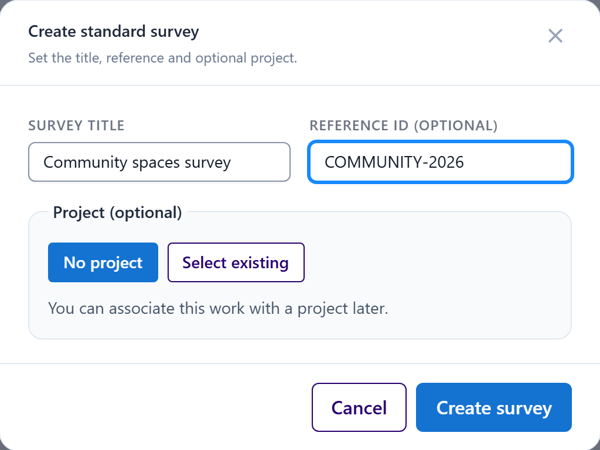

Create a standard survey to start a new questionnaire, or find an existing survey to continue your work.

{/* Available with */}
{/* Let Q-bit do it */}

## When to use it

Create a new survey when you need a fresh draft. Clone a standard survey when an existing questionnaire is a useful starting point, then review its content and settings for the new study. For example, clone a community-services survey for a new wave, then update its dates and wording before testing.

You need access to Asker and your organisation, and to the project if the survey is associated with one. A Registration-linked survey is associated with its Registration and is identified separately in the list.

## Create a standard survey

1. Open **Surveys**.
2. Select **Create survey**.
3. Enter a **Survey title**. A blank title uses “New standard survey.”
4. If useful, enter a **Reference ID (optional)**.
5. Under **Project (optional)**, choose **No project** or **Select existing**. If you select an existing project, choose it from the list. If offered, **Create new** creates a project when you save. A project selected in your current scope may already be chosen.
6. Select **Create survey**.
7. Open **Survey Builder** in the new survey to add pages and questions. Save the draft as you work.

Creating a survey gives you a draft to edit. If creation fails, read the displayed message, check your access, and retry. [Publishing a version](./publish-a-version) and [opening distribution](../fieldwork/activate-distribution) are separate actions. Neither creating nor publishing a survey sends invitations.

## Find, copy, or archive

Use **Search surveys** to search by name. Open **Filters** to choose **Survey type**, **Show surveys**, or **Distribution status**. If you cannot find a survey, check the project scope, filters, and your access.

For a standard survey, open **More** in its row and choose **Clone**. Review **New survey name**, then choose **Create clone**. A clone starts without a project. If you are viewing a project, select **Clear project filter** to find the copy. Open it, select **Associate with a project**, choose a project, and select **Save project** if needed. Review its questions, logic, and settings before using it. **Archive** opens an impact review and confirmation. To find archived surveys, change **Show surveys** to **Archived** and use the available restore action. If creation or a project search fails, check the displayed message and your access, then retry.

Continue with [saving your draft](./save-and-collaborate) or [adding questions](./add-and-edit-questions).
