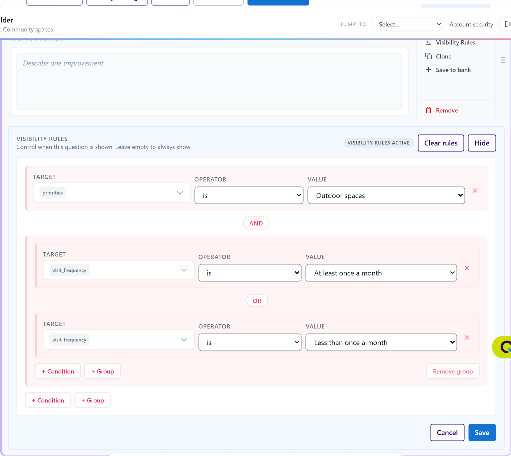
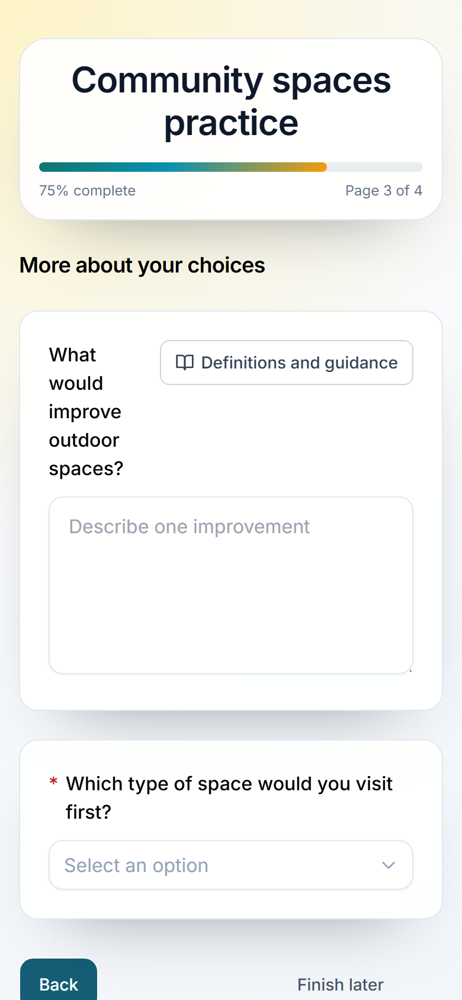
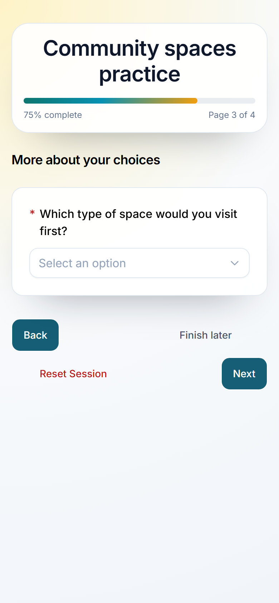
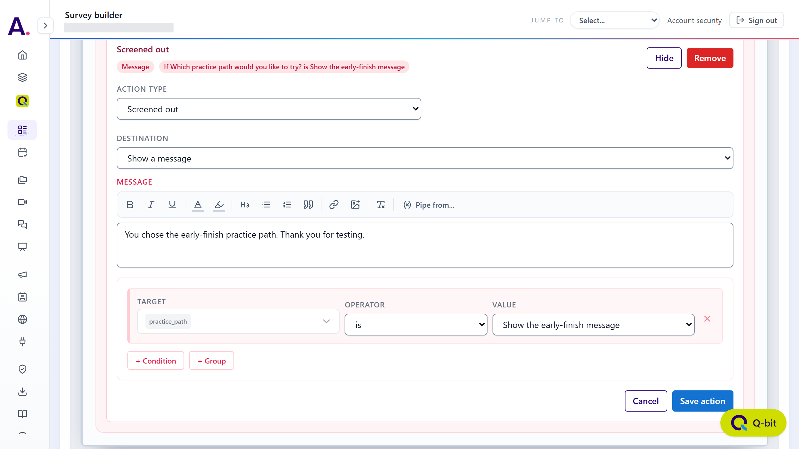

Display logic controls what respondents see. Page actions determine where they go or which outcome is recorded after they submit a page.

{/* Available with */}
{/* Let Q-bit do it */}

## When to use it

Use display logic to show a follow-up only when it is relevant. Use a page action when an answer should change the next page or end the survey with a particular outcome. For example, a “Yes” answer can reveal a question on the same page, while an action after submission can send a respondent to a completion message.

## Try a conditional follow-up

In this example, a follow-up appears only for someone who uses the library. Put both questions on the same page, with the source question first.

1. Add a **Single select** question: “Do you use the library?” Add **Yes** and **No** choices, then save the question.
2. Add an **Open end** question after it: “How could library services improve?” Save the question.
3. On the follow-up question card, select **Add Visibility Rule**. If a rule already exists, select **Visibility Rules**.
4. Set **Target** to the library-use question, **Operator** to **is**, and **Value** to **Yes**. Select **Save** for the rule, then **Save Draft**.
5. Preview the page. Select **Yes** and check that the follow-up appears. Enter an answer, then change the source answer to **No**. The follow-up disappears and its answer is removed.

If the source question is unavailable in **Target**, check that it comes before the follow-up and has been saved. If the follow-up does not appear, reopen its rule and check the target, operator, and value.

## Show a page, question, row, or option conditionally

*Separate editor example.*

1. Open the page settings and select **Edit visibility logic**. For a question, select **Add Visibility Rule**, or **Visibility Rules** if a rule already exists. For a row or option, select **Edit display rules**.
2. Select a **Target**, an **Operator**, and a **Value**. Use **+ Condition** to add a condition.
3. Use **AND** when all conditions in a group must match, or **OR** when any can match. Use **+ Group** for a nested combination. When the first group is added around existing root conditions, their operator is kept and the new group is joined with **AND**. Review the complete rule.
4. For page visibility, select **Save Logic**. For question, row, or option visibility, select **Save**. Save the page or question settings where applicable, then select **Save Draft**.

Page visibility uses answers from earlier pages. Question, row, and option visibility can also use eligible respondent-entered answers from earlier questions on the same page. The follow-up can appear as the respondent changes that answer, without submitting the page. If it becomes hidden, its answer is removed. Hidden rows and options are also removed from the answer.

Computed and hidden variables cannot be used as live sources for another item's visibility on the same page. Put the dependent item on a later page. Quota assignments, including computed results based on them, are available for display after the assignment group's trigger page is submitted.

For example, place a single-choice question before a follow-up and show the follow-up when the answer is “Yes.” Test both “Yes” and “No,” including changing an answer after completing the follow-up. An option marked **Hidden** stays hidden regardless of its display rules.

## Route after a page

1. In **Page actions**, select **Add page action** and choose an **Action type**.
2. For **Jump to page**, choose a **Target page**. Other outcomes include **Complete**, **Screened out**, **Cleaned out**, and **Over quota**. For example, select **Complete**, choose **Show a message** under **Destination**, and enter a thank-you message.
3. Add the conditions, select **Save action**, and select **Save Draft**.

Page actions run after submission and can use eligible answers and computed values from the current page or earlier pages. An action on a quota assignment's trigger page can use its assignment after submission. An author-defined **Over quota** action records that outcome. Automatic capacity enforcement is configured through quotas.

Actions are evaluated in their saved order, and the first matching action runs. If none match, normal progression continues to the next visible page. Create actions in the intended order or make their conditions mutually exclusive, and test overlapping cases. A jump can target an earlier page, so check that the route does not create a loop. See the [Library and Parks example](./set-up-quota-assignment-groups#show-the-assigned-module) for a Page Action based on assignment status.

If a target is unavailable, check the source's position and type. After moving pages or questions, or changing source choices, revisit dependent rules and choose an available target if needed. Run a [full survey test](./preview-and-test) for each path. Page previews alone cannot prove the full route. Publish a version when the tested changes are ready for respondents.
