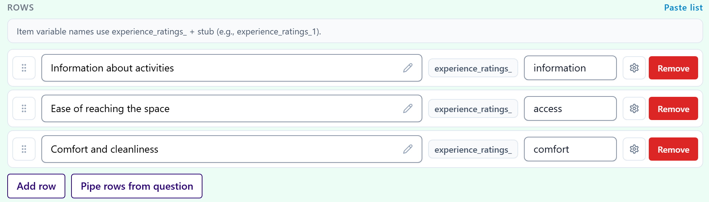
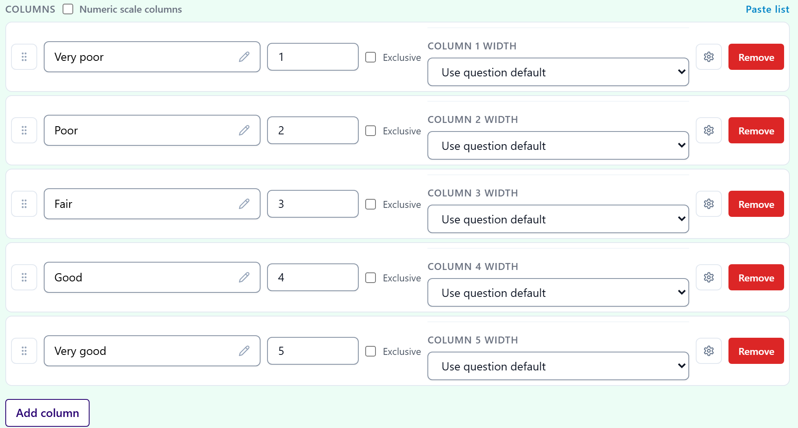
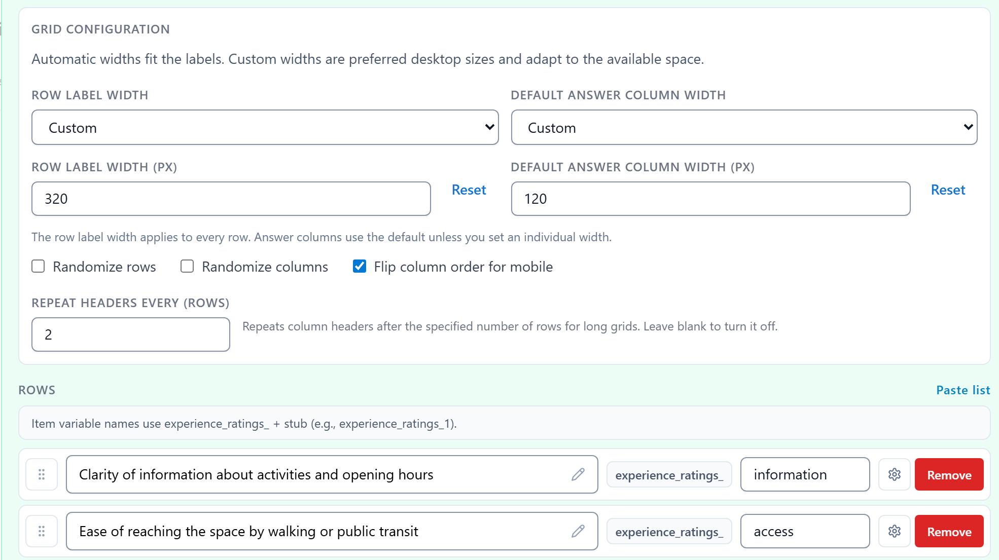
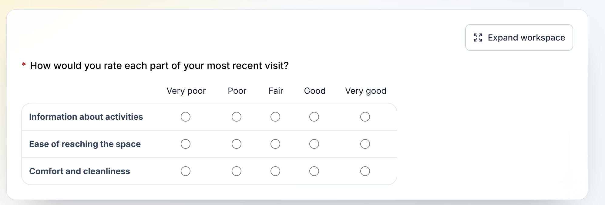
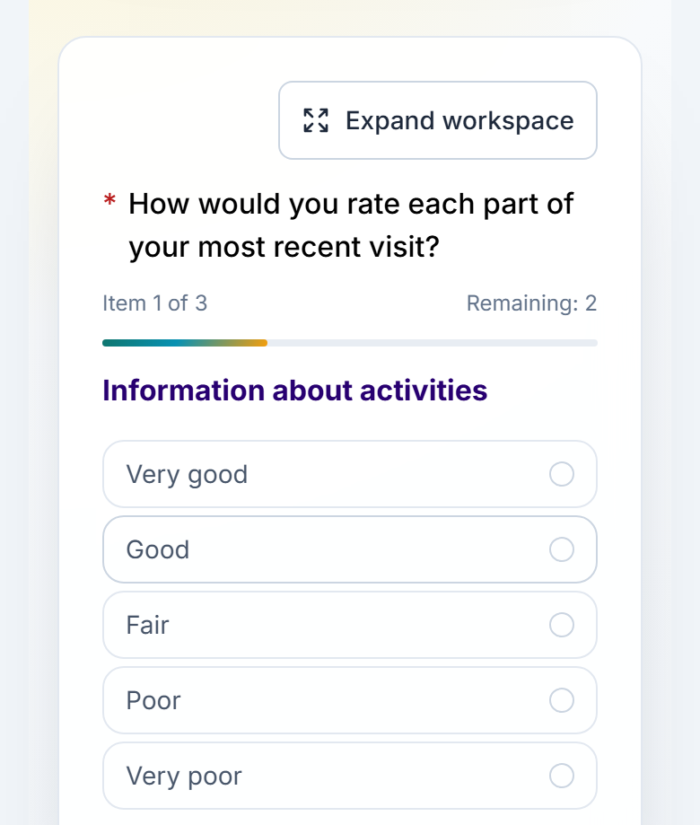

**Grid rating** and **Grid multi-select** collect answers for several rows using shared answer columns.

{/* Available with */}
{/* Let Q-bit do it */}

## When to use it

Choose **Grid rating** when each row needs one answer, such as a satisfaction rating for each service. Choose **Grid multi-select** when several columns can apply to the same row. Add the question, then define the rows and answer columns.

## Try a rating grid

This example asks for a rating of three parts of a visit. Start on the page where the grid should appear.

1. Select **+ Add item to page**, then choose **Grid rating**.
2. Enter “How would you rate each part of your most recent visit?” as the question text.
3. Under **Rows**, use **Add row** as needed. Enter **Information about activities**, **Ease of reaching the space**, and **Comfort and cleanliness**. Give each row a distinct, nonblank identifier.
4. Under **Columns**, use **Add column** as needed. Enter **Very poor**, **Poor**, **Fair**, **Good**, and **Very good** in that order. Give each column a distinct coded value.

   

   

5. Turn on **Required**, select **Save** in the question editor, then select **Save Draft** in the builder.
6. Preview the question on desktop and phone. Choose a rating for each row, then continue. Also try continuing with a row unanswered to check the required-answer feedback.

The desktop view shows the rows together. On a phone, the compact layout presents them one at a time. If a label or answer is missing, reopen the grid and check its rows and columns before saving and previewing again.

## Rows and columns

Give each row and column a clear label and a distinct identifier or coded value. Row stubs must be unique and nonblank; column values must be unique, nonblank, and no longer than 100 characters. Order the list and add visibility rules where needed. A piped or tracking-set list is read-only while linked.

For example, list transit and parks as rows and use Very dissatisfied through Very satisfied as columns. In a rating grid, the respondent selects one satisfaction column for each row. Test the grid with long row labels and a selection in more than one row.

## Layout and order

*Separate editor example.*

Automatic widths fit labels. Set **Row label width** or **Default answer column width** for a preferred desktop size, and set an individual answer-column width where needed. These widths adapt to available space. Custom row widths range from 120 to 640 pixels, and answer columns from 44 to 640 pixels.

**Randomize rows** and **Randomize columns** vary the order. **Flip column order for mobile** reverses columns in the phone layout. **Numeric scale columns** is available for applicable grids. To repeat headings in a long grid, enter a positive number in **Repeat headers every (rows)**; leave it blank to turn repetition off.

Save the question and draft. Check both the wide grid and the compact phone layout, including required-answer feedback.

Before comparing responses, check which category the [Top-box by row chart](../reports-analysis/standard-report-chart-types) counts. The report uses the last configured answer column or answer group, even when the respondent view displays the columns in a different order.

