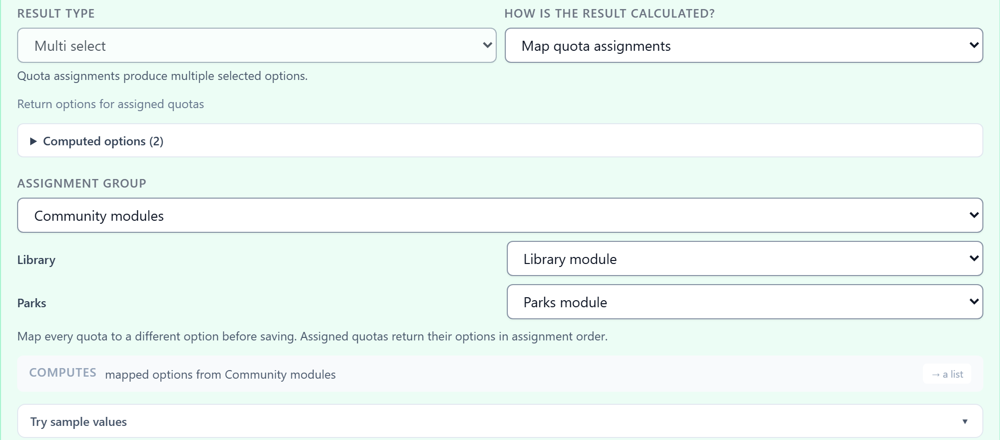

Hidden and computed variables provide values for survey logic, calculations, and text without showing an answer control to respondents.

{/* Available with */}
{/* Let Q-bit do it */}

## When to use it

Use a hidden variable to capture a value supplied in a survey URL. Use a computed variable to derive a value from answers or other available data. For example, map an answer to a category that controls a later follow-up. Build the source questions and any required quota assignment group first.

## Capture a URL value

1. Add a **Hidden variable** item and set **Source type** to **URL**.
2. Enter the URL parameter name in **Variable name**. Add a **Default value** to use when the parameter is absent or empty.
3. Select **Save** in the item editor, then **Save Draft**. Open two fresh responses, one with the parameter supplied and one without it. Check the later text or rule that uses the value. A resumed response can retain the value captured earlier. Avoid putting sensitive information in a URL.

To copy a text or numeric answer, use a computed variable with **Reference** and a compatible result type. To turn a selected answer into a result option, use **Map answers**.

## Calculate a value

1. Add a **Computed variable** item. Under **How is the result calculated?**, select a calculation.

   - **Map answers** applies IF and THEN rules. The first matching rule wins. **OTHERWISE (when no rule matches)** supplies the result if none match.
   - **Formula** combines numeric values. **Aggregate** calculates a sum, average, minimum, maximum, or count across numeric items or all rows of an eligible grid.
   - **Count values** counts the selected or returned values in **Values to count**. A missing input counts as zero.
   - **Random number** assigns a whole number within the inclusive range. The result stays stable for that respondent.
   - **Map quota assignments** returns options for the quotas assigned to a respondent.
   - **Reference** copies an available value. **Fixed value** supplies a constant.

2. Set **Result type** to **Text**, **Numeric**, **Single select**, or **Multi select**. New computed variables start as Text. Formula, Aggregate, Count values, and Random number require Numeric. Map quota assignments requires Multi select. For select results, add the result choices under **Computed options** and use those choices in the calculation.
3. Set **Default value (when the result is empty)** if needed. The default is used when the calculation returns no value, such as a missing input or division by zero. A zero count or an empty quota assignment is a result, so it does not use the default.
4. Open **Try sample values**, enter examples, and check the result, the matching rule, and the fallback. These samples are only used in the editor. For a random number, the preview uses the minimum as an example.
5. Select **Save** in the item editor, then **Save Draft**. Run a [full survey preview](./preview-and-test) with matching, non-matching, and missing inputs. Select **Publish Version** when the changes are ready for respondents. On a narrow screen, the publication control reads **Publish**.

When changing a calculation or result type, review its values and options. Existing values are kept, and an incompatible value needs to be changed or cleared. Select results must use the computed variable's own options. If a source or option is unavailable, restore it or select a compatible replacement and test again.

## Try a Map answers example

Suppose an earlier **Single select** question called **Library use** has **Yes** and **No** options. On a later page, add a **Computed variable** item and enter **Library category** as its question text. Choose **Map answers** and leave **Result type** as **Text**.

1. In **Rule 1**, set the **IF** condition to **Library use** **is** **Yes**.
2. Under **THEN**, choose **Value** and enter `Library user`.
3. Under **OTHERWISE (when no rule matches)**, choose **Value** and enter `Other`.
4. Open **Try sample values**. Select **Yes** for Library use and check that the result is **Library user** and Rule 1 matched.
5. Select **No** and check that the result is **Other** and no rule matched. Select **No sample value** to check the fallback for a missing answer.
6. Select **Save**, then **Save Draft**.
7. On a page after the computed variable, add an **Open end** question: “How could library services improve?” Save the question.
8. On that question card, select **Add Visibility Rule**. Set **Target** to **Library category**, **Operator** to **is**, and **Value** to `Library user`. Select **Save**, then **Save Draft**.
9. Run a [full survey preview](./preview-and-test). Answer **Yes** to Library use and check that the follow-up appears. Start a fresh preview, answer **No**, and check that it does not appear.

The variable itself is not shown to respondents. If the follow-up does not behave as expected, check its visibility rule. Then reopen the variable and check the source, rule order, and **OTHERWISE** value.

## Map quota assignments

Create the assignment group and its quotas first. Place the computed variable on the group's trigger page or a later page. Select **Map quota assignments**, choose the **Assignment group**, add **Computed options**, and map every quota to a different result option. Assigned quotas return their mapped options in assignment order. Follow the complete [Library and Parks example](./set-up-quota-assignment-groups#example-assign-one-of-two-modules) to configure and test both routes.

Assignments become available after the trigger page is submitted. A page action on that page can use the result. Display rules that depend on the assignment or mapped result need a later page. Test the assigned and unassigned paths. See [quotas and weights](./stage-quotas-and-weights) and [display logic](./display-logic-and-page-actions).
