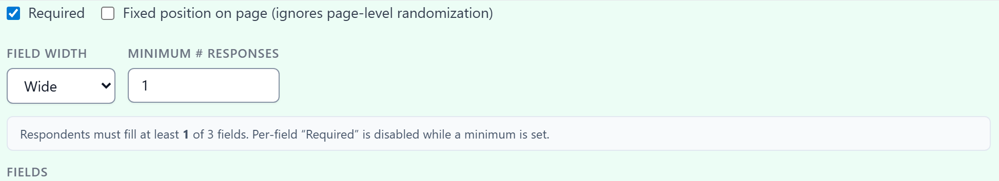
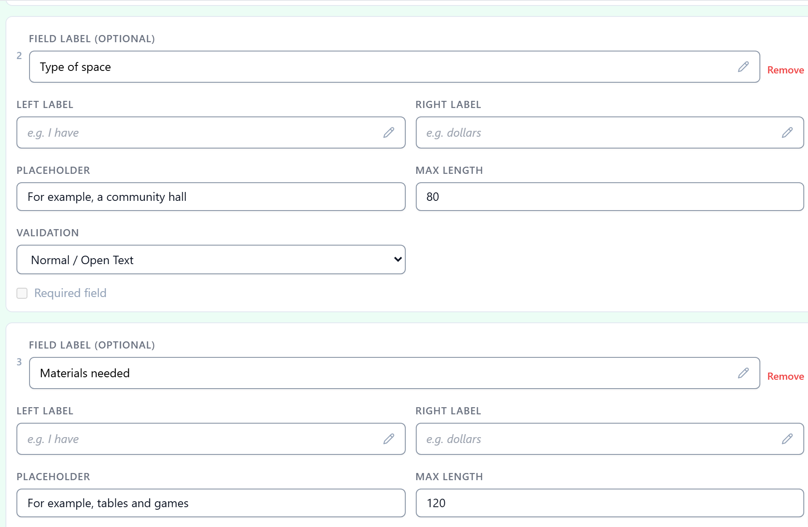
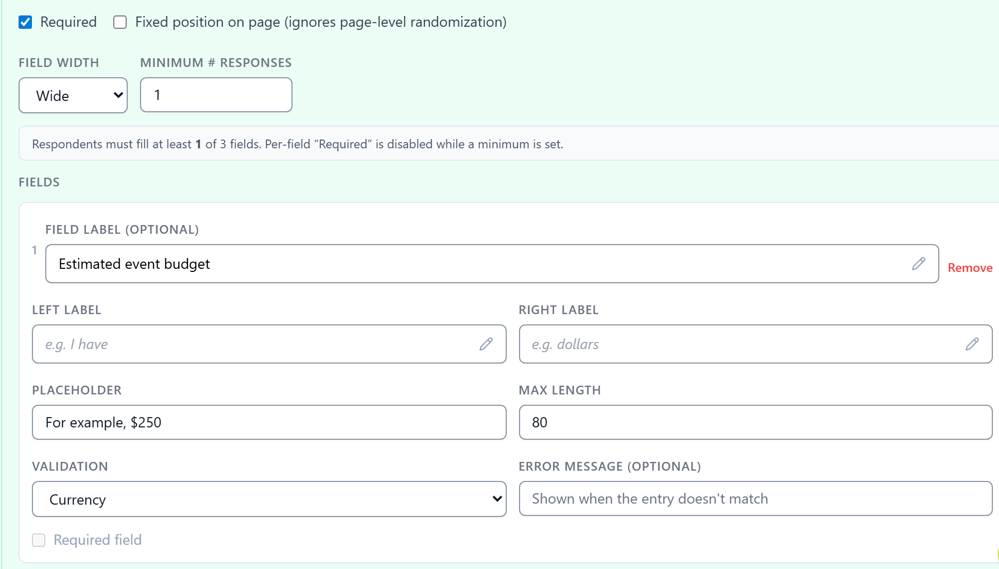
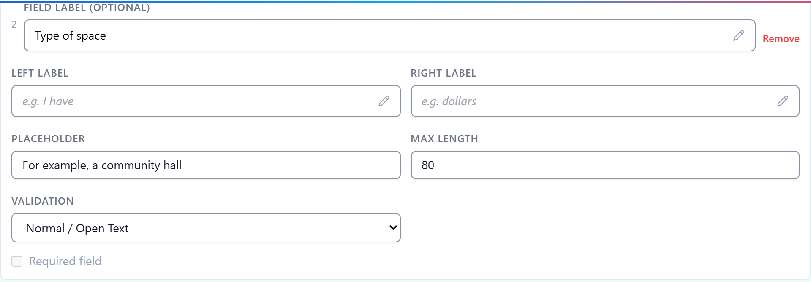
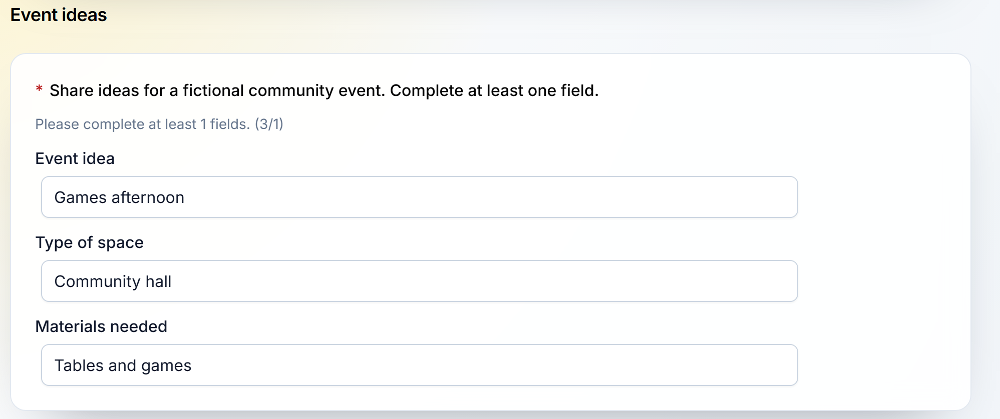
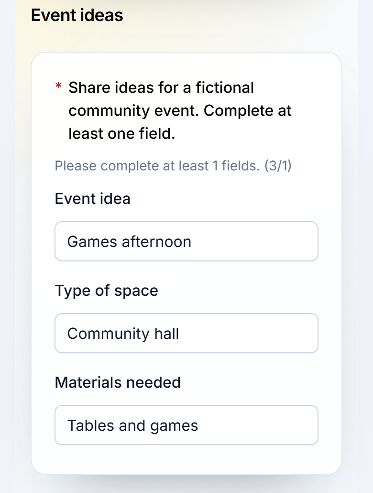

A **Hybrid entry list** collects several related text fields in one question.

{/* Available with */}
{/* Let Q-bit do it */}

## When to use it

Choose it when each field has its own label or validation, such as a set of contact details. For one short answer, use Textbox; for the same set of fields repeated across several people or items, use a Record Collection.

## Try collecting event ideas

1. On the desired page, select **+ Add item to page**, then choose **Hybrid entry list**.
2. Enter “Share ideas for a fictional community event. Complete at least one field.” as the question text.
3. Use **Add field** to create **Event idea**, **Type of space**, and **Materials needed**. Leave their validation as open text.
4. Turn on **Required** and set **Minimum # responses** to **1**.

   

   

5. Select **Save**, then **Save Draft**. In a desktop and phone preview, enter **Games afternoon**, **Community hall**, and **Tables and games** in the three fields. Also test leaving all fields blank.

The respondent can complete one or more fields. If an empty response is accepted, reopen the question and check both **Required** and the minimum before previewing again.

## Other field settings

1. Add the question and choose a shared field width. New lists start at medium width.
2. Select **Add field** for each entry. Give it a field label and, where useful, left and right labels, a placeholder, and a maximum-length setting.
3. Choose each field's **Validation**, such as email, phone, or a numeric format. Add an error message if the standard message is not sufficient.
4. To make an answer mandatory, turn on the question's **Required** setting, then mark individual fields **Required field** or set **Minimum # responses**.
5. Save the question and draft. Test empty, partial, valid, and invalid entries on desktop and phone.

An untouched optional question can be skipped. A minimum count applies only when the question is required. Setting a minimum clears the individual required flags; it asks for at least that many completed fields rather than particular fields. For example, with three contact fields and a minimum of one, a respondent can complete any one of them. If you remove the minimum, review and set individual required fields again.

In a community event survey, you could ask for an estimated budget, a type of space, and materials needed in one Hybrid entry list. Set the budget field to a currency format, leave the other two as open text, and require at least one response when any of those details is useful. Preview each field's placeholder and validation message before publishing.

*Editor example with a currency field for the estimated budget.*

*Separate editor example.*

*The currency field's label and validation settings.*

