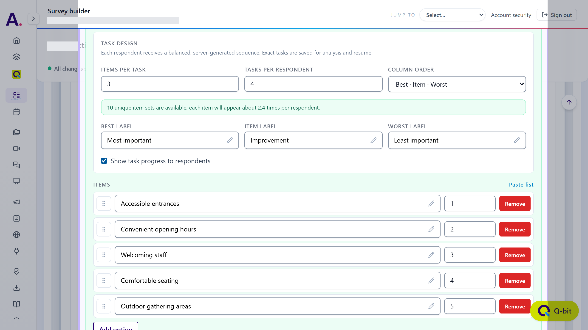
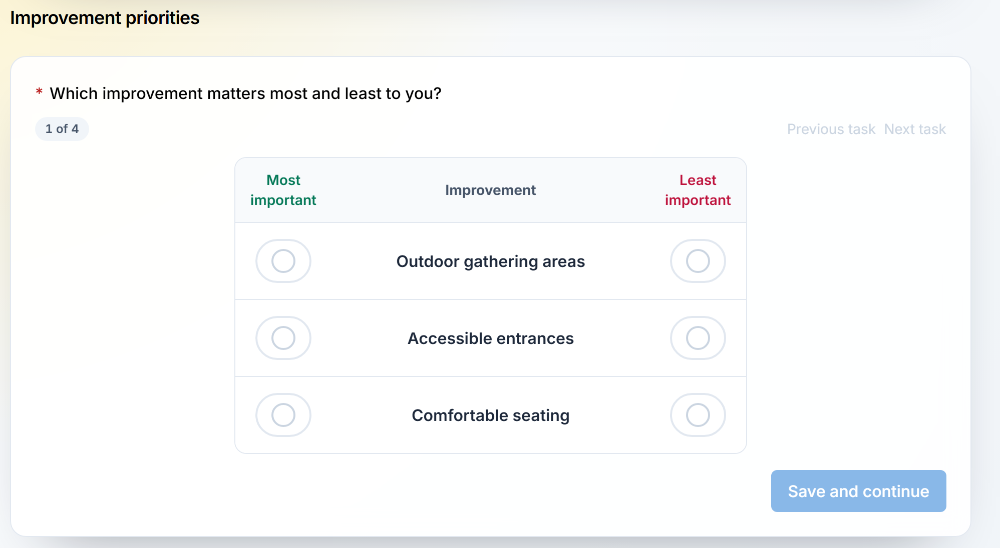
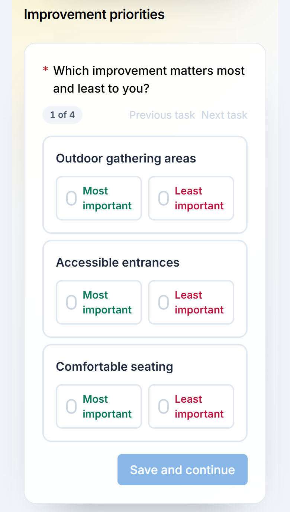

**MaxDiff** asks respondents to choose the best and worst item from each assigned set.

{/* Available with */}
{/* Let Q-bit do it */}

## When to use it

Choose it to compare named items through repeated best–worst tasks, such as identifying the most and least useful service features. For a single ordered list, consider Rank; for choices between combinations of features, consider Conjoint. Put the question on its own page.

## Try an improvement comparison

1. On a page of its own, select **+ Add item to page**, then choose **MaxDiff**.
2. Enter “Which improvement matters most and least to you?” as the question text.
3. Under **Items**, use **Add option** as needed to enter **Accessible entrances**, **Convenient opening hours**, **Welcoming staff**, **Comfortable seating**, and **Outdoor gathering areas** with distinct codes.
4. Set **Items per task** to **3** and **Tasks per respondent** to **4**. Set **Best label** to **Most important**, **Item label** to **Improvement**, and **Worst label** to **Least important**. Turn on **Show task progress to respondents**.
5. Review the design message, select **Save**, then **Save Draft**. Run a full preview on desktop and phone and complete all four tasks.

Each task shows three improvements. The respondent chooses one as most important and a different one as least important. The assigned combinations can vary. If the editor reports an infeasible design, add items or reduce the task settings before saving.

## Other MaxDiff settings

1. Add the MaxDiff question and at least four items with clear labels and distinct codes.
2. Set **Items per task** from 3 to 5 and **Tasks per respondent** from 2 to 100. A new question starts with three items per task and four tasks.
3. Choose **Column order**, edit the **Best label**, **Item label**, and **Worst label**, and choose whether to **Show task progress to respondents**.
4. Review the design message. There must be enough unique item sets for the requested tasks. Add items or reduce the task settings if the design is not feasible.
5. Save the question and draft. Run a full survey preview and complete every task, checking desktop and phone layouts.

For example, add four items for opening hours, location, staff support, and online booking. Use three items per task and four tasks. In each assigned set, the respondent selects one feature as best and a different feature as worst.

The assigned task sequence is generated for the respondent and retained for resume and analysis. Use a full preview to test the assigned tasks, then see [interpret experiment results](../reports-analysis/interpret-experiment-results) when you have responses.

