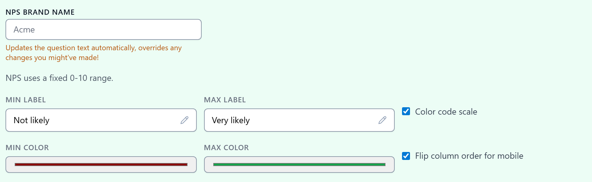
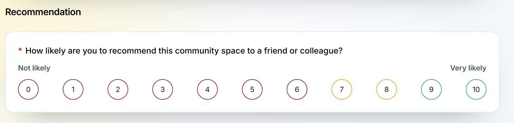
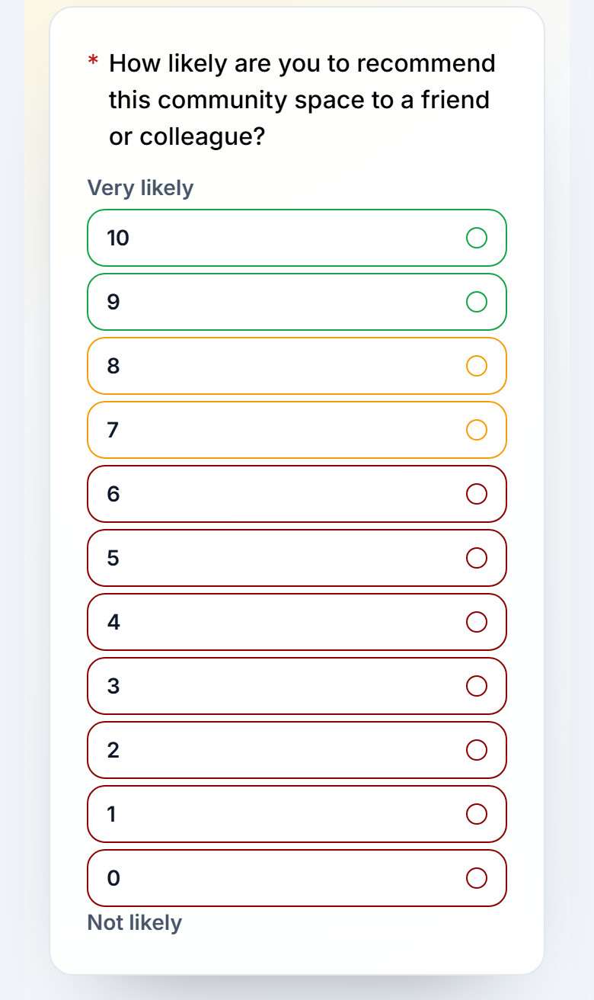

A new **NPS** question asks respondents how likely they are to recommend something on a fixed 0–10 scale. Respondents select one of the 11 scores.

{/* Available with */}
{/* Let Q-bit do it */}

## When to use it

Choose NPS when you want to track willingness to recommend, such as after a visit to a community centre. Use a [Scale question](./scale-questions) for other numeric ratings, such as satisfaction from poor to excellent.

## Set up the question

1. On the desired page, select **+ Add item to page**, then choose **NPS**.
2. Enter “How likely are you to recommend this community space to a friend or colleague?” as the question text.
3. Enter **Not likely** for **Min label** and **Very likely** for **Max label**. Turn on **Required** and **Color code scale**.
4. Turn on **Flip column order for mobile**. The compact phone layout presents the scores in reverse order, with the matching endpoint labels.
5. Select **Save**, then **Save Draft**. Preview on desktop and phone, and test selecting **0** and **10**.

The respondent sees 11 scores with a label at each end. If you use **NPS Brand name**, review the generated question text: changing the brand name replaces edits you made to it. If the wording or labels are wrong, correct them in the editor and preview again.

## Respondent view

The scale displays 11 choices with a label at each end. Check that a respondent can select either endpoint and that the labels remain clear on a phone.

## Read the result

Standard Reports group answered ratings into **Detractors** (0–6), **Passives** (7–8), and **Promoters** (9–10). The NPS score is the percentage of promoters minus the percentage of detractors. For example, if 60% are promoters and 20% are detractors, the NPS is 40. Passives count in the base used to calculate the percentages.

Use **NPS distribution** to inspect individual ratings, **NPS score KPI** for the overall result, **Promoter mix** to compare the three groups, or **NPS score trend** to see how the score changes over time. **Mean rating trend** shows the average rating over time. Review the answered base and any report filters or weights when comparing scores. With no answered ratings, the score displays **N/A**.
