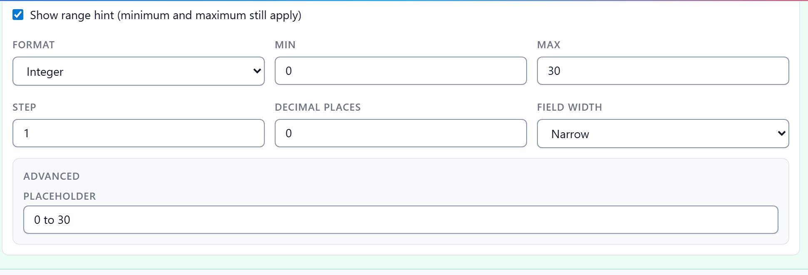
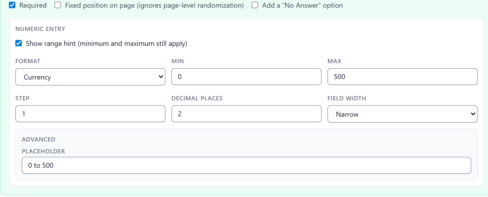
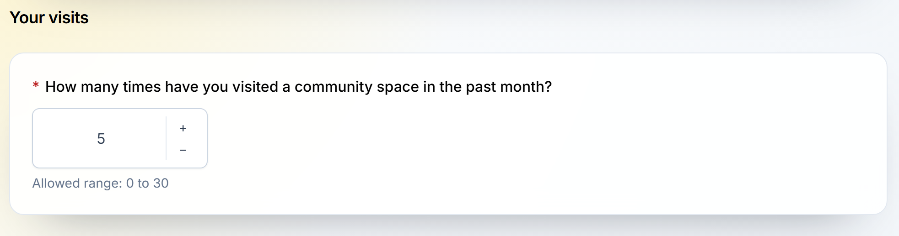
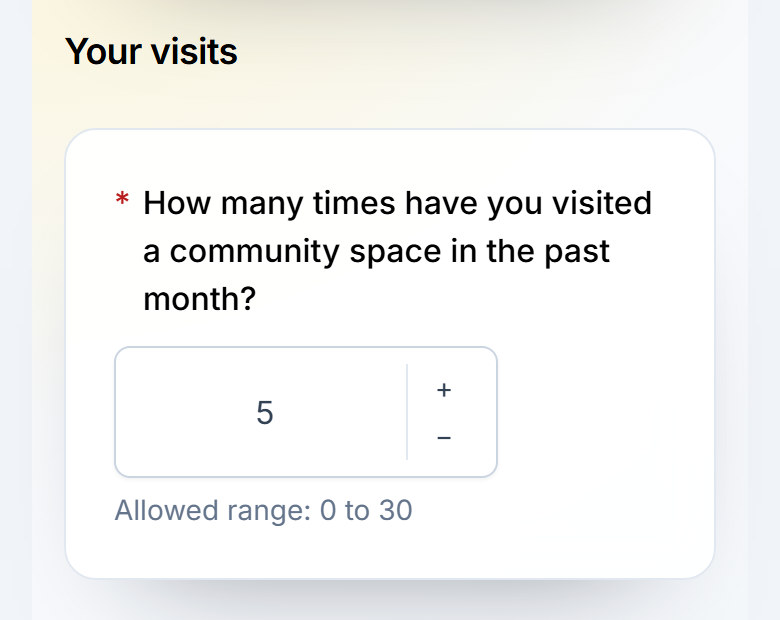

**Numeric entry** collects a number typed by the respondent, with optional bounds and formatting.

{/* Available with */}
{/* Let Q-bit do it */}

## When to use it

Choose it for a quantity such as the number of visits. Use a Scale or Slider when respondents should select a position in a fixed rating range, or Continuous sum when several entries must add to a total.

## Try a number of visits

1. On the page where the question belongs, select **+ Add item to page**, then choose **Numeric entry**.
2. Enter “How many times have you visited a community space in the past month?” as the question text.
3. Under **Numeric entry**, choose **Integer** for **Format**. Set **Min** to **0**, **Max** to **30**, and **Step** to **1**.
4. Turn on **Show range hint** and **Required**.

   

5. Select **Save** in the question editor, then **Save Draft** in the builder.
6. Preview the question and enter **5**. The respondent sees the allowed range of 0 to 30. Try an answer outside that range and check the feedback before continuing.

If the range hint is missing or incorrect, reopen the question, check the bounds and hint setting, save, and preview again.

## Other numeric settings

1. Add a Numeric entry question and enter its wording.
2. Choose **Format**: Integer, Decimal, Percent, or Currency.
3. Set **Min**, **Max**, and **Step** when needed. Set **Decimal places** for the intended display, and choose a field width and placeholder.
4. Turn on **Show range hint** if the respondent should see the minimum and maximum. Turning off the hint does not remove the bounds.
5. Set required or No Answer behaviour as appropriate, save the question, and save the draft.

A new numeric entry uses Integer, step 1, zero decimal places, a narrow field, and no minimum or maximum. Its range hint and No Answer are off by default.

**Step** sets the increment used by the plus and minus controls. Typed values can fall between increments, subject to the selected format, range, and storage limits.

For example, choose Currency with two decimal places, a minimum of 0, and a maximum of 500 for an estimated event budget. Test zero, a valid middle value, and values outside the bounds. Preview on a phone and check the displayed number format.

*Editor example configured for currency amounts from 0 to 500.*

*Separate editor example.*

