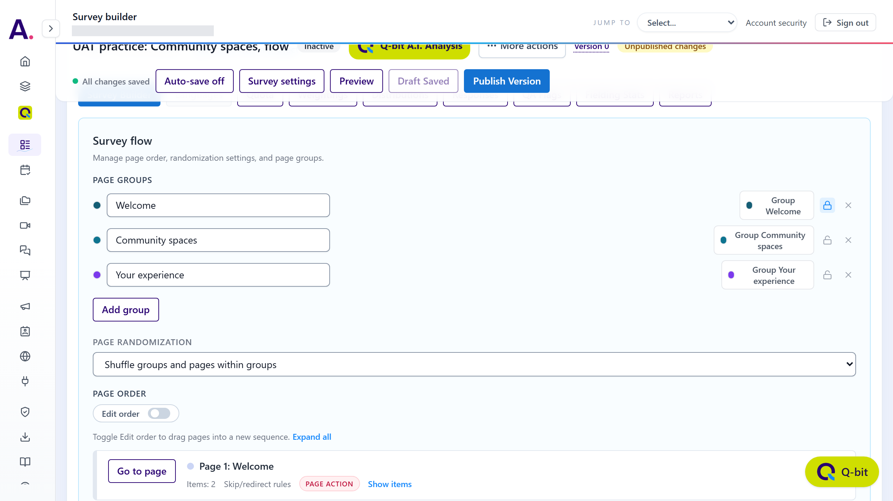
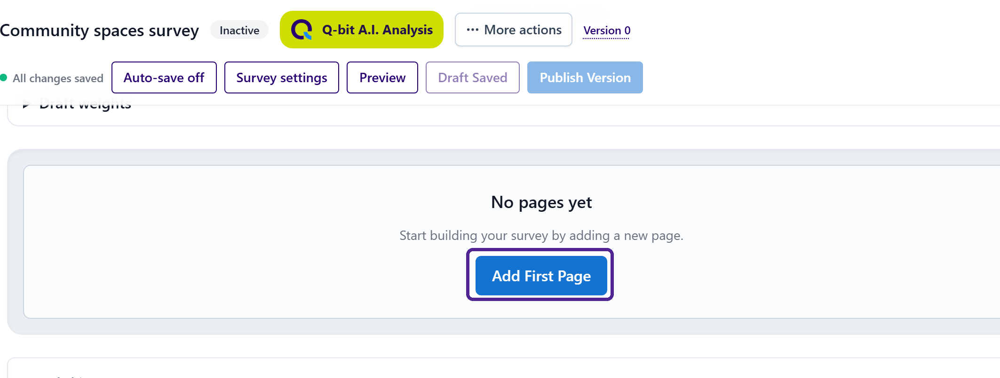
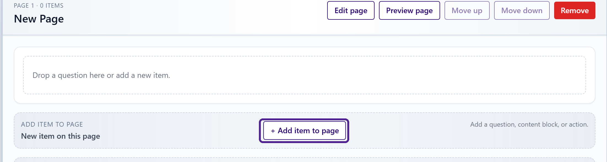
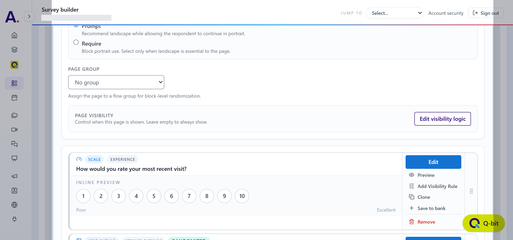
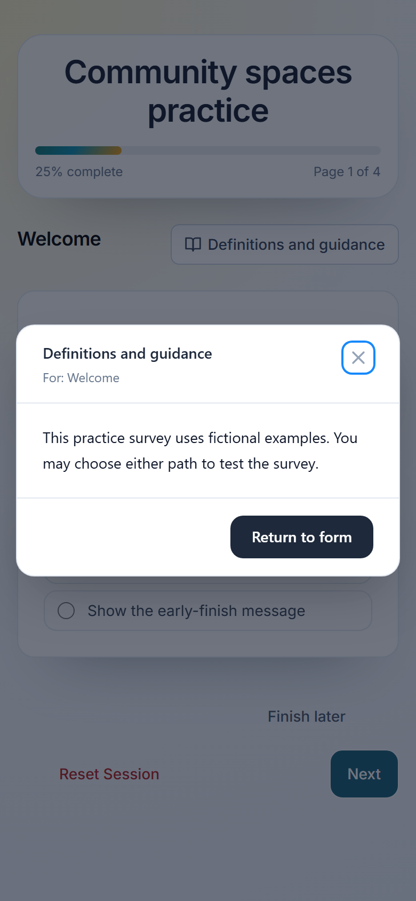

Organise pages and survey flow to group related questions and control their order for respondents.

{/* Available with */}
{/* Let Q-bit do it */}

## When to use it

Use separate pages to break a longer survey into manageable sections or to place a conditional follow-up after its source question. Use groups and randomisation when the order of a set of pages should vary. For example, in a group shuffle mode, group several service-rating pages together and leave an introductory page ungrouped. Open your survey in **Survey Builder** before making changes.

## Arrange pages

1. Open the survey's **Survey Builder**.
2. If you see **No pages yet**, select **Add First Page**. A page appears with a control to add an item.
3. To add another page, select **Add New Page** below an existing page.
4. Select **Save Draft** to save the page changes. Wait for **Draft Saved** or the saved status.

To change the order, open **Survey flow** and turn on **Edit order**. Drag pages into a new sequence. To group pages, select **Add group** under **Page groups**, then assign each page in **Page settings**. Select the lock icon beside a group to pin or unpin it. Removing a group leaves its pages in the survey and clears their group assignment.

**PAGE RANDOMIZATION** defaults to **No randomization**. Choose **Shuffle all pages**, **Shuffle within groups**, **Shuffle groups (keep pages within group ordered)**, or **Shuffle groups and pages within groups** to vary the relevant order. Only consecutive pages assigned to the same group form a group block. In group shuffle modes, ungrouped pages and pinned groups keep their run slots, and pinned groups keep their internal page order. Their absolute page numbers can still change when earlier groups of different lengths move.

A page that depends on an earlier answer must come after the question that collects it. Recheck visibility rules, piping, and page actions after changing the flow, then test each route.

## Configure a page

Open the page settings and review:

- **Page title**: appears as a section heading when section titles are enabled in survey settings.
- **Respondent guidance (optional)**: add definitions or instructions. Respondents open **Definitions and guidance** to read them, then return to the form.
- **Randomize questions on this page**: off by default. When enabled, the question order varies; fixed-position questions stay anchored.
- **Set response status when this page is reached**: defaults to **Do not change status**. **Complete**, **Disqualified**, or **Cleaned out** can set a status on entry. The page can still display and continue to later pages. Quota rules control automatic over-quota outcomes.
- **Use landscape orientation guidance (mobile)**: off by default. When enabled, **Prompt** recommends rotation while allowing portrait use. **Require** blocks portrait use until the device is rotated.
- **Page group**: assigns the page to an existing group.
- **Page visibility**: select **Edit visibility logic** to show a page only when its conditions match. Use **Clear rules** to remove an existing visibility condition.

Save the page settings and any visibility logic, then select **Save Draft** in the builder. For conditions and routing, see [display logic and page actions](./display-logic-and-page-actions).
