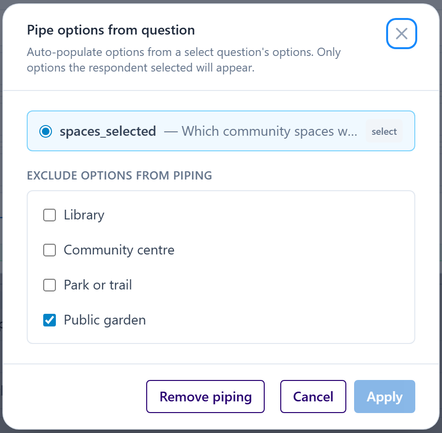
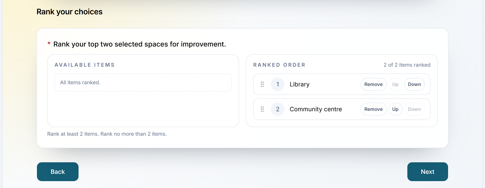

Pipe answers or choices into later content so respondents see wording and lists relevant to what they already answered.

{/* Available with */}
{/* Let Q-bit do it */}

## When to use it

Use a text pipe to refer to an earlier answer in a later prompt. Use a piped list when a later question should use selected choices or eligible rows from a source question. For example, ask which community services a respondent uses, then ask about the selected services on a later page. Place the source question on an earlier page and test the complete route.

## Try carrying choices to a ranking

Start with a required **Multi select** question on an earlier page: “Which community spaces would you like to improve? Select two or three.” Add **Library**, **Community centre**, **Park or trail**, and **Public garden** as choices. Save the question and draft.

1. On a later page, add a **Rank** question: “Rank your top two selected spaces for improvement.”
2. Select **Pipe options from question** and choose the earlier Multi select question. Read the warning before applying it: piping replaces the Rank question's current options.
3. Set **Minimum selections** and **Maximum selections** to **2**. Turn on **Required**, select **Save**, then **Save Draft**.
4. Run a full preview. Select **Library** and **Community centre** on the first page, then rank Library first and Community centre second.

The ranking shows those two selected spaces. Start a fresh preview with different choices and check that the list changes. If the source is unavailable, check that it is required, saved, and on an earlier page. See [ranking questions](./ranking-questions).

## Insert a value in text

1. Open a supported rich-text field in the question editor and choose **Pipe from...**.
2. In **Pipe a value**, select an earlier answer, computed value, or declared variable.
3. Finish the surrounding wording, save the question, and save the draft.
4. Complete a full preview using different source answers and check the resulting wording.

For example, a later prompt can refer to a service selected on an earlier page. Review the translated wording around the inserted value in each offered language.

## Carry choices or rows forward

In the later question's option or row editor, choose **Pipe options from question** or **Pipe rows from question**. Select an eligible required select or grid question on an earlier page. For a select source, only choices the respondent selected appear in the later list, except any you exclude. For a grid source, you can apply a condition to include rows according to the respondent's answers.

Applying piping replaces the later question's existing items. Review the warning before applying it. The linked list is read-only while piped. If no source is available, check its type, required setting, and page order.

Test with several selections, a single selection, and any exclusion or grid filter. After changing the source, moving pages, or editing a translation, save and test the later question again.

