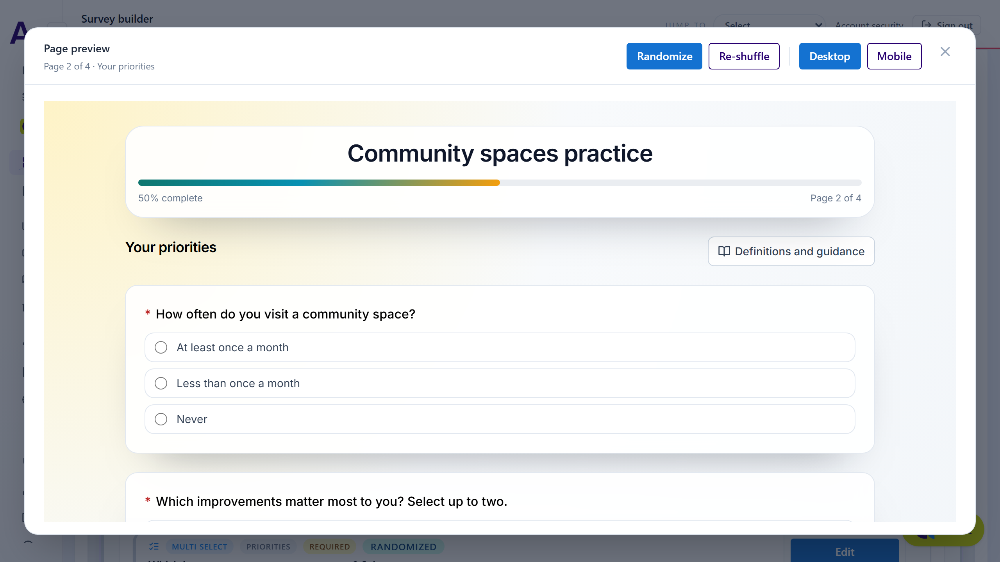
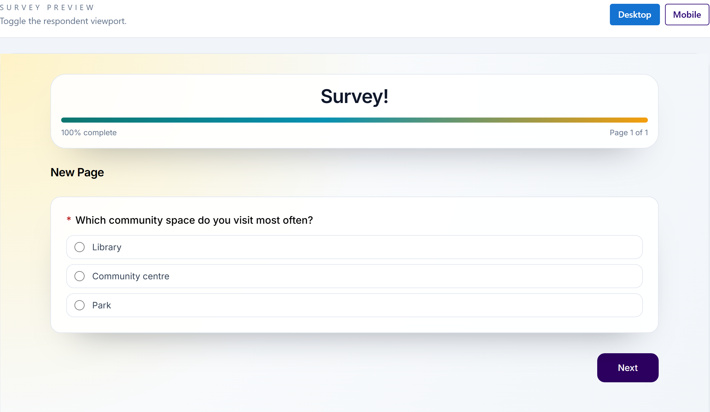
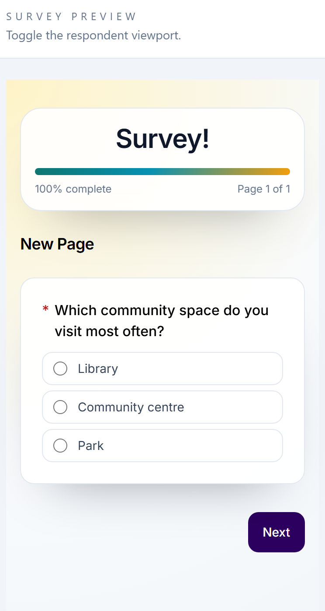
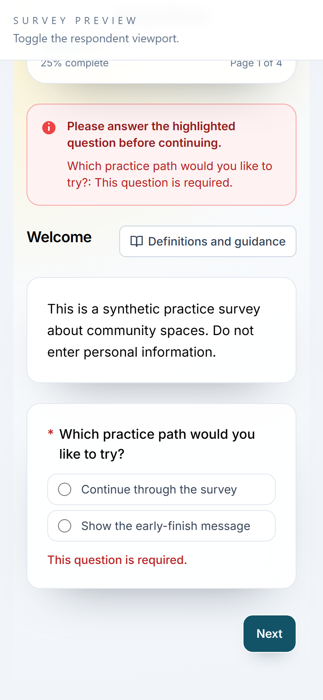

Preview and test a survey to find wording, layout, validation, and routing problems before publication.

{/* Available with */}
{/* Let Q-bit do it */}

## When to use it

Use a question or page preview for a quick check while editing. Use a full survey preview when earlier answers affect later questions, piping, or routes. For example, test both “Yes” and “No” on a question that controls a follow-up page. After publishing, use an approved test link to check the published version and entry settings. Testing through a respondent URL can create a real response, so use synthetic answers and follow your organisation's testing process.

1. Save open question edits in their editors.
2. Select **Save Draft** in the builder. Resolve any reported validation issues and wait for the saved status.
3. Use the question or page preview controls to inspect wording, choices, guidance, and layout. On desktop, use **Desktop** and **Mobile** to check both preview frames, including long labels and selected answers. The Mobile frame is a layout check; test a respondent URL on an actual phone-sized viewport before fielding. Where offered, use **Randomize** and **Re-shuffle** to inspect different orders.
4. Select **Preview** in the builder to open the full survey preview. On a narrow screen, find it under **Tools**.
5. Enter fictional answers and proceed through the pages to the end.
6. Repeat with different answers to exercise visibility rules, page actions, required questions, optional answers, and any piped content. Check Back and terminal messages where relevant.
7. Return to the builder and correct any issues.
8. Save the draft and test the affected paths again.

Answers entered in a question or page preview are temporary. These previews help check layout, but they do not replace a full test of piping and routing. The full preview uses the saved draft and can open while distribution is inactive or closed; it does not verify the published respondent entry. Full-preview responses are marked **Preview** in Responses. If the survey has no distribution link, opening the full preview creates a link labelled **Default**. Review translated content in **Languages** as well as the source-language draft. Do not use real participant details for test answers.

If validation prevents saving or publishing, use **Show issues** or the reported error to find and correct the problem, then retry. When the survey is ready, [publish a version](./publish-a-version).

