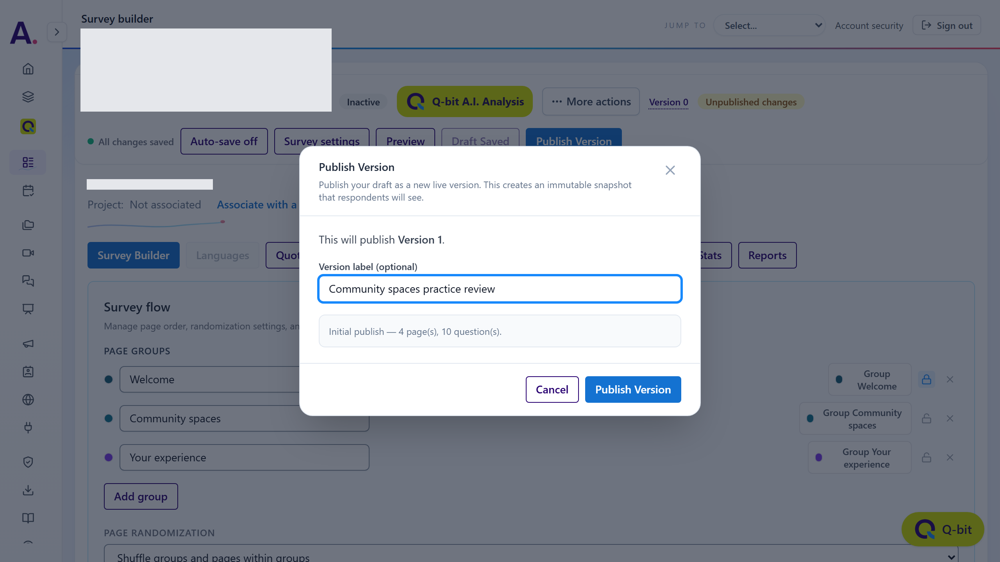
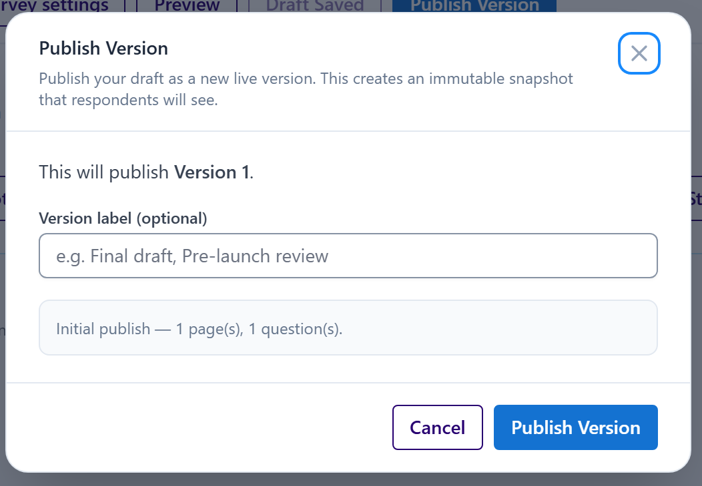
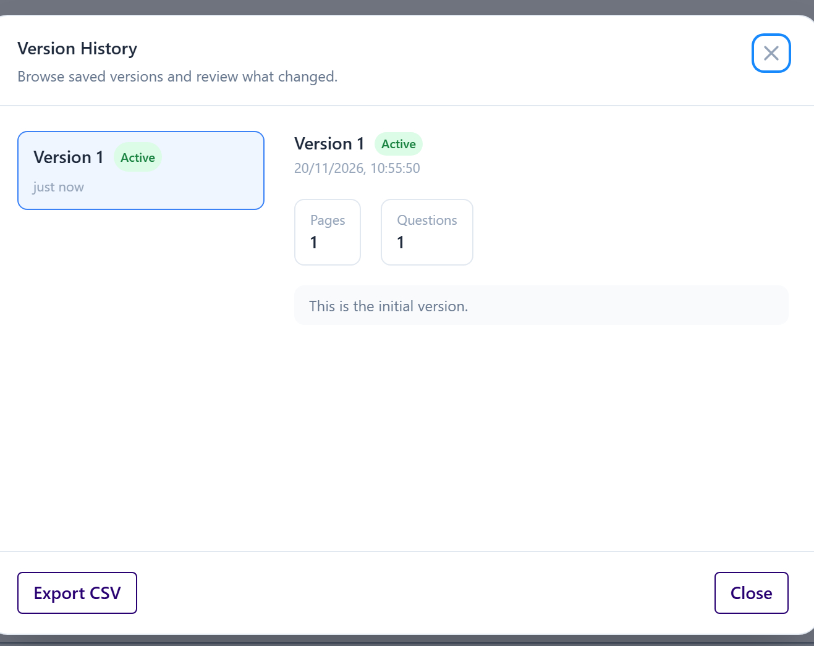
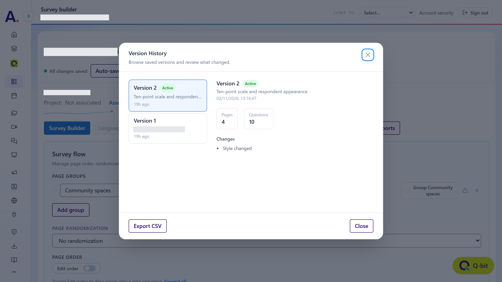

Publish a survey version to make a reviewed snapshot available for new respondents.

{/* Available with */}
{/* Let Q-bit do it */}

## When to use it

Publish after the draft and its paths have been reviewed and tested, such as when a revised community survey is ready for a new fieldwork period. Save draft changes while work is still in progress. Opening survey distribution is a separate action.

## Publish

1. Save open question edits using **Save** in the question editor.
2. Select **Save Draft** in Survey Builder. Make sure you hold editing access and wait for the saved status. Saving before opening the publication dialog lets its change summary reflect the saved draft.
3. [Test the draft](./preview-and-test).
4. Select **Publish Version** in Survey Builder. On a narrow screen, this control reads **Publish**. If it is unavailable, check your editing access and whether there are unpublished changes.
5. Review the change summary.
6. Add a **Version label (optional)** if it will help your team identify the release.
7. Select **Publish Version** in the dialog. Wait for the operation to complete. If the survey is already live and its link is open, a new entrant receives the new version immediately. A respondent who has already started continues on the original version.
8. Select the version number in Survey Builder to open **Version History**. On a narrow screen, find it under **Tools**.
9. Confirm the new version appears and review its change summary.

If the builder draft has unsaved changes, publishing first attempts to save them. Changes still open in a question editor must first be saved in that editor to be included in the builder draft. If saving fails, resolve the error or editing conflict before trying again. If publication reports an error or the connection is interrupted, check Version History and the published version before retrying. A draft that saved successfully remains saved.

Use **Export CSV** in Version History if you need a downloadable record.

Next, [activate distribution](../fieldwork/activate-distribution) and choose how respondents will enter. A published version alone does not open a closed survey or send invitations.
