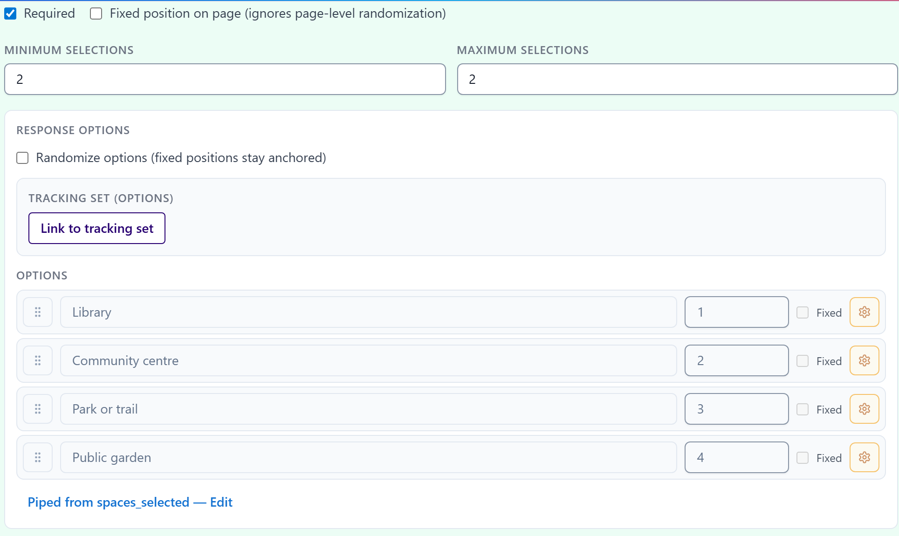
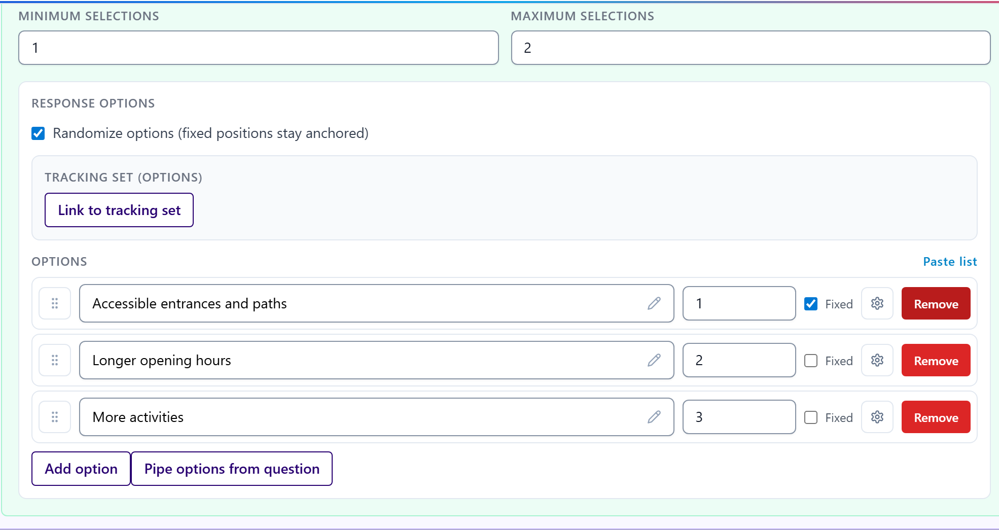
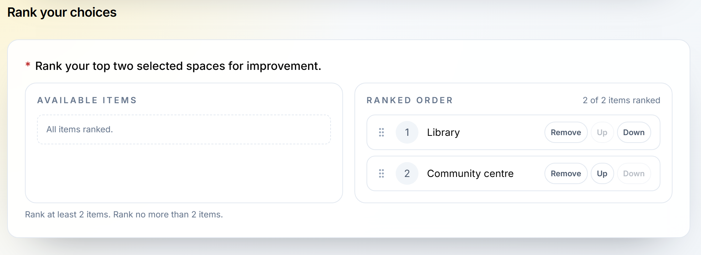
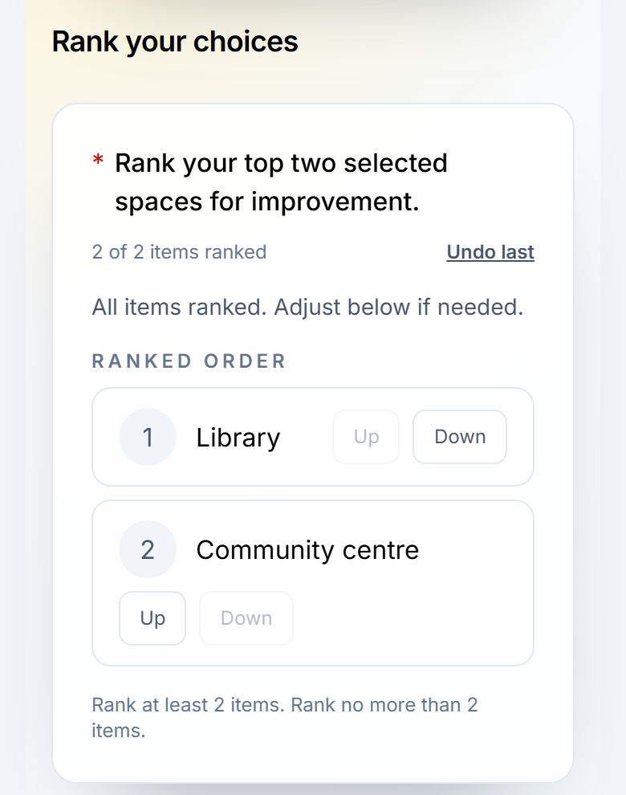

**Rank** collects an ordered list of the items a respondent selects.

{/* Available with */}
{/* Let Q-bit do it */}

## When to use it

Choose it for priorities where first, second, and third place matter. Use Multi select when respondents can choose several items but do not need to order them, or MaxDiff for repeated best–worst comparisons.

## Try ranking selected spaces

First add a required [Multi select question](./choice-questions#try-a-multi-select-question) on an earlier page, asking which community spaces to improve.

1. On a later page, select **+ Add item to page**, then choose **Rank**.
2. Enter “Rank your top two selected spaces for improvement.” as the question text.
3. Select **Pipe options from question** and choose the earlier Multi select question. Review the replacement warning before applying it.
4. Set **Minimum selections** and **Maximum selections** to **2**. Turn on **Required**.

   

5. Select **Save**, then **Save Draft**. In a full preview, select **Library** and **Community centre** on the earlier page. Rank Library first and Community centre second.

The ranking shows only the selected spaces, in the order the respondent ranks them. If the earlier question is unavailable, check that it is a required eligible select question on an earlier page, save the draft, and try again.

## Other ranking settings

1. Add a Rank question and enter the prompt. Add the items with readable labels and distinct coded values.
2. Set **Minimum selections** and **Maximum selections** if the respondent should rank a specific number of items. Leave a limit blank when it is not needed. The minimum applies when an answer is submitted; turn on **Required** to prevent skipping the question.
3. Enable **Randomize options** if the starting order should vary. Items marked fixed remain anchored. Piped or tracking-set lists are read-only while linked.
4. Save the question and draft. Preview selection and reordering on desktop and phone, including a partial ranking and a response outside the limits.

For example, to require a respondent's top three priorities, set both limits to three, turn on **Required**, and state that instruction in the question. New ranking questions have no selection limits or randomization by default.

In the [Rank distribution](../reports-analysis/standard-report-chart-types), each item's base is the respondents who ranked it. If 10 of the 20 people who ranked Library placed it first, its unweighted first-place share is 50% among those 20.

*Editor example with a minimum of one selection, a maximum of two, and a fixed option.*

*Separate editor example.*

