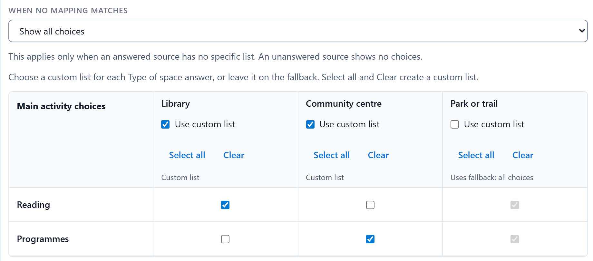
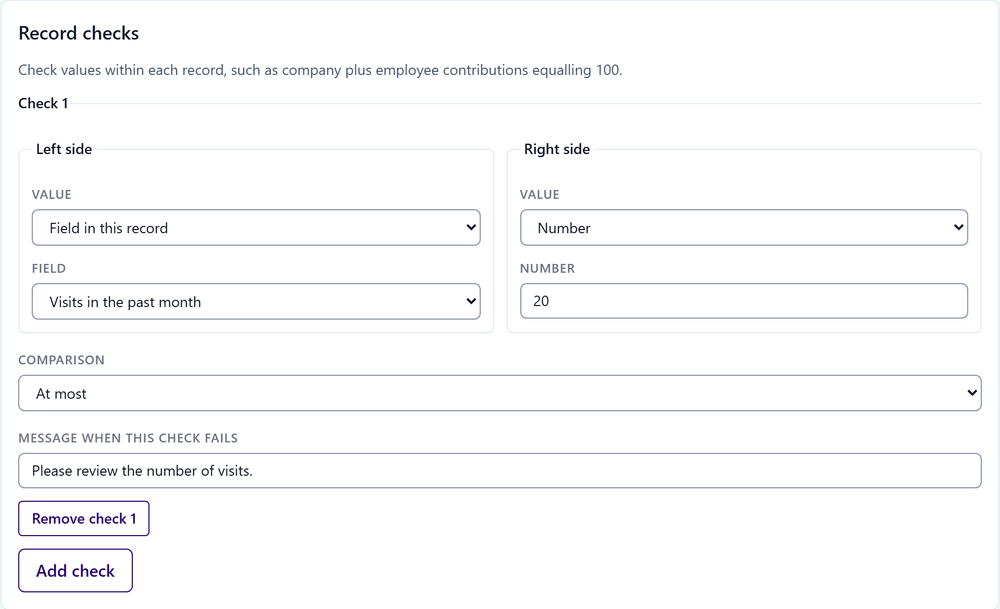

Record Collection filters and checks control the choices and validate relationships between values within each record.

{/* Available with */}
{/* Let Q-bit do it */}

## When to use it

Use a filter when one field determines the choices for a later field in the same record. Use a record check when values within that record must satisfy a comparison. Start with a Record Collection containing the fields and choices you need.

## Filter a choice field

1. Place the controlling **Single select** field before the dependent choice field.
2. In the dependent field, choose the controller under **Filter choices using**.
3. For each source choice, select **Use custom list** and choose which dependent choices should be available, or leave it on the fallback. Review the preview and selection limits.
4. Under **When no mapping matches**, choose **Show no choices** or **Show all choices** for an answered source with no specific mapping. An unanswered source shows no choices.
5. Save and test every source choice, including an unanswered and an unmapped case.

For example, a province field can control a later list of available locations. Before publication, if a source field or choice is removed, update the filter before proceeding. If a mapping refers to removed choices, select **Reset mappings** and set the lists again. Changing the source also resets the mappings. After publication, retain existing field and choice identities; use a new collection for an incompatible redesign. Keep the controlling field before its dependent field, and make sure every required dependent field has enough available choices.

## Check values within a record

For a total that must equal 100 in each record, first add two required **Numeric** fields, such as Company contribution and Employee contribution. Then configure the check.

1. Under **Record checks**, select **Add check**. On the **Left side**, set **Value** to **Calculation** and **Operation** to **Add**.
2. For **Value 1** and **Value 2**, choose **Field in this record** and select Company contribution and Employee contribution respectively.
3. Set **Comparison** to **Equals**. On the **Right side**, choose **Number** and enter 100.
4. Enter a **Message when this check fails**, such as “Contributions must total 100%.” Save the question and draft.

Test the check in a complete respondent journey. In one record, 60 and 40 total 100 and pass the check. In another, 60 and 30 total 90, so the respondent sees the message and must correct the values before continuing. The check applies within each record, not across all records. A collection can contain up to 100 checks.
