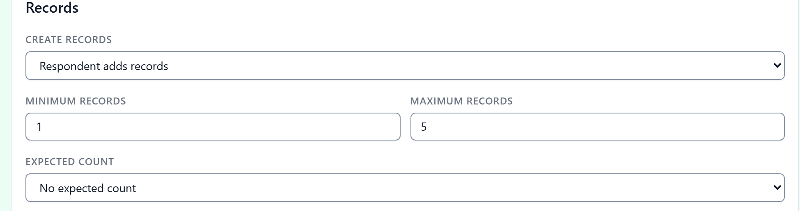
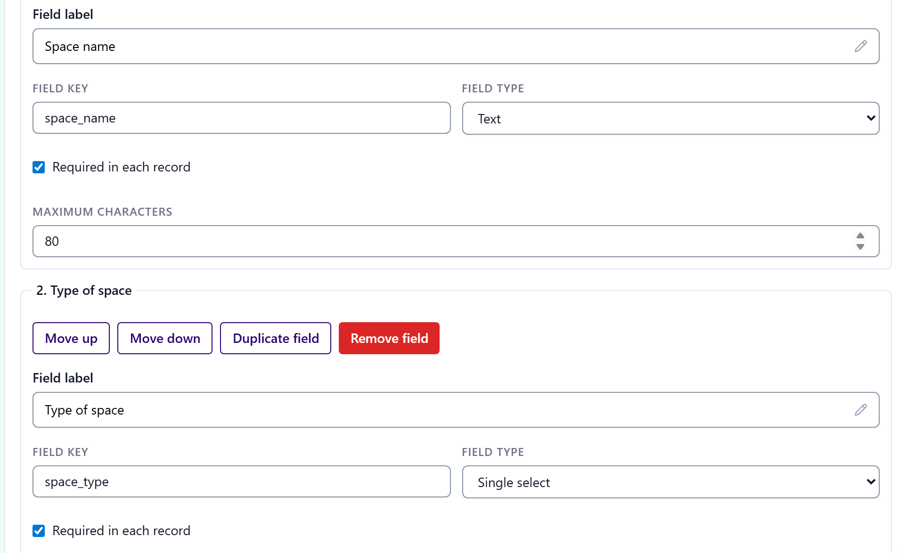
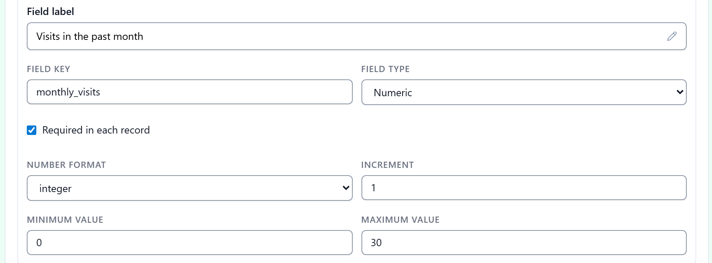
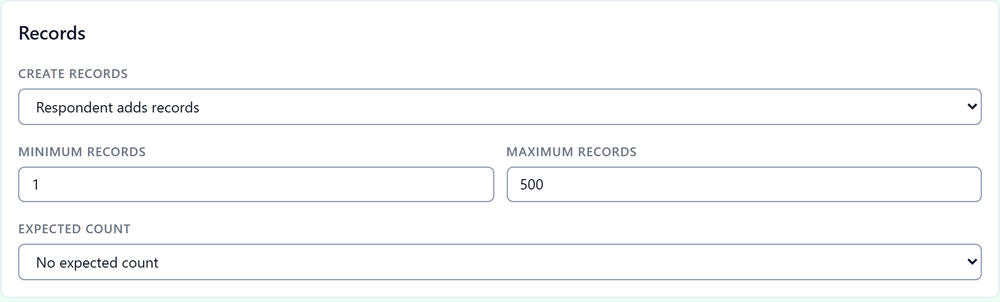
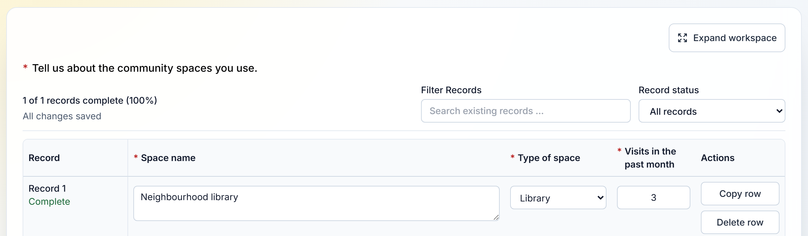
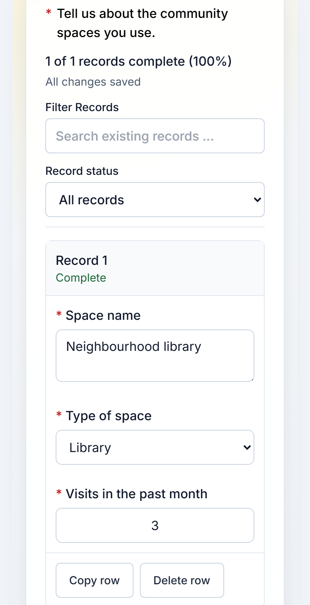

**Record Collection** gathers the same set of fields for multiple records in one survey question.

{/* Available with */}
{/* Let Q-bit do it */}

## When to use it

Choose it when respondents need to describe several people, employers, or other items using the same fields. For one fixed set of related fields, consider a Hybrid entry list. Decide whether respondents will add records or an earlier answer will create them.

## Try collecting community-space records

1. On the desired page, select **+ Add item to page**, then choose **Record Collection**. Enter “Tell us about the community spaces you use.” as the question text.
2. Under **Create records**, choose **Respondent adds records**. Set **Minimum records** to **1** and **Maximum records** to **5**.
3. Use **Add field** to create a **Text** field labelled **Space name**, a **Single select** field labelled **Type of space**, and a **Numeric** field labelled **Visits in the past month**. Give each field a distinct **Field key** and turn on **Required in each record**.
4. For **Type of space**, add **Library**, **Community centre**, and **Park or trail** as choices with distinct keys and export values. For the visits field, choose **integer** under **Number format**, set **Minimum value** to **0**, and **Maximum value** to **30**.

   

   

   

5. Select **Save**, then **Save Draft**. In a full preview, select **Add record**, enter **Neighbourhood library**, choose **Library**, and enter **3** visits. Check that the record is complete on desktop and phone.

If a record is incomplete, check its required fields and correct the missing answer. If a field or choice is missing, reopen the collection, review its definition, and run the full preview again.

## Choose the source and count

*Separate editor example.*

1. Add a Record Collection and open its editor. Under **Create records**, choose **Respondent adds records** or **From an earlier answer**.
2. For an earlier answer, choose an unconditional **Source question** from a strictly earlier page. A selected option or matching row creates a record; respondents cannot add or remove those piped records. Use **Exclude source items** and, for a row source, **Include rows answered** where appropriate.
3. Set **Minimum records** and **Maximum records**. A new collection starts with a minimum of 0 and a maximum of 100. The maximum must be between 1 and 500 active records, and the minimum cannot exceed it. Existing published limits stay as they are until deliberately changed.
4. Optionally choose an earlier numeric answer as **Expected count**. Turn on **Require the record count to equal this answer** only when the counts must match. The question supplying the count must be unconditional and on a strictly earlier page. Make sure its possible values fit the collection's maximum.

If respondents may have no records to add, set **Minimum records** to 0 and leave the question-level **Required** setting off.

For a piped source or expected count, keep the source and collection pages ungrouped, turn off page randomisation, and avoid Page Actions on pages before the source question. If both a piped source and an expected count are used, apply these precautions to both source questions.

For example, ask for the number of employees on an earlier page, then set up a collection with **Respondent adds records**, a maximum of 200, and that answer as the enforced **Expected count**. If the respondent answers 3, they add three employee records and complete the required fields in each. Test that all three can be added and reviewed before continuing.

The server rejects a definition above 500 and a respondent submission above the collection's limit. It does not truncate the records to make them fit. In the example above, an answer of 201 exceeds the maximum of 200. The respondent needs to correct the earlier answer or contact the study team. For a collection based on an earlier answer, check that the number of selected options or matching rows can fit the maximum.

## Define fields

Add a field for each detail collected in every record. Set a distinct **Field key**, a **Field label**, and a **Field type**: Text, Numeric, Single select, or Multi select. Use **Required in each record** where needed. Text fields offer maximum characters; numeric fields offer format, increment, and bounds. Choice fields need labelled choices with distinct keys and export values, and multi-select fields can have selection limits.

A collection supports up to 100 fields and 1,000 choices per choice field. Changing a field type resets its type-specific settings and choices. Before publication, review dependent filters and checks before changing or deleting a field.

After publication, keep the same source question, existing fields and their types, and existing choices. Do not delete and recreate an existing field or choice, even with the same label, because it receives a new identity. Use a new Record Collection question for an incompatible redesign.

Save the question and draft. Test the collection through a full survey journey, including adding, editing, and reviewing records on desktop and phone. For dependent choices and checks, see [filter and validate records](./record-collection-filters-and-checks). After collecting responses, use [Record Collection summaries](../reports-analysis/read-record-collection-summaries) to inspect records and field values. A completed response can contribute three records, so the summary distinguishes the respondent base from the record base.

