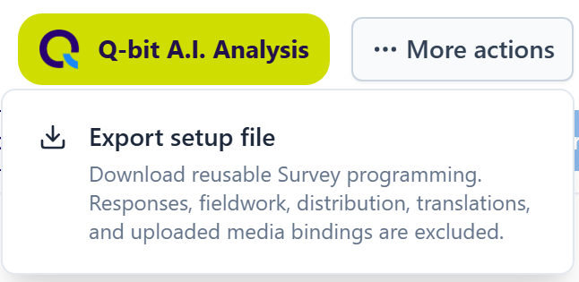

Reuse saved questions or survey setups to give a new study a reviewed starting point.

{/* Available with */}
{/* Let Q-bit do it */}

## When to use it

Choose a starting point for the work you need.

- **Clone** a standard survey when an existing questionnaire is the starting point for a new study or wave. See [Create and find a survey](./create-and-find-a-survey).
- Use the **Question Bank** when you need one saved question in another survey.
- Use **Import setup** when you have a portable setup file and need its reusable programming in a new draft.
- Use Q-bit when you want help drafting or changing a survey from your instructions. Review its proposal before accepting it. See [Review Q-bit changes](./review-q-bit-survey-changes).

Review the wording, codes, routing, and settings for the new study whichever starting point you choose.

## Use the Question Bank

For example, reuse a community-space question in a second survey.

1. In the source survey, save the eligible question in its editor. On its question card, select **Save to bank**.
2. Open the destination survey and find the page where the question belongs.
3. Select **+ Add item to page**, then **Add from Question Bank**.
4. Search for the question by title. Check **Organization** or **My own**, then select **Insert** beside the question.
5. Review the inserted wording, choices, and unique question key. Recreate any question-level visibility rules and piping needed in this survey.
6. Select **Save Draft**, then preview the question in the destination survey.

The inserted question is a separate item in the destination draft. If it is not in the list, check the search and bank view, or confirm that the source question was saved to the bank. Deleting your bank item does not remove questions already inserted into surveys.

## Export and import a setup

1. In the source survey, select **Save Draft**. Open **More actions** and choose **Export setup file**.
2. Review the reusable JSON file before sharing it. It excludes responses, fieldwork, distribution, translations, uploaded media bindings, and tracking-set links. Image references are cleared, including external image URLs and rich-text images.
3. On the Surveys page, select **Import setup**. The **Example**, **Authoring guide**, and **File structure** downloads describe the expected package.
4. Choose the project association and a JSON setup file up to 2 MB, then select **Review import**. Read the contents, effects, and warnings.
5. Select **Create draft**. Open the draft, restore or configure any excluded material, save, and test before publication.

If an import response is interrupted, use **Retry this import** to recover the same result. A setup file is not a response export or a published survey.

Restore the images, media, tracking-set links, translations, and other excluded material the new study needs. Test the restored content and its respondent presentation before publishing.
