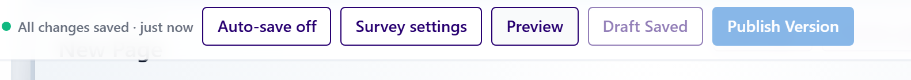

Save and coordinate edits in Survey Builder so your team can work on a survey draft before publication.

{/* Available with */}
{/* Let Q-bit do it */}

## When to use it

Save as you build or revise a survey, and coordinate editing access when another person needs to take over. For example, one editor can save and release access after writing questions, then another can review the saved draft. The editable draft is separate from the published version, and you need editing access to save changes.

## Save your work

1. Open the survey and select **Survey Builder**.
2. Make your changes.
3. If a question editor is open, select **Save** in that editor to apply its changes to the builder draft.
4. Select **Save Draft** in the builder.
5. Wait for **Draft Saved** or **All changes saved** before leaving.

To save periodically, turn **Auto-save** on. On a narrow screen, find it under **Tools**. It runs about every 45 seconds while editing and saving are available. It saves changes already applied to the builder draft, so save open question edits in the editor first. You can still save manually.

If the save status offers **Show issues**, open it, use **Go to** where available, and correct the reported items. For a failed save, use **Retry** after resolving the error. Keep the tab open while recovering work.

Saving the draft does not publish it. Use [Publish Version](./publish-a-version) after reviewing and testing the draft.

## Work with another editor

A survey can open read-only when another session holds editing access. If **Request access** is offered, select it and coordinate with the current editor. They can use **Save and release lock** to hand over their saved work, or **Release lock** when there are no changes to save. When offered, select **Take over editing** or **Resume editing** to continue. If saving fails, resolve the error before handing over.

If the takeover dialog offers the previous editor's unsaved work, choose **Resume their edits** to bring it into this tab, or **Start from the saved version**. If this tab also has unsaved changes, choose **Keep my changes** or **Use their edits instead**. The latter requires confirmation and replaces this tab's unsaved changes. Only one set can be kept in this tab. Review the result and save it.

If a newer saved draft conflicts with your unsaved work, saving pauses until you choose which version to keep. Use **Download my changes** to retain a recovery copy. **Use the saved version** discards this tab's unsaved changes. **Keep my version** retains this tab's work, and the next save replaces the changes saved elsewhere. Coordinate with the other editor before choosing, then save and check the result.
