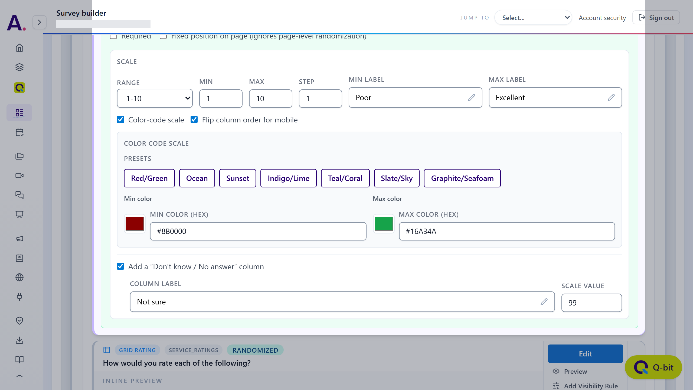
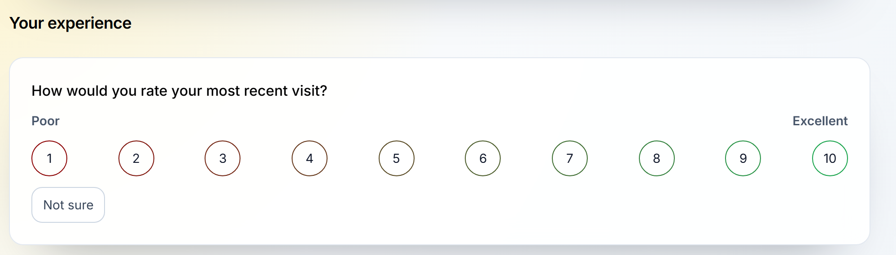
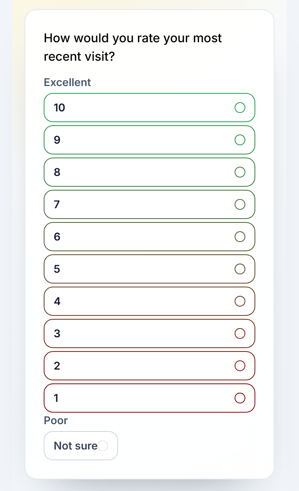

A **Scale** question collects one numeric rating from a set range with labels at its endpoints.

{/* Available with */}
{/* Let Q-bit do it */}

## When to use it

Choose it for a rating such as satisfaction from 1 to 5. Use Single select for categories without a numeric scale, or a Slider when the respondent should select along a track.

## Set the range

Choose a preset or enter **Min**, **Max**, and **Step**. Available presets include 1–3, 1–5, 1–7, 1–10, and 0–10. A new scale uses 1–5 with step 1. Choose a positive step and a range that produces the points you intend respondents to select.

Enter **Min label** and **Max label** to explain the endpoints. For example, a 1–5 satisfaction scale might use “Very dissatisfied” and “Very satisfied.” Preview every displayed point and check that the wording matches the direction.

## Optional settings

**Color-code scale** enables endpoint colour controls. **Flip column order for mobile** reverses the scale order in the compact phone layout; review the labels and order on a phone. A new scale has colour coding off and mobile reversal on.

Where offered, enable **Don't know** and give it a label and a code outside the scale range. This gives respondents a separate answer instead of forcing a rating. Save the question and draft, then test the ordinary and Don't know responses.

## Example: a ten-point visit rating

1. On the desired page, select **+ Add item to page**, then choose **Scale**.
2. Enter “How would you rate your most recent visit?” as the question text.
3. Set **Min** to **1**, **Max** to **10**, and **Step** to **1**. Enter **Poor** for **Min label** and **Excellent** for **Max label**.
4. Turn on **Color-code scale** and choose **Red/Green**. Turn on **Add a “Don’t know / No answer” column**, enter **Not sure** as the **Column label**, and set **Scale value** to **99**.
5. Select **Save**, then **Save Draft**. Preview on desktop and phone. Check the ten ratings and the separate **Not sure** choice, then try each kind of answer.

Lower ratings have red outlines and higher ratings have green outlines. If a point or label is missing, reopen the question and check the range, step, and endpoint labels before saving and previewing again.

When a respondent chooses **Not sure**, Asker stores 99. The [Standard Report's numeric charts](../reports-analysis/standard-report-chart-types) exclude that code from rating calculations and their base.

On a narrow phone screen, **Flip column order for mobile** can show 10 at the top and 1 at the bottom. Check that the endpoint labels still make the direction clear. If you do not want internal question keys in the respondent view, turn off **Show question keys** in **Survey settings → Appearance**. To check the ordinary respondent link, publish the changed survey version, then set the survey to **Live** in **Distributions**.

