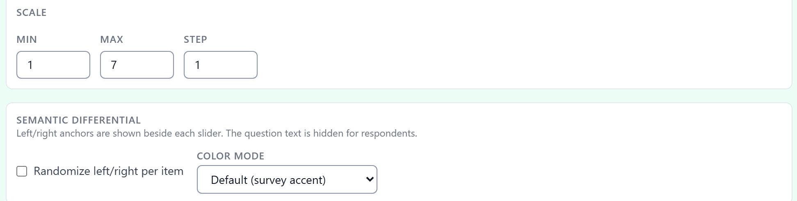
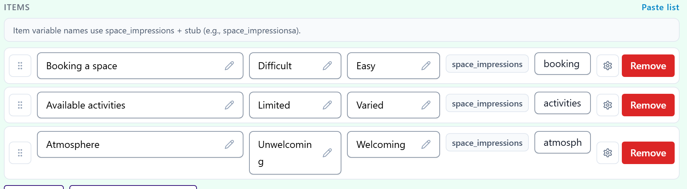
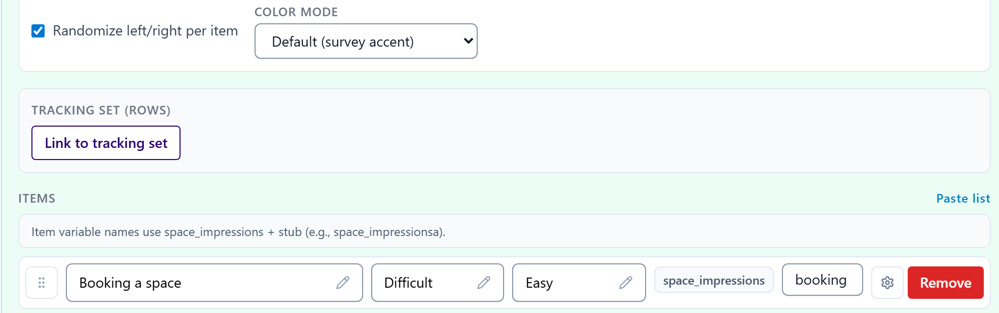
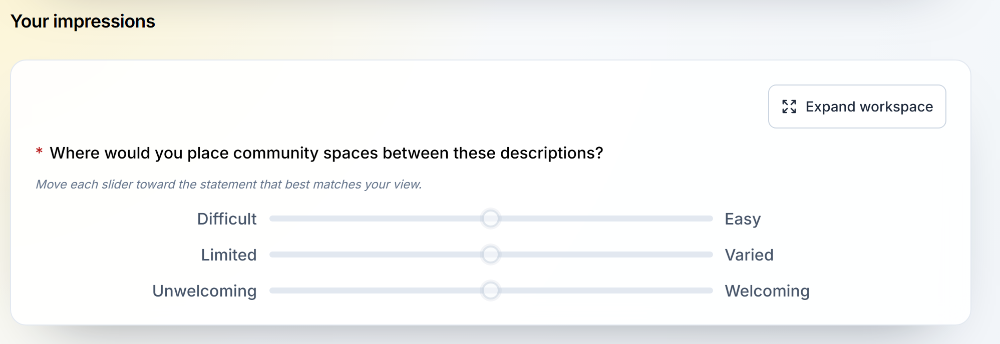
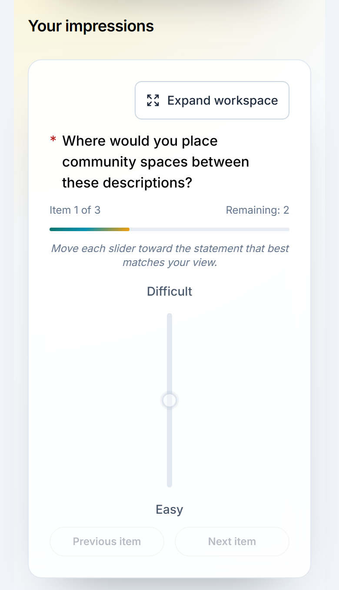

**Semantic differential** collects ratings between paired opposing descriptions for one or more items.

{/* Available with */}
{/* Let Q-bit do it */}

## When to use it

Choose it when items use paired opposing descriptions, such as “Difficult” and “Easy,” and sides may need to swap. Slider lists also allow endpoint labels for each item. For one fixed-point rating, consider Scale.

## Try three pairs of descriptions

1. On the desired page, select **+ Add item to page**, then choose **Semantic differential**.
2. Enter “Where would you place community spaces between these descriptions?” as the question text.
3. Set **Min** to **1**, **Max** to **7**, and **Step** to **1**. Leave side randomisation off for this example.
4. Under **Items**, use **Add item** to create three items with distinct stubs. Give their left and right labels as **Difficult / Easy**, **Limited / Varied**, and **Unwelcoming / Welcoming**.

   

   

5. Turn on **Required**, select **Save**, then **Save Draft**. Preview on desktop and phone and move each slider.

The respondent sees the three pairs rather than the internal item names. If the sides do not match the intended meaning, reopen the item and correct its endpoint labels before previewing again.

## Other semantic differential settings

1. Add the question and create items with a distinct stub and clear left and right labels.
2. Set the shared **Min**, **Max**, and **Step**. A new question starts at −10 to 10 with step 1 and side randomization off.
3. Review the available colour mode and the option to randomise sides. If sides can swap, check that each label still describes the intended end of its slider.
4. Add visibility rules or link an eligible tracking or piped list when needed. Linked rows are read-only while linked.
5. Save the question and draft, then test different answers and long endpoint labels on desktop and phone.

For example, ask “Where would you place community spaces between these descriptions?” Set one row's endpoints to “Difficult” on the left and “Easy” on the right. On a −10 to 10 range, choosing the “Easy” endpoint records 10 even if the respondent sees “Easy” on the left because the poles have swapped. Each row has its own response. Test the full route after changing source rows or their order, especially when another question depends on these answers.

The respondent sees the question text above the sliders. The individual item names are hidden, so make each pair of endpoint labels understandable on its own. Check the result in a full survey test.

*Separate editor example.*

