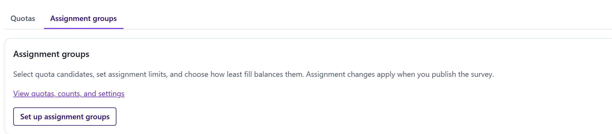
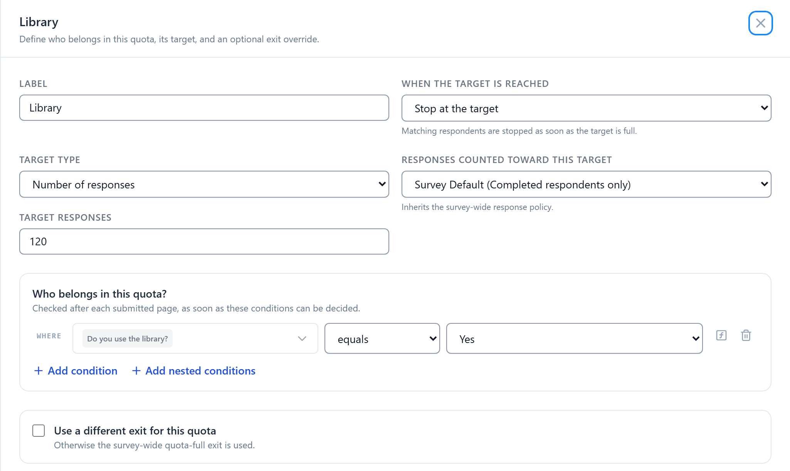
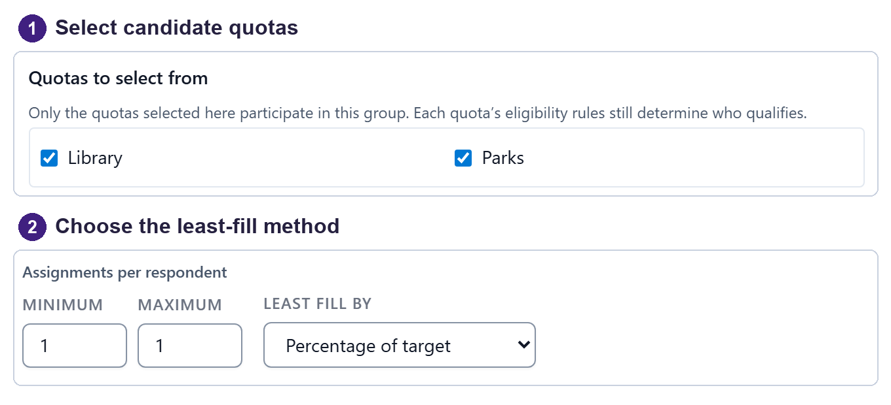
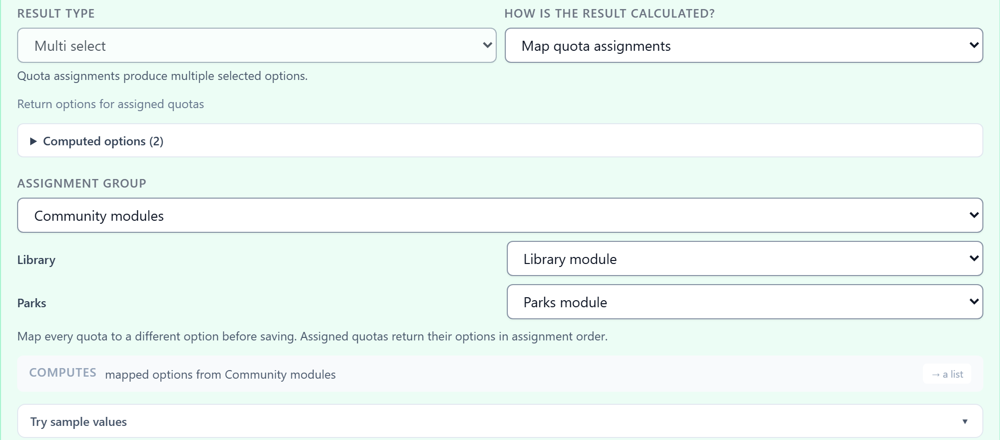
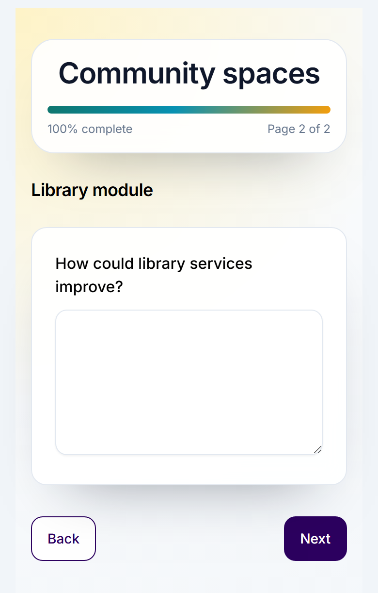
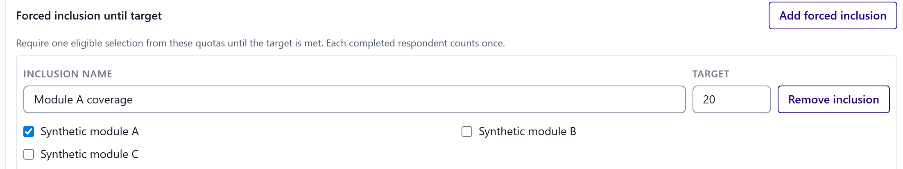

**Quota → Assignment groups** is where you set up least fill in Asker. Use it when a respondent can qualify for several quotas and you want Asker to choose which of them receive credit. Everyone can answer the same questionnaire. Showing different questions based on the assignment is optional.

{/* Available with */}
{/* Let Q-bit do it */}

## When to use it

Suppose someone uses both the library and the parks. To count that person in **both** categories, [add two ordinary quotas](./stage-quotas-and-weights#add-a-quota) and save them. To credit **one** of the two, put both quotas in an assignment group and set the maximum to 1.

Each quota’s **eligibility rule** determines who qualifies for it. The **assignment group** selects from that respondent’s eligible, available quotas. Submitting the group’s trigger page saves the selection. Completing the survey gives credit to the selected quotas in that group.

## Example: count one of two eligible quotas

A community study needs 120 Library completes and 40 Parks completes. Everyone answers the same questionnaire. You need survey editing access and a page that everyone taking this path will submit.

### Define who qualifies

1. In Survey Builder, add a page called **Eligibility**.
2. Add two required **Single select** questions: **Do you use the library?** and **Do you use parks?** Give each question **Yes** and **No** choices. Save each question, then select **Save Draft**.
3. Open **Quota → Assignment groups**. If prompted, select **Set up assignment groups** to copy current quota definitions into the draft.
4. Expand **Quota definitions for publication**. If Library or Parks already exists, edit its copied definition here.
5. Select **Add quota**. Enter **Library** as the **Label**, choose **Number of responses**, and enter **120** under **Target responses**.
6. Under **Who belongs in this quota?**, choose **Do you use the library? → equals → Yes**. Select **Stop at the target** under **When the target is reached**, then **Save quota**.
7. Repeat for **Parks** with a target of **40** and the rule **Do you use parks? → equals → Yes**. Select **Save quota**.

Check that both definitions are listed before creating the group. If a question or choice is unavailable, return to the builder, save it, and reopen the quota editor. For a tracking quota that should continue accepting assignments beyond its target, choose **Keep collecting**.

## Create a group

1. Select **Add assignment group**. Enter a **Group name**. This example uses **Community modules**. Under **Assign after page**, choose **Eligibility**. Eligibility answers can be collected on that page or earlier. Place the trigger on a page all respondents who need an assignment will submit.
2. Under **Quotas to select from**, select **Library** and **Parks**. These are the quotas that compete for assignments. A quota can belong to one assignment group.
3. Under **Assignments per respondent**, set **Minimum** and **Maximum** to **1**. For a study that seeks two assignments but can proceed with one, use **Minimum 1, Maximum 2**. Asker tries to assign up to the maximum. The minimum determines whether enough assignments were made for the group to report **Assigned**. New groups start with minimum 0 and maximum 1. Set the maximum between 1 and the number of selected quotas, up to 100.
4. Under **Least fill by**, choose **Percentage of target** for this example. **Response count** is the other method. Both take active reservations into account.
5. Select **Save Draft** and test the eligibility paths.
6. [Publish the survey version](./publish-a-version) to activate the group. The counting setup is complete when the group is published.

### Choose how Asker measures least fill

Suppose someone qualifies for both quotas, both have space, and no places are reserved. Library has **36 of 120 completes (30%)**. Parks has **16 of 40 (40%)**.

| Least fill by | Which quota receives this respondent? |
| --- | --- |
| **Percentage of target** | **Library**. It has reached 30% of its target, compared with 40% for Parks. Choose this when quotas with different targets should progress proportionally. Each candidate needs a positive target. |
| **Response count** | **Parks**. It has fewer completes, 16 compared with 36. Choose this when you want to balance counts across eligible quotas. |

Both methods include active reservations in the comparison. If Library also has 18 places held, Asker compares 54 of 120 (45%) with 16 of 40 (40%) and selects Parks by percentage. Library still has 36 completes. If someone qualifies for Parks alone, Library’s fill plays no part in their assignment.

### Check the result when everyone sees the same questions

Use a published **synthetic test survey** to check counting. With the maximum set to 1 and space in both quotas, note the current counts in **Quota → Quotas**. Complete one fresh test response that answers **Yes** to both eligibility questions. If yours is the only test response, one quota should increase by one and the other should stay at its previous count. **Refresh fills** recounts the saved assignments. [Read quota targets and counts](../fieldwork/understand-quota-counts)

## Example: assign one of two modules

To show Library questions to respondents assigned to Library and Parks questions to those assigned to Parks, reuse the same group. Add a separate page for each module after **Eligibility**.

### Show the assigned module

1. On **Eligibility**, add a [computed variable](./hidden-and-computed-variables#map-quota-assignments) called **Assigned module**. Choose **Map quota assignments**, then **Community modules**. The **Result type** is **Multi select**, even when your group selects one quota.
2. Add **Library module** and **Parks module** under **Computed options**. Map each quota to its corresponding option. Select **Save**, then **Save Draft**.
3. On the **Library** page, open **Edit visibility logic**. Set **Target** to **Assigned module**, **Operator** to **is**, and **Value** to **Library module**. Select **Save Logic**. Repeat on the Parks page with **Parks module**, then select **Save Draft**.
4. If people with no assignment should finish here, add a **Page Action** to **Eligibility**. Choose **Complete → Show a message** and write the closing message. Set the condition to **Community modules: Assignment status → is not → Assigned**. Select **Save action**, then **Save Draft**. With a minimum and maximum of 1, this sends anyone without an assignment to the message. Choose a different outcome if your study requires one. [Display logic and Page Actions](./display-logic-and-page-actions)

The computed variable can sit on the trigger page. The group assigns when the respondent submits that page, before Page Actions run. Put pages or questions whose visibility depends on the assignment **after** the trigger page.

Run a [full survey preview](./preview-and-test) with a fresh response for each row.

| Library | Parks | Expected result in this example |
| --- | --- | --- |
| Yes | No | Library module only |
| No | Yes | Parks module only |
| Yes | Yes | Exactly one module. Either can be selected when the quotas are tied. |
| No | No | The closing message configured in the Page Action |

Preview uses zero live fill and reservations. Use it to check eligibility and page routing. Use the published synthetic survey to check how fieldwork counts and reservations influence selection.

## Require an inclusion until a target

Use **Forced inclusion until target** when one eligible quota needs priority. For example, suppose Parks should take priority until 20 eligible respondents complete. Select **Add forced inclusion**, enter an **Inclusion name**, set **Target** to **20**, select **Parks**, and save the draft. Publish the change when ready.

Asker gives an eligible, available Parks quota priority while the inclusion needs places. Each completed respondent counts once toward the inclusion target, even if they received two quotas covered by that rule. Active reservations temporarily cover places. After the target is met, Parks can still be selected through ordinary least fill. For several inclusion rules, allow at least one slot per rule in **Maximum**.

## What happens when a respondent continues

**Back, reload, and resume.** A valid saved assignment stays with the response. If someone edits an eligibility answer, Asker may replace a selection that no longer qualifies. After they have answered questions that depend on that selection, changing eligibility may require a restart.

**An assignment is missing or smaller than expected.** Check that the respondent submitted the page chosen under **Assign after page**, matched the quota rules, and had an available place. A group can keep a partial selection even when it falls short of its minimum. With no selection, the group reports a reason even if the minimum is zero. Use **Assignment status** if the survey should take a different path in that case.

| Assignment status | What to check |
| --- | --- |
| **Assigned** | The respondent has an available selection and the group met its minimum. |
| **No eligible quotas** | Check the respondent’s answers against the membership rules for the quotas in the group. |
| **Targets met** | Check completed counts against the eligible quotas’ targets and their behaviour at capacity. |
| **Capacity reserved** | Check for places held by in-progress respondents. If the minimum is greater than one, also check whether enough distinct quotas were eligible and available. |

## Review and publish

**Save Draft** keeps group changes and quota definitions for the next version. They take effect when you [publish the survey version](./publish-a-version). Use **View quotas, counts, and settings** to inspect current fieldwork. If publication reports that definitions changed, review the current quota definitions and your pending edits. Changing response counts alone does not cause this conflict.

**Reload current quota definitions** replaces pending quota definition edits, including imported definitions. It keeps assignment groups and draft weights. If a selected quota is missing from the current definitions, remove or replace it in **Quotas to select from** and any forced-inclusion rule before reloading. **Discard draft quotas** removes draft quota definitions and assignment groups together. Current quotas and draft weights are retained. Update dependent logic first.

For a survey that already has responses, keep the quotas those responses use. Create new quotas for a materially different assignment design. [Manage quotas and weights](./stage-quotas-and-weights)
