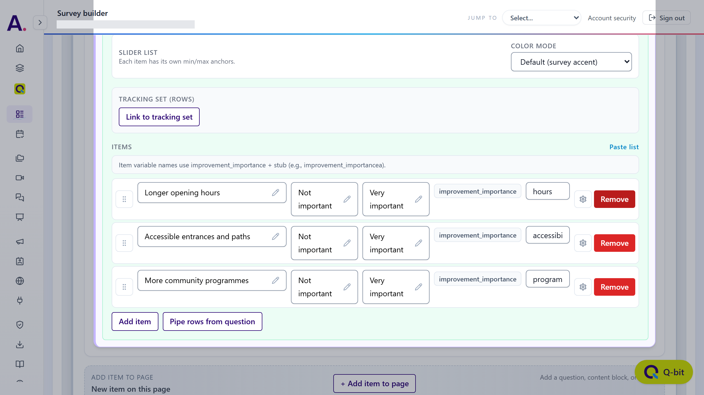
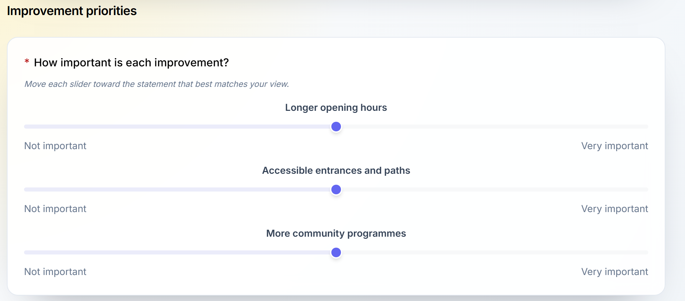
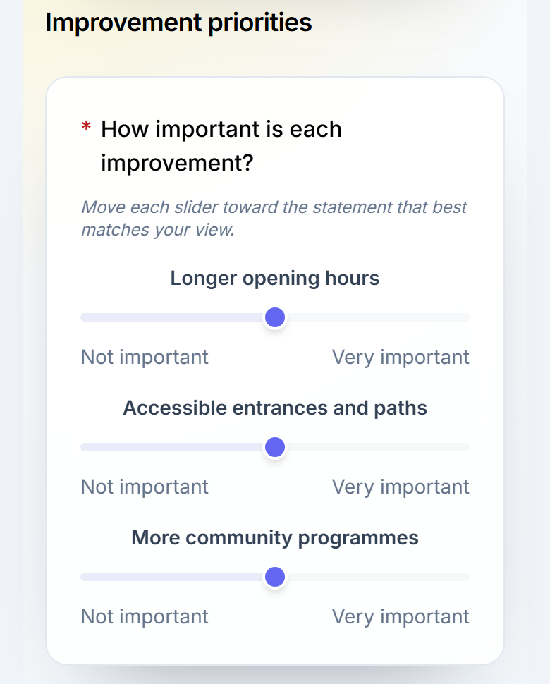

A **Slider list** presents a slider for each item using a shared range.

{/* Available with */}
{/* Let Q-bit do it */}

## When to use it

Choose it when respondents should rate several statements on the same range. A slider list can also have endpoint labels for each item. Use a single Slider for one rating, or Semantic differential for paired opposing descriptions with optional side randomisation.

## Try three improvement ratings

1. On the desired page, select **+ Add item to page**, then choose **Slider list**.
2. Enter “How important is each improvement?” as the question text.
3. Set the shared **Min** to **0**, **Max** to **10**, and **Step** to **1**.
4. Under **Items**, use **Add item** to create **Longer opening hours**, **Accessible entrances and paths**, and **More community programmes**. Give each a distinct stub. Use **Not important** and **Very important** as the endpoint labels for each item.
5. Turn on **Required**, select **Save**, then **Save Draft**. Preview on desktop and phone and move each slider.

The respondent sees a separate slider for each improvement. If a row or endpoint is missing, reopen the question, check the row and its labels, and preview again.

## Other slider-list settings

1. Add a Slider list and enter the question wording.
2. Set the shared **Min**, **Max**, and **Step**. A new list starts at 0–100 with step 1 and shared colours.
3. Add rows with clear labels and distinct stubs. Arrange them in the desired order and use row visibility rules where needed.
4. Add or review each item's endpoint labels and the available shared or per-row colour settings. A linked tracking set or piped list is read-only while linked.
5. Save the question and draft. Test several completed rows and the phone layout, including long item labels.

For example, use a 0–10 range for several service attributes. Each row receives its own answer. If rows depend on an earlier selection, check the full respondent route using [piping](./pipe-answers-and-choices).

