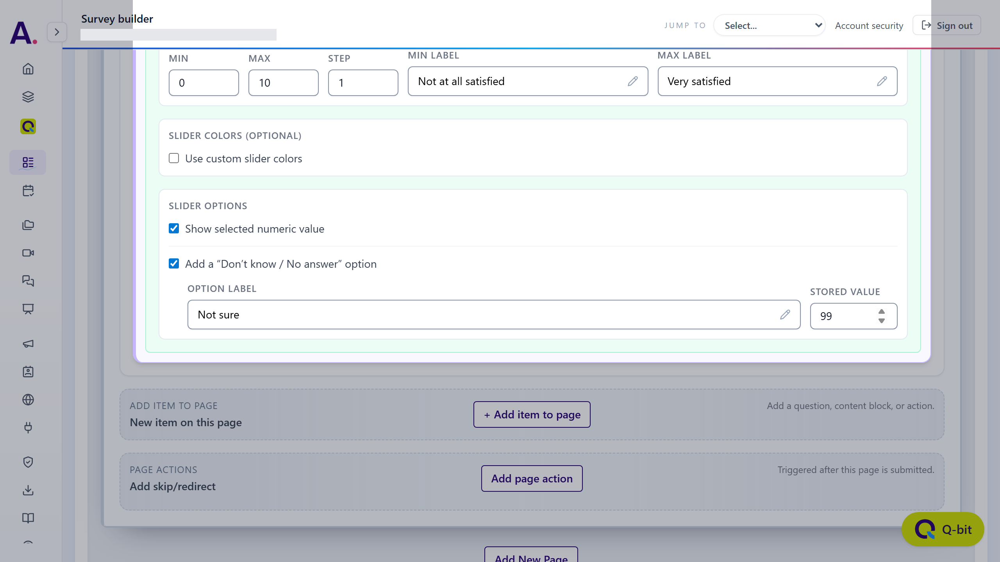
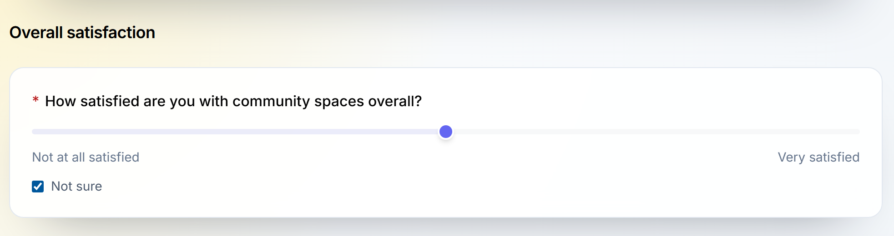
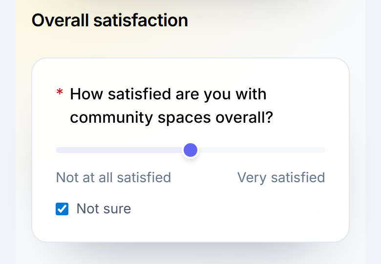

A **Slider** collects a value chosen along a continuous or stepped track.

{/* Available with */}
{/* Let Q-bit do it */}

## When to use it

Choose it for one rating on a range, such as a 0–100 assessment. Use a Slider list for several items with the same range, or Scale when the respondent should select from displayed scale points.

## Try a satisfaction slider

1. On the desired page, select **+ Add item to page**, then choose **Slider**.
2. Enter “How satisfied are you with community spaces overall?” as the question text.
3. Set **Min** to **0**, **Max** to **10**, and **Step** to **1**. Set the endpoint labels to **Not at all satisfied** and **Very satisfied**.
4. Turn on **Show selected numeric value** and **Add a “Don’t know / No answer” option**. Enter **Not sure** as the **Option label** and **99** as the **Stored value**.
5. Select **Save**, then **Save Draft**. Preview on desktop and phone, move the slider, and select **Not sure** separately.

The respondent can choose a position on the track or select **Not sure**. If the separate answer is missing, reopen the question and check its label and setting before saving and previewing again.

## Other slider settings

1. Add a Slider question and enter its wording.
2. Set **Min**, **Max**, and **Step**, then add **Min label** and **Max label**. A new slider starts at 0–100 with step 1, colour coding on, selected-value display off, and Don’t know off.
3. Choose whether to show the selected value, and review the available colour settings. Use endpoint wording that remains clear without colour.
4. If appropriate, add **Don’t know / No answer** with a label and a **Stored value** outside the slider range. This keeps the skip code distinct from a rating.
5. Save the question and draft. Test an untouched slider, both ends, a middle value, and the optional skip on desktop and phone.

For example, set a range of 0 to 10 with step 1 and label the ends “Not at all satisfied” and “Very satisfied.” A respondent selects a position in that range; test how the selected value appears with your display setting.

The track can show a midpoint before an answer has been selected. Ask the respondent to make a selection rather than treating that position as a completed answer. Check the saved response and validation in a full survey test.

On a 0–10 slider, you could use 99 as the **Stored value** for **Not sure**. Asker records 99 for that response and excludes it from the [Standard Report's numeric slider charts](../reports-analysis/standard-report-chart-types) and their rating base.

