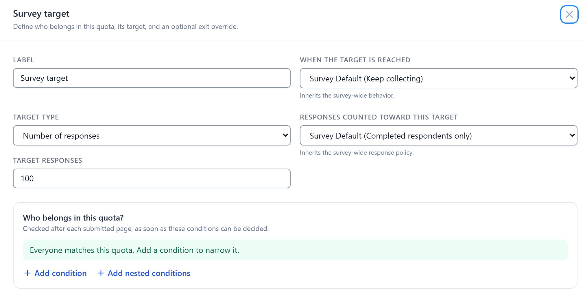
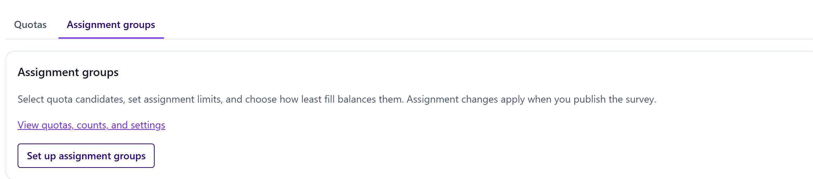
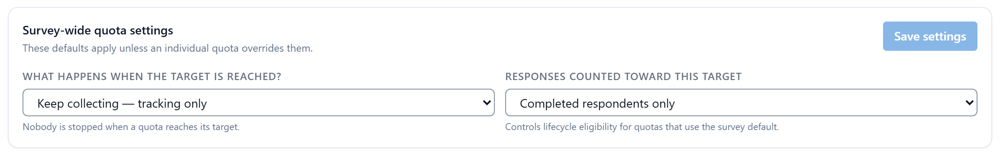
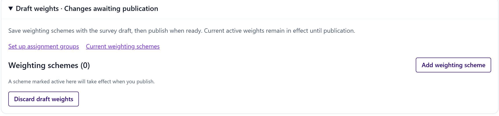
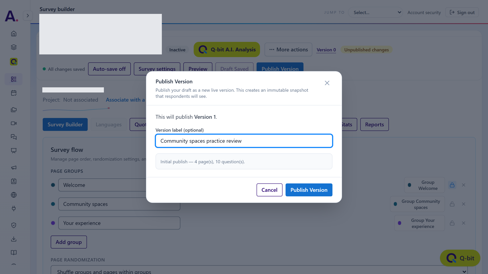

Quotas track or limit which responses you collect. Weights adjust how collected responses contribute to a report. Use the survey's current settings for immediate changes, or prepare definitions to publish with the next survey version.

{/* Available with */}
{/* Let Q-bit do it */}

## When to use it

Use **Quotas** to set collection targets and monitor counts. Use **Weightings** when a researcher has supplied population targets and a report needs to reflect them. Prepare settings for publication when they need to change alongside a new survey version.

## Add a quota

For this example, first add and save a single-select question, “Do you use the library?”, with **Yes** and **No** choices. The quota will track respondents who answer Yes.

1. In the survey navigation, select **Quota**. Open the **Quotas** tab and choose **Add quota**.
2. Enter **Library** as the **Label**.
3. Under **Target type**, choose **Number of responses** and enter **120** under **Target responses**.
4. Under **Who belongs in this quota?**, choose “Do you use the library?”, set the operator to **equals**, and select **Yes**.
5. Under **When the target is reached**, choose the tracking-only option beginning **Keep collecting**. Review which responses count toward the target.
6. Select **Save quota** and confirm that **Library** appears in the quota table. If it is missing, reopen the editor and check for a validation message before saving again.

**Save quota** updates current fieldwork settings immediately. For a limit instead, choose **Stop at the target**, or use the survey default. A target can also be a **Percentage of total target**. Each ordinary quota counts qualifying responses according to its own rules. Use [Set and monitor survey quotas](../fieldwork/set-and-monitor-quotas) for survey-wide defaults, full-quota exits, and counts.

## Set up least-fill quotas

Use [Assignment groups](./set-up-quota-assignment-groups) to balance credit across eligible quotas. In **Quota → Assignment groups**, choose the candidate quotas, trigger page, number of assignments, and **Least fill by** method. Save the draft and publish the group. On completion, only the quotas selected for that respondent in the group receive credit, even when everyone answers the same questionnaire.

## Apply weights to a report

In **Weightings**, create and save a scheme. In a Standard Report, pick the saved **Weighting scheme** and select **Apply changes**. The picker includes inactive schemes. Standard Reports use top-level **Target** cells. See [Create and manage weighting schemes](../reports-analysis/manage-weighting-schemes) for how the report handles unsupported cells and unmatched responses.

## Optional: Prepare quota definitions for publication

Use publication definitions to coordinate quota changes with a new survey version. This is also where you prepare quota definitions used by an [assignment group](./set-up-quota-assignment-groups).

1. In the survey navigation, select **Quota**, then open **Assignment groups**. Select **Set up assignment groups** to copy the current quota definitions into the draft.
2. Open **Quota definitions for publication** to add or edit quota labels, targets, conditions, and overrides. Select **Save quota** in each editor.
3. If needed, [set up assignment groups](./set-up-quota-assignment-groups) using those definitions. Select **Save Draft** in the survey header.

To check fieldwork progress while preparing publication definitions, choose **View quotas, counts, and settings**. Ordinary changes in response counts can continue during preparation. If someone edits the current quota definitions after you prepare the copy, publishing can report a conflict. Review the current definitions before using **Reload current quota definitions**. Reloading replaces staged definitions, including imported edits, and keeps assignment groups and draft weights. If a group references a removed quota, update that selection before reloading.

## Prepare weights for publication

1. Open **Builder**, expand **Draft weights**, and select **Prepare draft weights** to copy current schemes into the draft.
2. Add or edit schemes and cells. For Standard Reports, use top-level **Target** cells with percentages that total 100%. Save each scheme and check its activation status. Publication saves the schemes and their status to **Weightings**.
3. Select **Save Draft** in the survey header. Use **Current weighting schemes** to inspect live schemes.

## Review and publish

Save the draft before opening **Publish Version** so the change summary reflects the saved draft. On a narrow screen, the control reads **Publish**. Review the listed survey and research settings, then [publish the version](./publish-a-version). After publishing, confirm the definitions under **Quotas** and confirm the weighting scheme under **Weightings**.

**Discard draft quotas** removes the draft quotas and assignment groups, while keeping draft weights and current live quotas. Update any computed variables and logic rules that refer to removed groups before saving. **Discard draft weights** removes the draft weighting definitions while keeping draft quotas, assignment groups, and live weights. If current definitions cannot be loaded, reconnect before preparing them. If editing is paused, regain editing access before applying an open editor.
