A survey collects answers to questions you prepare and share with respondents.

{/* Available with */}
{/* Let Q-bit do it */}

## When to use it

Follow this example to create a first survey with one question, test it, and open a direct link. You need access to Asker and your organisation, and to the project if you use one. For practice, use a synthetic survey and fictional answers.

## Create the survey

1. Open **Surveys**.
2. Select **Create survey**.
3. Enter `Community spaces survey` as the **Survey title**.
4. Under **Project (optional)**, leave **No project** selected for this example. To use a project, choose **Select existing**, then choose one you can access.
5. Select **Create survey**. **Survey Builder** opens for the new survey.

   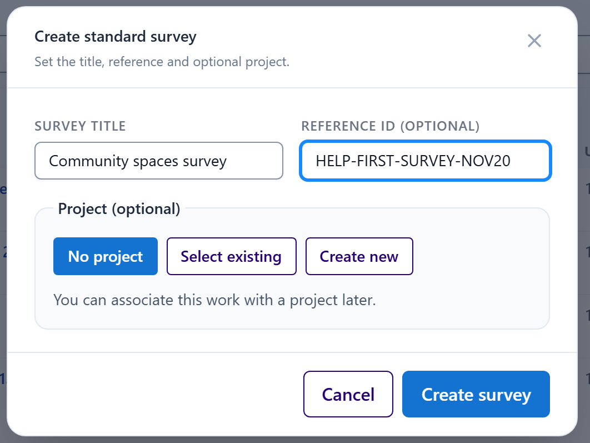

The survey is a draft. Creating it does not publish the survey or send invitations. If you cannot find it later, check your project scope and filters. See [create and find a survey](./create-and-find-a-survey).

## Add a question and save

1. Select **Add First Page**. A page appears in the builder.

   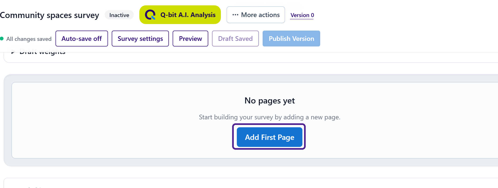

2. On that page, select **+ Add item to page**.

   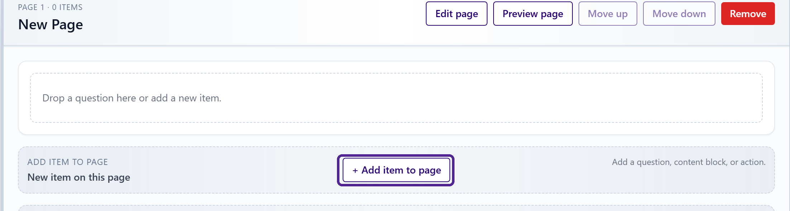

3. Select **Single select**. The question editor opens.
4. In **Question text**, enter `Which community space do you visit most often?`

   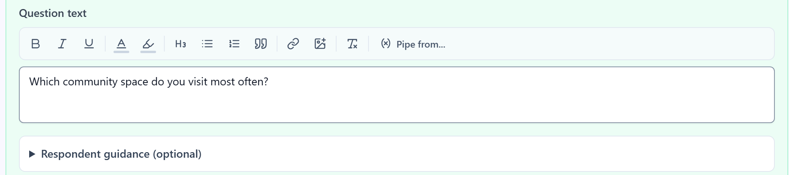

5. Under **Response options**, select **Paste list**.
6. Enter `Library`, `Community centre`, and `Park`, each on a separate line.
7. Choose **Replace list**.
8. Select **Insert items**. Check the labels and their distinct values.

   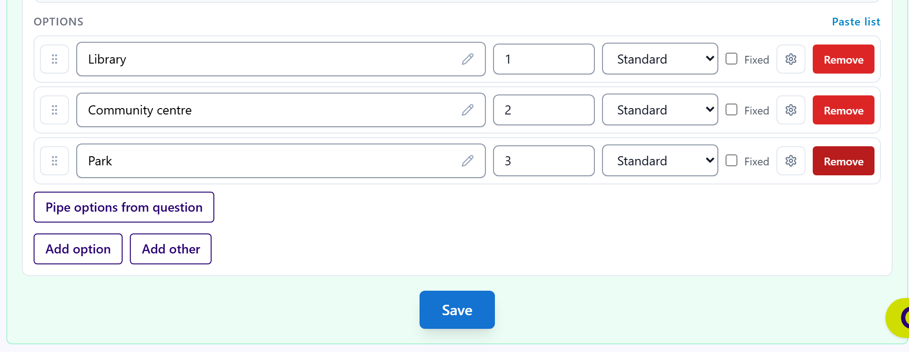

9. Select **Save** in the question editor. The question is applied to the builder draft.
10. Select **Save Draft** in the builder. Wait for **Draft Saved** or **All changes saved** before leaving.

   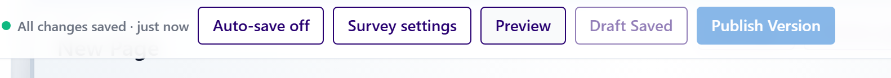

Saving the question and saving the survey draft are separate steps. If saving reports an issue, use **Show issues** or the displayed message to find it, correct it, and retry. See [add questions](./add-and-edit-questions) and [save your draft](./save-and-collaborate).

## Preview and publish

For the practice survey, open **Survey settings → Appearance**, clear **Show question keys**, and select **Apply settings**. Save the draft if the builder shows **Save Draft**. The preview will show the question without its internal key.

1. Select **Preview** in the builder. On a narrow screen, find it under **Tools**.
2. Answer the question with a fictional answer and continue through the survey.

   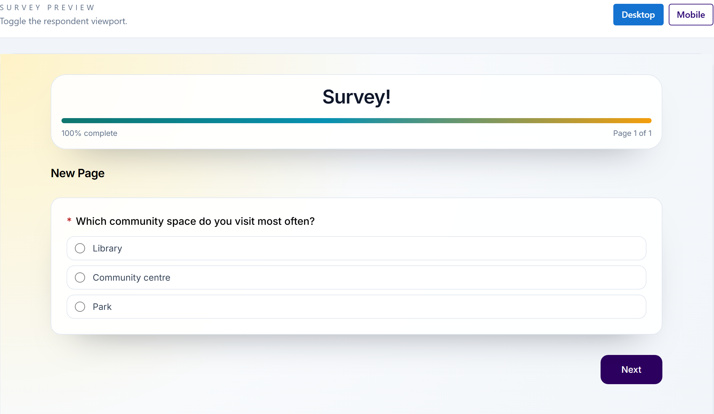

   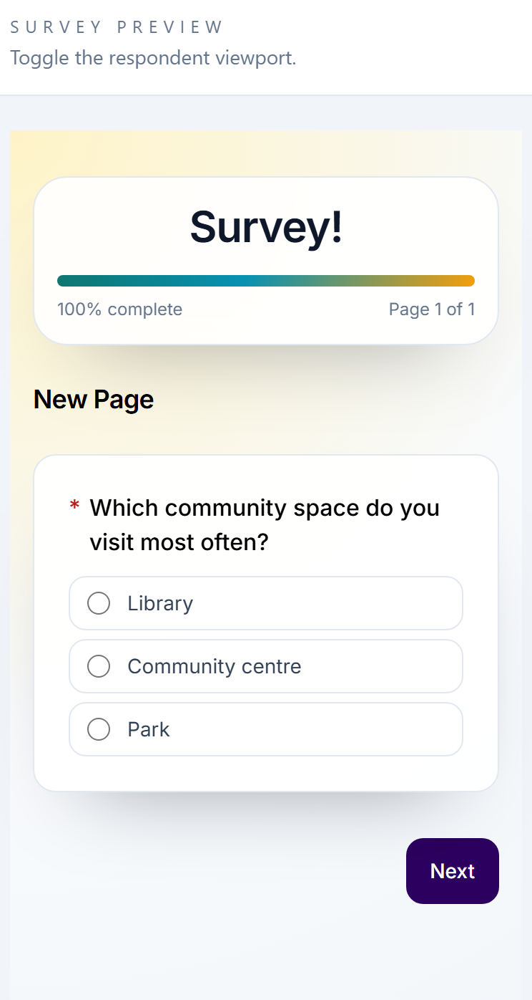

3. Return to the builder, correct any problems, and save the draft. Preview again after changes.
4. Select **Publish Version**. On a narrow screen, the control reads **Publish**.
5. Review the change summary and enter a **Version label (optional)** if useful.

   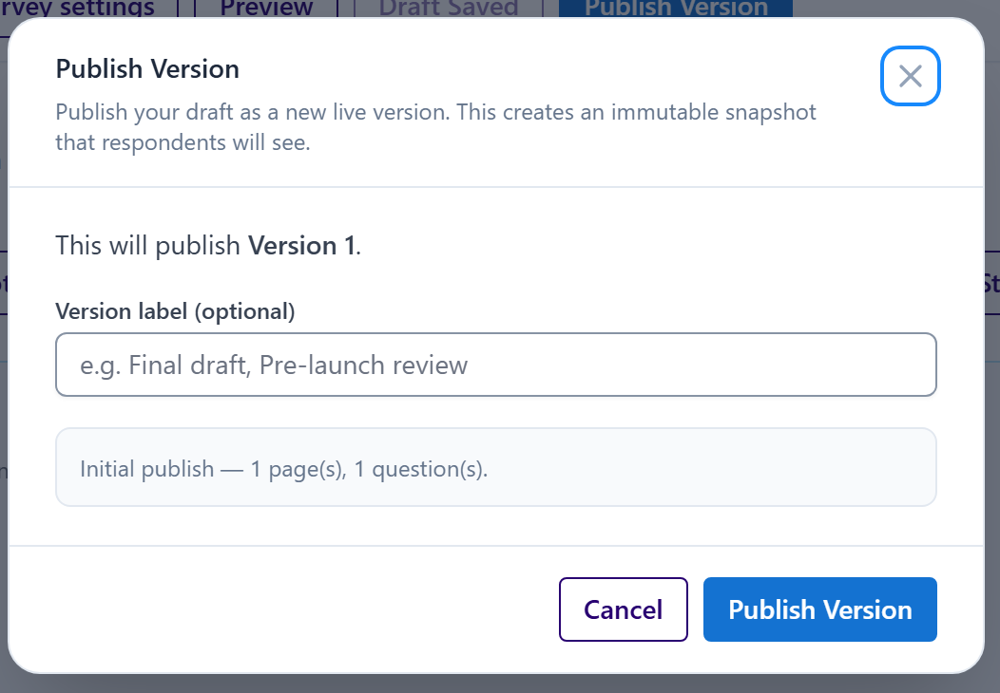

6. Select **Publish Version** in the dialog.
7. Select the version number in the builder to open **Version History**. On a narrow screen, find the version number under **Tools**. Confirm that the new version appears.

   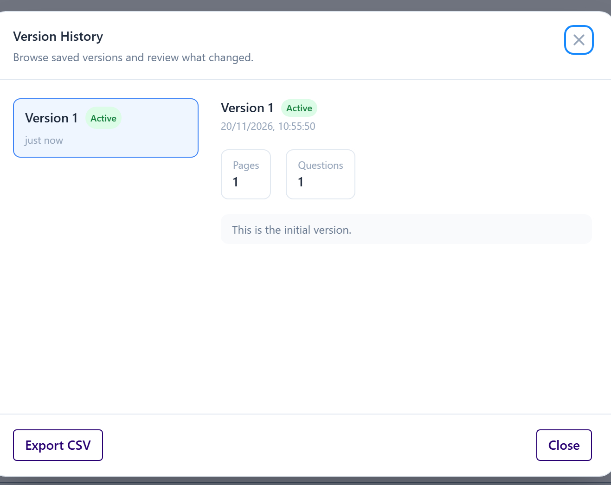

The preview uses the saved draft. It does not confirm that the published respondent link is open. If a publication response is interrupted, check **Version History** before retrying. See [preview and test](./preview-and-test) and [publish a version](./publish-a-version).

## Open a direct link

1. Open **Distributions** in the survey.
2. Under **Live survey URLs**, find the link labelled **Default**. A full preview creates it if the survey had no link.
3. If there is no link, select **Add link**. Asker creates one immediately.
4. Select the link row to expand it. Check that the control says **Close**. If it says **Reopen**, select **Reopen** to open that link.
5. When the published survey and link are ready, select **Live** under **Distribution status**. Check that the status shows **Live**.
6. Use the link's **Open** action to check its respondent URL, or use **Copy URL** to copy it. The expanded link also identifies the **Respondent URL** and **Preview URL** separately.

   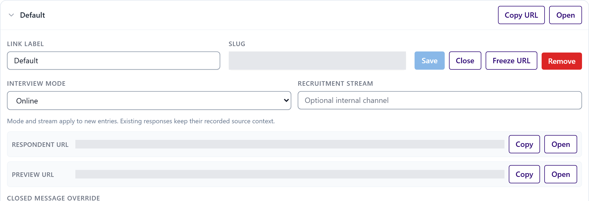

On an approved test link for a synthetic survey, complete the respondent journey with fictional answers. A respondent URL can create a real response, so follow your organisation's testing process and keep test results separate from customer data. A completion message or redirect shows that you reached the end; check **Responses** as well to confirm the recorded result. When ready, share the intended respondent URL with the approved audience. See [direct links](../fieldwork/manage-direct-links).

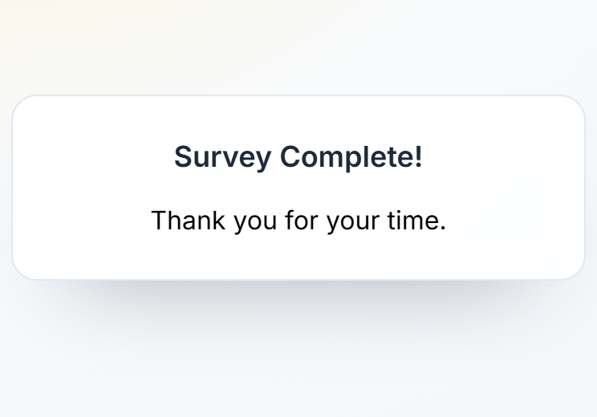

If the link is closed or unavailable, check the survey's **Live** status, the individual link, and whether the survey is archived. Publishing a version, setting the survey to **Live**, and opening a link are separate actions. None sends an invitation.

## Check the first response

1. Return to the survey and open **Responses**.
2. If you do not see the response, select **Clear filters** when it is available and check the date and status filters.
3. Select the response row to open **Response details**.
4. Check the **Complete** status, **Direct link** source, and recorded answer. A preview response has a **Preview** badge.

   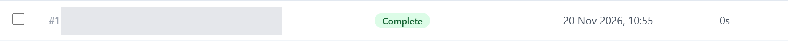

   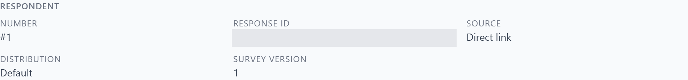

   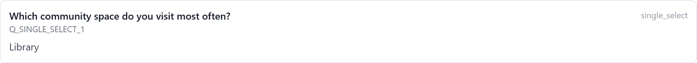

Use [Fielding Stats](../reports-analysis/monitor-fieldwork) to monitor starts and completions, and [Responses](../reports-analysis/review-survey-responses) to inspect individual answers.

## Invite an email list instead

To invite a sample by email, [create a campaign](../fieldwork/create-a-campaign), add contacts, and prepare the invitation. Once the survey, sample, and message are ready, open the campaign's **Send** tab and choose **Schedule** or **Send invite now**. Creating a campaign does not send it. See [schedule and send a campaign](../fieldwork/schedule-and-send-a-campaign).

If you are recruiting through a panel supplier, see [choose and activate survey distribution](../fieldwork/activate-distribution).
