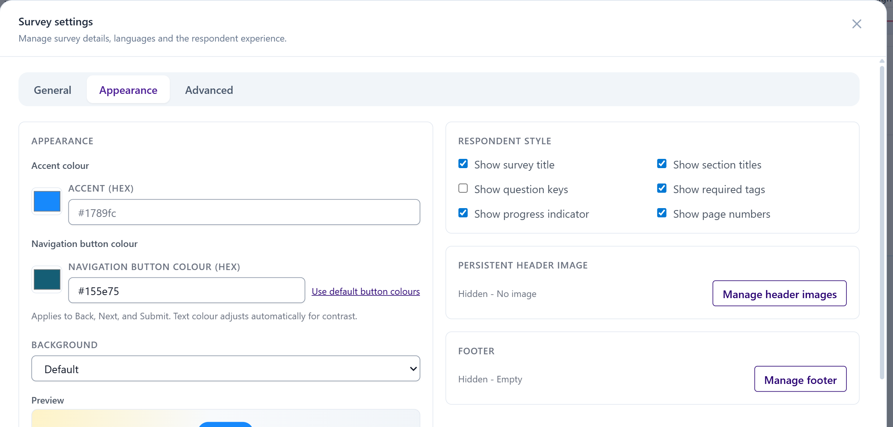
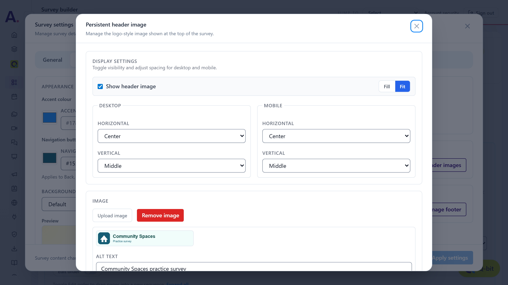
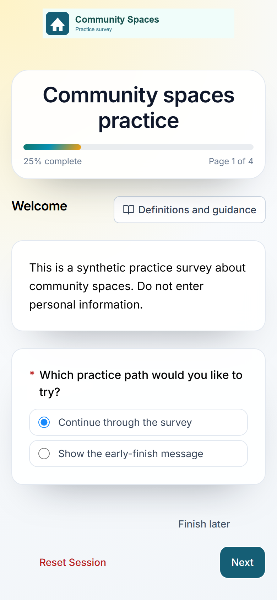
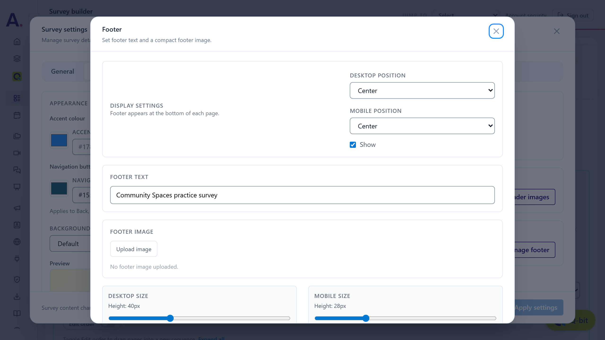
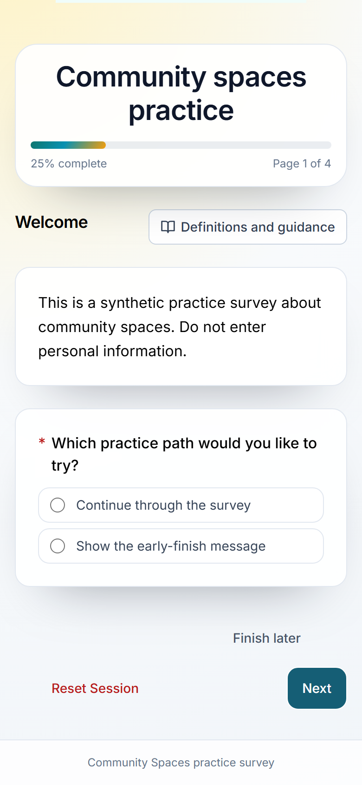

Set survey appearance and navigation to make the respondent experience readable and consistent with the survey's needs.

{/* Available with */}
{/* Let Q-bit do it */}

## When to use it

Use **Survey settings** to choose what respondents see around the questions and which navigation controls are offered. For example, add a descriptive browser title and allow respondents to finish later for a longer survey. Review the result in both desktop and phone previews.

## Try a browser title and respondent view

1. In the builder, open **Survey settings**. On a narrow screen, find it under **Tools**.
2. Under **General**, enter **Community spaces survey** as the **Browser title**.
3. Open **Appearance**. Under **Respondent style**, turn off **Show question keys**.
4. Select **Apply settings**, then **Save Draft** in the builder.
5. Select **Preview** and check the browser tab and a question on desktop and phone. The tab shows the browser title, and question keys do not appear beside the question.

If the result is unchanged, return to **Survey settings**, check the title and setting, select **Apply settings**, and save the draft before previewing again. These draft changes reach new respondents after publication.

## Titles and presentation

Set the **Internal name** for staff and the **Browser title** for the respondent's browser tab. Selecting **Apply settings** saves the internal name and applies appearance changes to the working draft. In the style settings, choose whether to show the survey title, section titles, question keys, required tags, progress, and page numbers.

Choose an accent, navigation button colour, and background. Background options include the default, a solid colour, a gradient, or an image. Check the contrast guidance and read the preview, especially with long text and a selected answer. Use labels as well as colour to communicate meaning.

A persistent header image can have separate desktop and mobile position and sizing. Add useful alt text for an image that conveys information. The footer can include text and an image, with separate desktop and mobile positioning.

## Navigation

**Allow back navigation** and **Allow save progress** are enabled by default. **Show 'Reset Session'** is off by default. When save progress is allowed, respondents may see **Finish later**, which provides a private continuation link. Treat it like access to that respondent's session. Control availability also depends on the respondent session.

Select **Apply settings**, then save the draft. Test the relevant controls in a full survey journey. Publish a version to make the appearance and navigation changes available to new respondents.

Check the published respondent journey on an approved test link as well. A preview helps inspect the saved draft, but it does not verify the published respondent entry or link availability. Testing through a respondent URL can create a real response, so use synthetic answers and follow your organisation's testing process.

