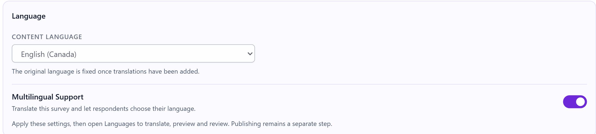
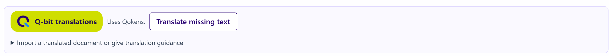

**Languages** is the survey builder's workspace for preparing, reviewing, and previewing a second respondent language. Enable **Multilingual Support** in **Survey settings** before opening it.

{/* Available with */}
{/* Let Q-bit do it */}

## When to use it

Use Languages when respondents need a survey in Canadian English and Canadian French. Prepare the second language before publishing it, and review it again whenever the original wording changes. For example, a community survey's questions, answer choices, instructions, and closing text all need to make sense in French before you offer French to respondents.

## Enable Languages

1. In the survey builder, open **Survey settings → General**. Under **Language**, confirm the **Content language** is the language of the wording you have authored. Changing this selection does not translate existing text.
2. Turn on **Multilingual Support**, then select **Apply settings**. The **Languages** area becomes available.
3. Select **Save Draft** to keep the setting when you return to the survey. Opening Languages or saving a draft does not publish a new respondent version.

The original content language becomes fixed once translations have been added. Choose it before your team starts translating.

## Try translating one item

For this example, start with an English survey that has a page titled **Welcome** and has **Multilingual Support** enabled.

1. Open **Languages** and find the **Welcome** page title in **Survey content**.
2. Open the item and enter **Bienvenue** as its French wording.
3. Compare it with the original, then select **Mark reviewed**.
4. Select **Save Draft**.
5. Choose that page under **Preview page**, then select **Preview French draft**. Check that the page title reads **Bienvenue**.

Other items may still appear in English until they are translated. If the title does not appear as expected, reopen the item, check its French wording and review status, save the draft, and preview again. Complete the remaining review items before offering French to respondents.

## Translate and review the wording

1. Open **Languages**. Read any blockers at the top of the page. Resolve them before offering the second language.
2. Use **Translation status** to find **Missing**, **Needs review**, and **Source changed** items. The **Survey content** and **Interface and system messages** views help you check both authored wording and messages respondents may see.
3. Open an item to compare the full original with its translation. Enter the target wording, check its meaning and formatting, then select **Mark reviewed**. **Use original wording** is available when the original text should deliberately appear in both languages.
4. Repeat until the review count is clear. If the original survey text changes later, return to the **Source changed** items and review the new wording. A previous review does not approve a changed source.

## Use Q-bit translations

With a saved multilingual survey and access to Q-bit translations, open **Languages** and expand **Translation preferences and organisation terminology** to check your organisation's guidance. Under **Q-bit translations**, choose **Translate missing text** to prepare draft suggestions for untranslated items. To translate a specific item, select its row and choose **Translate 1 selected**. The number changes with your selection. Existing translations stay in place by default. Use **Replace existing wording in this selection** only when you intend to replace them. Translation jobs use Qokens. The floating Q-bit launcher directs you to **Languages** for this task. If the translation control is unavailable, check your editing access and whether your organisation has enabled Q-bit translations, then save the draft and try again.

If you already have translated wording, expand **Import a translated document or give translation guidance**. Add any **Terminology or translation guidance**, select your document, and choose **Import with Q-bit**. Use a readable DOCX, PDF, TXT, MD, PPTX, XLSX, or CSV file up to 8 MB. Q-bit matches passages from the document to questionnaire items. Inspect the supporting passages and any notes about uncertain or missing matches. Complete unresolved translations in **Languages**.

Compatible suggestions appear in the working draft as the job completes. Review them alongside the original, including question text, answer choices, and messages. Select **Mark reviewed** for wording you approve, then use **Save Draft**. To request suggestions automatically after saved source edits, opt in under translation preferences. Review remains required before offering the language.

For a larger translation, expand **Excel translation exchange**. **Download Excel** provides the current text, and **Upload translations** checks a completed workbook before anything is applied. In **Review imported translations**, choose the compatible changes to add to the working draft. Imported wording still needs review, followed by the usual **Save Draft** action. Blank workbook cells leave existing translations unchanged.

## Work with an external translator

1. In **Languages**, select the items to share, or leave the selection empty to share all translatable items, including interface messages. Expand **External translators** and select **Create assignment**.
2. Enter the assignment title, translator's name, and email address. Choose the starting translations and access period, then select **Create assignment**. This saves the current survey draft.
3. Copy the **Invitation link** and share it with the named translator. The translator opens it, selects **Send my code**, and enters the six-digit code sent to their invited email address. They select **Open translation**. They do not need an Asker account.
4. The translator edits the assigned wording, selects **Mark ready** for finished items, and selects **Submit for review**. Their edits save in their workspace and remain separate from the survey draft until accepted.
5. In **External translators**, select **Review submissions**. Open a submission and use **Compare wording** to review the original, current survey translation, and submitted translation. Select the items to accept and choose **Accept and save draft**. To request changes, enter feedback and choose **Return selected**.

Review source changes or conflicts before accepting wording. Accepting saves the survey draft, including other current edits. Preview the language and publish the survey version when the wording is ready.

## Preview and offer the second language

1. Choose a **Preview page**, then select **Preview French draft** or **Preview English draft**. Check long labels, instructions, answer choices, and validation messages in the phone layout.
2. Test each route that reveals conditional content. Correct unclear or missing wording and save the draft.
3. When the survey has no remaining review items or blockers, select **Offer Canadian French when published** or **Offer English when published**, as appropriate. The control stays unavailable while required review or blockers remain.
4. Select **Save Draft**, then use the survey's usual publication controls when it is ready. Test the published respondent journey in every offered language, including the final page.

The draft preview warns when text still needs attention. Reviewed translations can appear beside original-language wording that has not been translated yet. Answers entered in this page preview are temporary; use a full survey test to check piping and routing.

If **Languages** is missing, return to **Survey settings → General** and confirm **Multilingual Support** was applied and the draft was saved. If **Multilingual Support** is absent, an administrator can confirm whether it is available for the survey type and environment. If the text list cannot load, check that the draft is valid, then reopen Languages.
