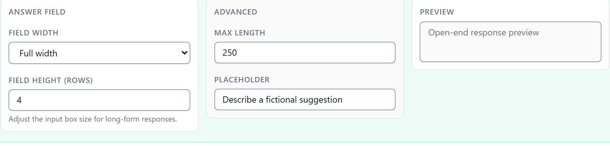
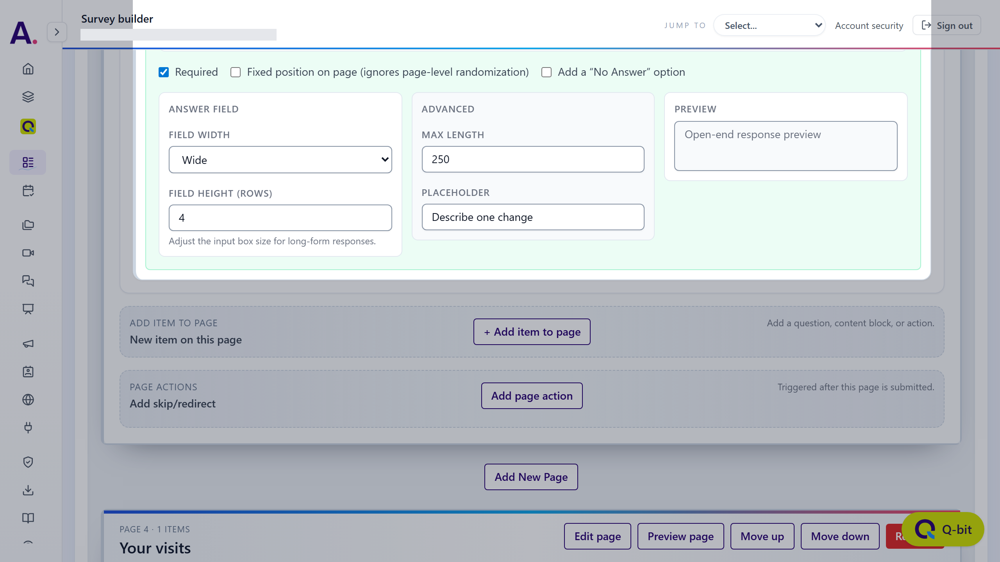
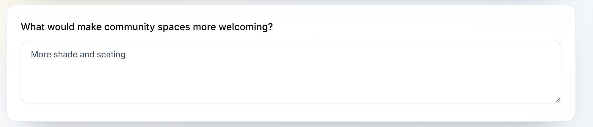
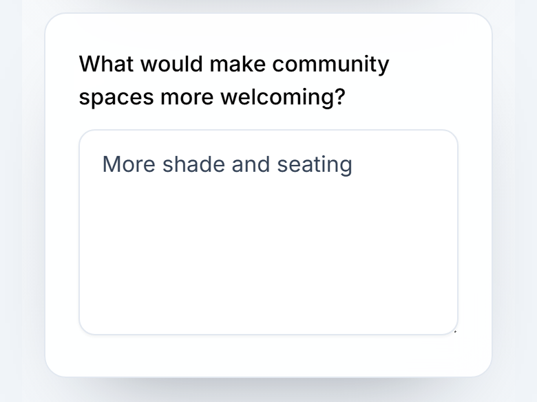

**Open end** and **Textbox** questions collect written responses from respondents.

{/* Available with */}
{/* Let Q-bit do it */}

## When to use it

Choose **Open end** for a longer, multi-line explanation and **Textbox** for a short, single-line answer. Use Numeric entry when the answer should be treated as a number. Add the question, enter its wording, and decide whether it is required.

## Try an open-end question

1. On the desired page, select **+ Add item to page**, then choose **Open end**.
2. Enter “What would make community spaces more welcoming?” as the question text.
3. Set **Max length** to **250** and enter “Describe a fictional suggestion” as the **Placeholder**.

   

4. Select **Save** in the question editor, then **Save Draft**.
5. Preview on desktop and phone. Enter “More shade and seating” and check that the answer fits in the multi-line field.

If the prompt or placeholder is wrong, reopen the question, correct it, and preview again. The placeholder disappears when the respondent enters an answer.

## Size and instructions

*Separate editor example.*

Both types provide **Field width**, **Max length**, and **Placeholder**. Open end also provides **Field height (rows)**. New open-end questions start with a full-width, four-row field; new textbox questions start at medium width. A custom width is available from 120 to 1,600 pixels. Check the field on a phone because the available width is smaller.

Use placeholder text as an example, not as the only instruction. An optional No Answer control can give respondents a way to indicate they do not wish to answer; edit its label where offered.

## Validate a textbox

Textbox offers **Validation**, including numeric formats, email, phone, date, Canadian postal formats, U.S. ZIP, and a custom pattern. For a custom pattern, enter a regular expression and, if needed, an **Error message (optional)**. Write a message that explains how to correct the entry.

For example, choose email validation for an email field, then test a valid address and an incorrectly formatted address. The main Open end editor does not offer the same validation picker. Save and preview the question, then save the draft.

